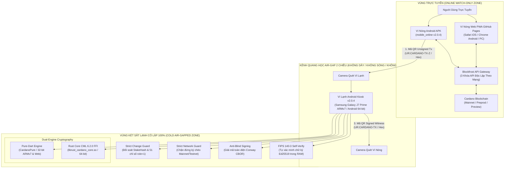
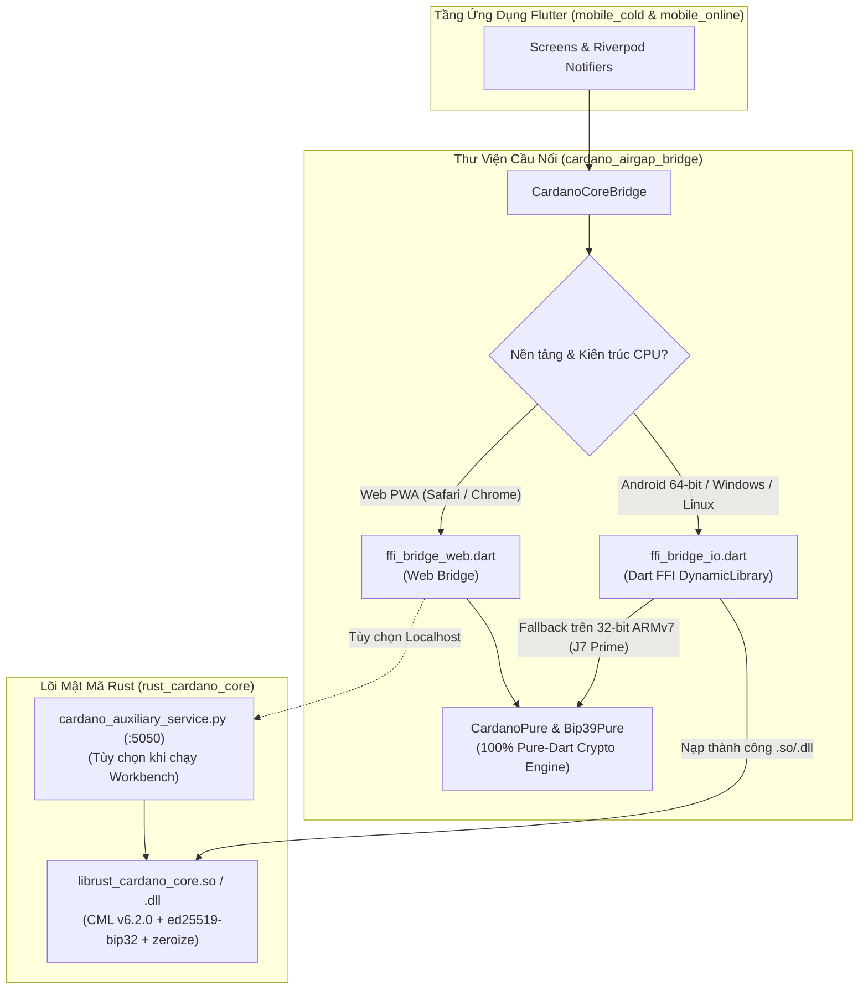
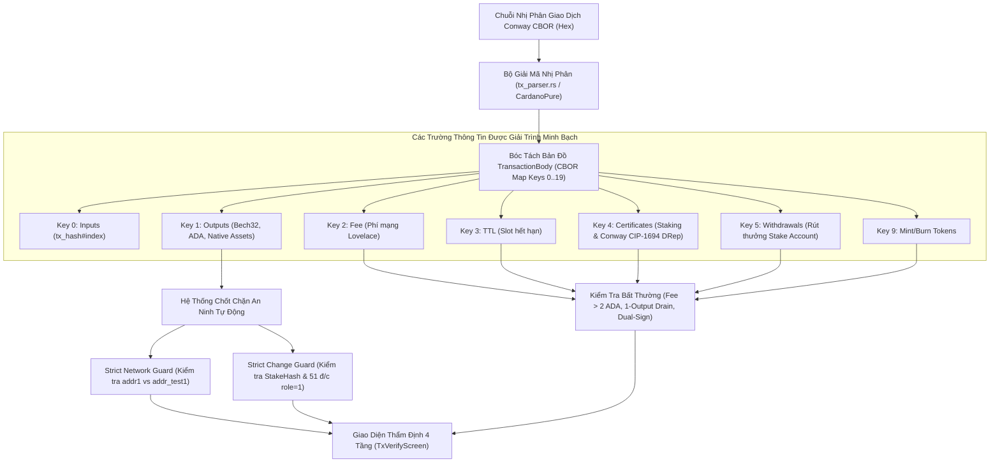
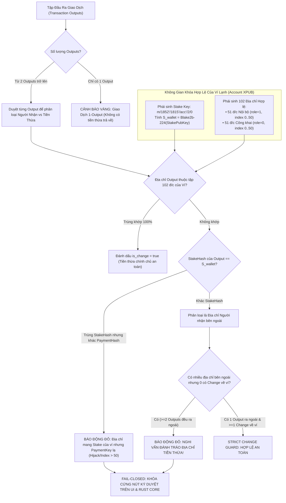
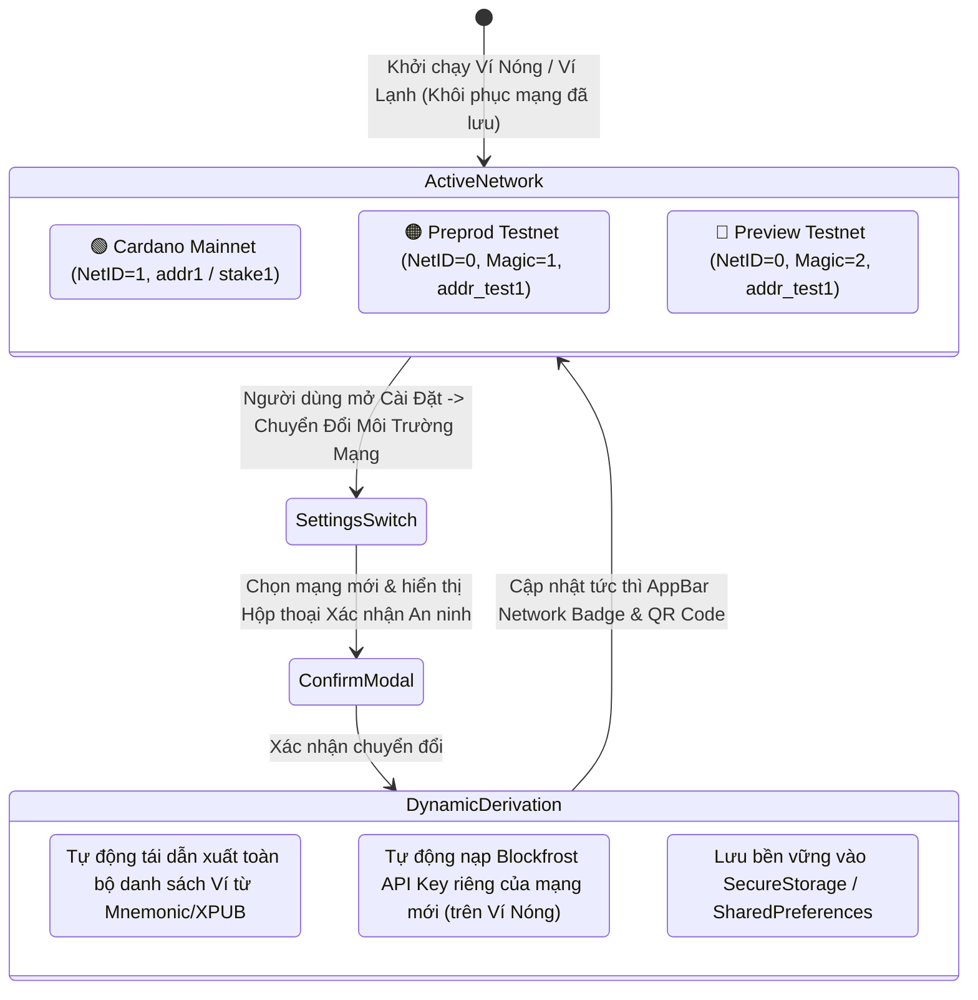
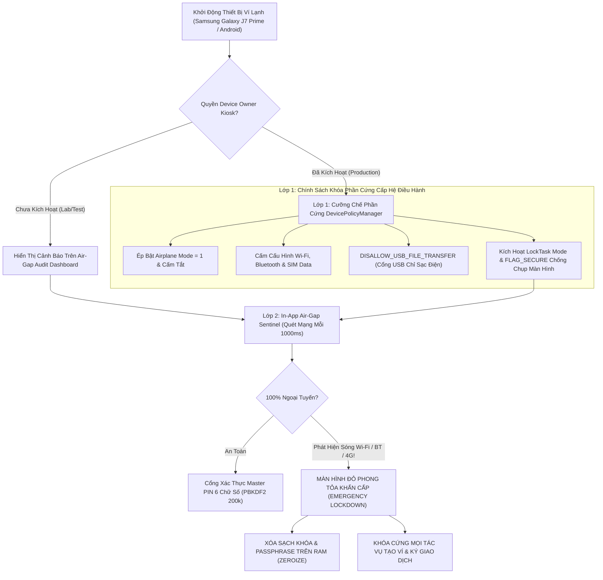
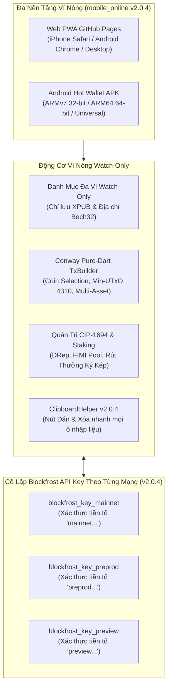
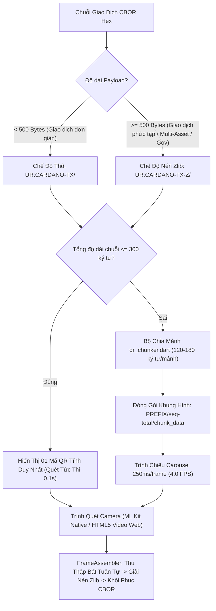
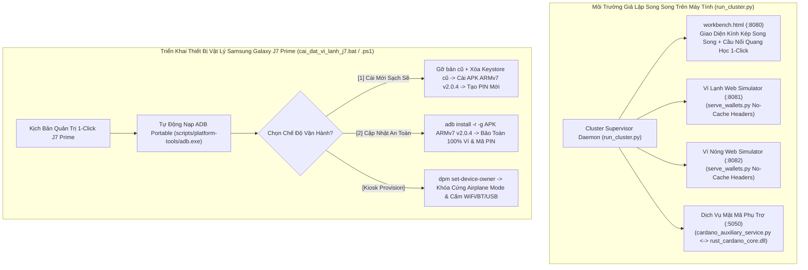

# TÀI LIỆU ĐẶC TẢ KỸ THUẬT HOÀN CHỈNH & TOÀN DIỆN (MASTER TECHNICAL SPECIFICATION)
## HỆ THỐNG VÍ KÉP CARDANO AIR-GAPPED ĐA NỀN TẢNG (FLUTTER + RUST CML FFI + PURE-DART)
### PHIÊN BẢN HỢP NHẤT TOÀN DIỆN & KIỂM TOÁN HOÀN HẢO (ENTERPRISE GOLD MASTER RELEASE v2.0.4)

---

### THÔNG TIN TÀI LIỆU & QUẢN TRỊ DỰ ÁN
- **Tên dự án:** Cardano Air-Gapped Multi-Platform Dual-Wallet System
- **Mã định danh hệ thống:** `cardano-airgap-vault`
- **Phiên bản hệ thống:** `v2.0.4 (Enterprise Gold Master Release - UX Ergonomics, Multi-Network & J7 Prime Production Ready)`
- **Ngày phê duyệt & Đóng băng tài liệu:** 11/11/2026
- **Kho lưu trữ chính thức (Monorepo):** `https://github.com/SonVu91/antigravity-project.git`
- **Địa chỉ xuất bản Ví Nóng Web (GitHub Pages PWA):** [https://sonvu91.github.io/antigravity-project/](https://sonvu91.github.io/antigravity-project/)
- **Chuẩn Cardano Protocol:** Conway Era (CIP-1694, CIP-1852, CIP-0003, CIP-0005, CIP-0008, CIP-0019, CIP-0025, CIP-0068)
- **Kiến trúc Mật mã Kép (Dual-Engine Cryptography):**
  1. *Native Engine (64-bit Android & Desktop Windows/Linux):* Rust C-FFI (`cardano-multiplatform-lib` v6.2.0, `bip39`, `ed25519-bip32`, `zeroize`)
  2. *Pure-Dart Engine (32-bit ARMv7 & Web PWA):* `CardanoPure` + `Bip39Pure` (100% độc lập, không phụ thuộc thư viện động bên ngoài)
- **Thiết bị Phần cứng Mục tiêu Cốt lõi:** Tối ưu hóa 100% cho điện thoại **Samsung Galaxy J7 Prime** (Kiến trúc 32-bit ARMv7 `armeabi-v7a`, Chipset Samsung Exynos 7870 Octa-core, Màn hình 5.5 inch 16:9 Full HD, Android 6.0.1 – 8.1.0) và tương thích toàn diện các thiết bị Android 64-bit (`arm64-v8a`), iOS (qua Web PWA), Windows/macOS/Linux.
- **Khung ứng dụng:** Flutter 3.x / Dart 3.x / Rust 2021 Edition
- **Giao thức Truyền tin Air-Gap:** Kênh quang học 2 chiều Adaptive Multipart Animated QR (`UR:CARDANO-TX` / `UR:CARDANO-TX-Z`) & Kênh Hex CBOR dự phòng
- **Môi trường Mạng hỗ trợ (3-trong-1):** Cardano Mainnet (`Network ID = 1`), Preprod Testnet (`Network ID = 0, Magic = 1`), Preview Testnet (`Network ID = 0, Magic = 2`)
- **Trạng thái Kiểm định An ninh:** Đã vượt qua kiểm định chuyên sâu theo tiêu chuẩn Sentry Code Review, Backend Security Coder, FIPS 140-3 Cryptographic Self-Verification, và Báo cáo Kiểm định Miễn nhiễm Lỗ hổng Nonce Ed25519 (Đối chiếu sự cố Yoroi/SecondFi 06/2026).

---

## MỤC LỤC TỔNG THỂ (14 PHẦN CHUYÊN SÂU)

1. [PHẦN 1: TỔNG QUAN DỰ ÁN, TRIẾT LÝ BẢO MẬT & KIẾN TRÚC HỆ THỐNG AIR-GAPPED MONOREPO](#phần-1-tổng-quan-dự-án-triết-lý-bảo-mật--kiến-trúc-hệ-thống-air-gapped-monorepo)
   - 1.1. Bối cảnh Kỹ thuật, Kỷ nguyên Conway (CIP-1694) & 3 Trụ Cột An Ninh Bất Biến
   - 1.2. Mô hình Cô lập Ngoại tuyến Hoàn toàn (Air-Gapped Isolation Model & Defense-in-Depth)
   - 1.3. Cấu trúc Kho Mã nguồn Monorepo Hợp nhất
   - 1.4. Lộ trình Triển khai 5 Giai đoạn Có Cổng Nghiệm thu (5 Gated Phases) & Tiến hóa v2.0.0 $\rightarrow$ v2.0.4
   - 1.5. Sơ đồ Luồng Luân chuyển Dữ liệu Kép 3 Bước (3-Step Bidirectional Optical Pipeline)

2. [PHẦN 2: ĐẶC TẢ LÕI MẬT MÃ DÙNG CHUNG VÀ KIẾN TRÚC ĐỘNG CƠ KÉP (`rust_cardano_core` + `cardano_airgap_bridge`)](#phần-2-đặc-tả-lõi-mật-mã-dùng-chung-và-kiến-trúc-động-cơ-kép-rust_cardano_core--cardano_airgap_bridge)
   - 2.1. Động cơ Mật mã Kép: Native Rust CML v6.2.0 FFI & Pure-Dart Engine (`CardanoPure` / `Bip39Pure`)
   - 2.2. Chuẩn Sinh Mnemonic BIP-39 (12/15/24 từ), Entropy CSPRNG & Toán học Checksum SHA-256
   - 2.3. Phái sinh Khóa Phân cấp CIP-1852 (Shelley/Conway Era HD Wallet) & Bộ Chọn Động `account_index` / `address_index`
   - 2.4. Cơ chế Phái sinh Kép: BIP-39 Seed PBKDF2 Mặc định & CIP-0003 Icarus Master Derivation (Bit Clamping)
   - 2.5. Cấu trúc Byte-Level Địa chỉ Cơ sở (Shelley Base Address - CIP-0019) & Bảng Ánh xạ Header Byte / Bech32
   - 2.6. Xuất Khóa Công khai Mở rộng Tài khoản (Account XPUB 64-byte) cho Watch-Only
   - 2.7. Cơ chế Xóa Sạch Bộ Nhớ Sâu (Deep Memory Zeroization) & Kiến trúc Fail-Closed (`catch_unwind`)
   - 2.8. Đặc tả Giao diện Hợp đồng C-FFI Native (`api.rs`) & Lược đồ JSON Trao đổi Chuẩn

3. [PHẦN 3: TOÁN HỌC CHỮ KÝ SỐ ED25519, TỰ XÁC MINH FIPS 140-3 & PHÂN TÍCH CHUYÊN SÂU VỤ HACK VÍ YOROI (SECONDFI 2026)](#phần-3-toán-học-chữ-ký-số-ed25519-tự-xác-minh-fips-140-3--phân-tích-chuyên-sâu-vụ-hack-ví-yoroi-secondfi-2026)
   - 3.1. Toàn cảnh 5 Vector Khai thác Lịch sử Blockchain (>35 Tỷ USD)
   - 3.2. Giải phẫu Toán học Chuẩn Chữ ký Ed25519 (RFC 8032) & Sinh Nonce Tất định $r = \mathcal{H}_{512}(b \parallel M) \pmod \ell$
   - 3.3. Mổ xẻ Lỗ hổng Chết người của Ví Yoroi / SecondFi v10.0.3 (06/2026) & Phương trình Giải ngược Khóa Riêng trên $\mathbb{F}_\ell$
   - 3.4. Chứng minh Tính Miễn nhiễm Tuyệt đối của `rust_cardano_core` (CML 6.2.0) & `CardanoPure`
   - 3.5. Cơ chế Tự Xác minh Chữ ký Tại chỗ Chống Tiêm lỗi Phần cứng (FIPS 140-3 Self-Verification Guard)
   - 3.6. Ma trận So sánh Đối đầu An ninh (Comparative Security Matrix)

4. [PHẦN 4: BỘ PHÂN TÍCH GIAO DỊCH CONWAY CBOR & CHỐNG KÝ MÙ (ANTI-BLIND SIGNING ENGINE)](#phần-4-bộ-phân-tích-giao-dịch-conway-cbor--chống-ký-mù-anti-blind-signing-engine)
   - 4.1. Giải mã Cấu trúc Nhị phân CBOR Giao dịch Kỷ nguyên Conway (RFC 8949 & Bảng Map Keys 0..19)
   - 4.2. Bóc tách Toàn diện: Inputs, Outputs, Phí Mạng (Fee), TTL, Minting & Native Multi-Asset
   - 4.3. Bóc tách Chứng chỉ Quản trị Conway CIP-1694 (DRep Delegation) & Ủy thác Stake Pool
   - 4.4. Bóc tách Rút thưởng Cổ phần (Withdrawals) & Cơ chế Tự động Lập lịch Ký Kép (Dual-Witness)
   - 4.5. Hệ thống Cảnh báo Trực quan & Các Chốt chặn Phòng vệ Ký Mù

5. [PHẦN 5: CƠ CHẾ CHỐNG ĐÁNH TRÁO TIỀN THỪA NGHIÊM NGẶT (STRICT CHANGE GUARD)](#phần-5-cơ-chế-chống-đánh-tráo-tiền-thừa-nghiêm-ngặt-strict-change-guard)
   - 5.1. Giải phẫu Kịch bản Tấn công Đánh tráo Tiền thừa (UTxO Change Hijacking Attack)
   - 5.2. Thuật toán Đối soát Khóa Cổ phần Bất biến (Stake Credential Matching: $C_{\text{stake}} == S_{\text{stake}}$)
   - 5.3. Quét Đa Điểm Không Gian Địa chỉ Nội bộ (`role = 1`, Lookahead Window 51 chỉ số `0..50`)
   - 5.4. Bảo vệ Giao dịch 1-Output & Cảnh báo Rút Cạn Ví (Single-Output Full Drain Guard)
   - 5.5. Cơ chế Khóa Chết Ký Duyệt Fail-Closed khi Phát hiện Sai lệch

6. [PHẦN 6: BỘ CHUYỂN ĐỔI ĐA MÔI TRƯỜNG MẠNG & CHỐT CHẶN STRICT NETWORK GUARD](#phần-6-bộ-chuyển-đổi-đa-môi-trường-mạng--chốt-chặn-strict-network-guard)
   - 6.1. Kiến trúc Đa Mạng 3-trong-1: Cardano Mainnet, Preprod Testnet & Preview Testnet
   - 6.2. Động cơ Tự động Tái Dẫn xuất Địa chỉ Động (Dynamic Derivation Engine `addr1` $\leftrightarrow$ `addr_test1`)
   - 6.3. Chốt chặn An toàn Lệch mạng Nghiêm ngặt (Strict Network Guard ở cả Tầng UI & Tầng Lõi Mật Mã)
   - 6.4. Thiết kế Luồng Chuyển đổi Mạng trong Cài đặt, Hộp thoại Xác nhận & Lưu trữ Bền vững

7. [PHẦN 7: ĐẶC TẢ CHI TIẾT ỨNG DỤNG VÍ LẠNH NGOẠI TUYẾN (`mobile_cold`) & SAO LƯU QUÂN SỰ SCHEMA V3](#phần-7-đặc-tả-chi-tiết-ứng-dụng-ví-lạnh-ngoại-tuyến-mobile_cold--sao-lưu-quân-sự-schema-v3)
   - 7.1. Triết lý Thiết kế Zero Internet & Loại bỏ Hoàn toàn Quyền Mạng trong `AndroidManifest.xml`
   - 7.2. Hệ thống Kiosk Sentinel v2, Cưỡng chế Phần cứng Device Owner & Phân tách Release vs Debug
   - 7.3. Giám sát Kết nối Liên tục (`AirgapSentinelService`) & Màn hình Đỏ Phong tỏa Khẩn cấp (Lockdown Screen)
   - 7.4. Bảng Điều khiển Kiểm toán Air-Gap (Air-Gap Audit Dashboard) & Chế độ Thoát Kiosk Tạm thời (`Admin Exit`)
   - 7.5. Bảo mật Lưu trữ Cục bộ Hybrid Keystore, Băm PIN PBKDF2 200.000 vòng & Tự Hủy Dữ liệu Chống Brute-Force
   - 7.6. Tính năng Ví Ẩn Chối bỏ Hợp lý (BIP-39 Passphrase / Từ thứ 25) Chạy Hoàn toàn Trên RAM
   - 7.7. Động cơ Sao lưu & Phục hồi Mã hóa Quân sự Schema v3 (`AES-256-GCM` + `PBKDF2` 200k vòng + Đa phương thức nạp `.coldbackup` v2.0.4)

8. [PHẦN 8: ĐẶC TẢ CHI TIẾT ỨNG DỤNG VÍ NÓNG TRỰC TUYẾN & WEB PWA (`mobile_online`)](#phần-8-đặc-tả-chi-tiết-ứng-dụng-ví-nóng-trực-tuyến--web-pwa-mobile_online)
   - 8.1. Kiến trúc Ví Quan sát Không Khóa Riêng (Watch-Only Vault) & Quản lý Danh mục Đa Ví / Đa Tài khoản
   - 8.2. Tích hợp Blockfrost API & Cơ chế Cô lập Project ID Độc lập Theo Từng Mạng (Per-Network Key Isolation v2.0.4)
   - 8.3. Động cơ Soạn thảo Giao dịch Cardano Conway Pure-Dart (`tx_builder.dart`): Coin Selection, Min-UTxO & Multi-Asset
   - 8.4. Ủy thác Stake Pool (FIMI Pool), Quản trị Conway CIP-1694 (DRep) & Rút thưởng Staking Tự động
   - 8.5. Động cơ Phát sóng Giao dịch (Transaction Broadcasting) & Bộ Thông dịch Mã lỗi Node Thông minh
   - 8.6. Động cơ Cập nhật Không Mất Dữ liệu (`HotUpdateService`) & Phân phối Web PWA trên GitHub Pages

9. [PHẦN 9: GIAO THỨC TRUYỀN TIN QUANG HỌC AIR-GAP THÍCH ỨNG (ADAPTIVE QR PROTOCOL)](#phần-9-giao-thức-truyền-tin-quang-học-air-gap-thích-ứng-adaptive-qr-protocol)
   - 9.1. Mô hình Kênh Truyền Quang học 2 Chiều Không Dây Dẫn (Bidirectional Optical Data Plane)
   - 9.2. Quy chuẩn Phân mảnh Thích ứng Dual-Mode (`UR:CARDANO-TX` Tĩnh & `UR:CARDANO-TX-Z` Nén Zlib)
   - 9.3. Thuật toán Cắt mảnh 180 Bytes, Trình chiếu Carousel 4 FPS & Bộ Ghép Khung hình Bất tuần tự
   - 9.4. Trình Quét Quang học Lai (`mobile_scanner` ML Kit & Web HTML5 Video) & Kênh Hex CBOR Dự phòng

10. [PHẦN 10: HỆ THỐNG THIẾT KẾ UI/UX PRO MAX & KỸ THUẬT CÔNG THÁI HỌC THỰC CHIẾN v2.0.4 (J7 PRIME & MOBILE WEB)](#phần-10-hệ-thống-thiết-kế-uiux-pro-max--kỹ-thuật-công-thái-học-thực-chiến-v204-j7-prime--mobile-web)
    - 10.1. Ma trận Màu sắc Định danh Ngữ nghĩa Kép (Cold Ice Cyan vs Hot Amber Gold vs Hidden Amethyst)
    - 10.2. Cơ chế Tô sáng Địa chỉ Chống Đầu độc (8-Char Head/Tail Monospace) & Phân cấp Thẻ Giao dịch 4 Tầng
    - 10.3. Thiết kế Lưới Seed Phrase 2 Cột Rộng Rãi (`160dp`, `FittedBox.scaleDown`, `15.5pt Bold`) — Triệt tiêu Lỗi Cắt chữ `...`
    - 10.4. Kiến trúc Khôi phục Sao lưu Đa phương thức: Tự động Quét Tệp `.coldbackup` thành Nút Chạm Nhanh (Action Chips)
    - 10.5. Kiến trúc Tách Biệt Bước Xem Trước (Merge/Replace) & Hộp Thoại Xác Thực Mã PIN Chuyên Dụng (`••••••`) Chống Bàn Phím Số Che Khuất
    - 10.6. Tiện ích `ClipboardHelper` Đa Nền Tảng (Paste & Clear) & Kỹ thuật Chống Tràn Màn Hình (`scrollable: true`, `viewInsets.bottom`)

11. [PHẦN 11: MÔI TRƯỜNG GIẢ LẬP SONG SONG, CỤM DỊCH VỤ PHỤ TRỢ & KỊCH BẢN TỰ ĐỘNG HÓA ADB J7 PRIME](#phần-11-môi-trường-giả-lập-song-song-cụm-dịch-vụ-phụ-trợ--kịch-bản-tự-động-hóa-adb-j7-prime)
    - 11.1. Bàn Giả lập Song song Quang học (`workbench.html` `:8080`, `serve_wallets.py` `:8081`/`:8082`)
    - 11.2. Dịch vụ Mật mã Bổ trợ Native Core (`cardano_auxiliary_service.py` `:5050`) & Trình Giám sát Tự phục hồi (`run_cluster.py`)
    - 11.3. Bộ Kịch bản Quản lý Cài đặt Đa năng 1-Click cho Samsung Galaxy J7 Prime (`cai_dat_vi_lanh_j7.bat` / `.ps1`)
    - 11.4. Chế độ 1 (Cài mới sạch sẽ & Reset PIN) vs Chế độ 2 (Cập nhật an toàn `adb install -r -g` Giữ nguyên Ví & Keystore)
    - 11.5. Quy trình Cưỡng chế Kiosk Device Owner Doanh nghiệp (`provision_kiosk.bat` / `.sh`) & Xử lý Cảnh báo ADB Provisioning

12. [PHẦN 12: MA TRẬN ĐE DỌA AN NINH 16 VECTƠ, MÔ HÌNH STRIDE & KẾT QUẢ KIỂM TOÁN MÃ NGUỒN](#phần-12-ma-trận-đe-dọa-an-ninh-16-vectơ-mô-hình-stride--kết-quả-kiểm-toán-mã-nguồn)
    - 12.1. Ma trận Phân tích Đe dọa theo Mô hình STRIDE
    - 12.2. Ma trận 16 Vectơ Tấn công Thực tế & Cơ chế Phòng thủ Bất biến của Hệ thống v2.0.4
    - 12.3. Kết quả Rà soát Bảo mật theo Tiêu chuẩn Sentry Code Review, Backend Security Coder & Security Audit

13. [PHẦN 13: TIÊU CHUẨN NGHIỆM THU, BỘ KIỂM THỬ ĐẦU-CUỐI E2E 18 KỊCH BẢN & QUY TRÌNH CI/CD](#phần-13-tiêu-chuẩn-nghiệm-thu-bộ-kiểm-thử-đầu-cuối-e2e-18-kịch-bản--quy-trình-cicd)
    - 13.1. Bộ Kiểm thử Đầu-Cuối Tự động hóa 18 Kịch bản (`test_e2e_verification.ps1` & `run_tests.ps1`)
    - 13.2. Kiểm thử Đơn vị Chuyển đổi Đa mạng, Chống tràn Giao diện & Tương thích 32-bit ARMv7
    - 13.3. Quy trình CI/CD Tự động hóa trên GitHub Actions (`build-apk.yml` & `deploy-pages.yml`)

14. [PHẦN 14: DANH MỤC ĐÓNG GÓI XUẤT XƯỞNG v2.0.4, BẢNG MÃ BĂM SHA-256 & QUY TRÌNH VẬN HÀNH CHUẨN (SOP)](#phần-14-danh-mục-đóng-gói-xuất-xưởng-v204-bảng-mã-băm-sha-256--quy-trình-vận-hành-chuẩn-sop)
    - 14.1. Danh mục Đóng gói Phát hành Chính thức tại `/output/v2.0.4/` (ARMv7 32-bit, ARM64 64-bit, Universal, Web PWA)
    - 14.2. Bảng Mã Băm SHA-256 Checksums Chính thức (`SHA256SUMS-v2.0.4.txt`) Xác minh Tính Toàn vẹn FIPS 140-3
    - 14.3. Quy trình Vận hành Tiêu chuẩn Hằng ngày (SOP) & Khuyến nghị An ninh Bất biến cho Chủ sở hữu Ví

---

## PHẦN 1: TỔNG QUAN DỰ ÁN, TRIẾT LÝ BẢO MẬT & KIẾN TRÚC HỆ THỐNG AIR-GAPPED MONOREPO



### 1.1. Bối cảnh Kỹ thuật, Kỷ nguyên Conway (CIP-1694) & 3 Trụ Cột An Ninh Bất Biến
Trong kỷ nguyên quản trị phi tập trung **Cardano Conway (CIP-1694)**, giao dịch trên mạng lưới không còn đơn thuần là chuyển nhận ADA mà bao hàm các cấu trúc nhị phân phức tạp: chứng chỉ ủy quyền đại diện biểu quyết (**DRep Delegation**), ủy thác cổ phần (**Stake Pool Delegation**), rút thưởng gộp (**Staking Withdrawals**), tài sản đa nguyên tử (**Multi-Asset Native Tokens**) và hợp đồng thông minh (**Plutus V1/V2/V3 Scripts**). Cùng lúc đó, các hình thức tấn công nhắm vào ví tiền mã hóa ngày càng tinh vi:
- **Tấn công Rò rỉ Nonce Mật mã học (Cryptographic Nonce Flaw):** Điển hình là sự cố ví Yoroi / SecondFi tháng 06/2026 khiến hơn 16.1 triệu ADA bị rút cạn chỉ từ một chữ ký giao dịch do lỗi lập trình hàm sinh Nonce Ed25519 trên phần mềm ví trực tuyến.
- **Tấn công Ký Mù (Blind Signing):** Người dùng bị đánh lừa ký duyệt các chuỗi hex CBOR thô mà không biết bên trong có cài cắm lệnh chuyển quyền kiểm soát Staking/Governance hoặc rút toàn bộ tài sản.
- **Tấn công Đánh tráo Tiền thừa (UTxO Change Hijacking):** Mã độc trên thiết bị có kết nối mạng âm thầm thay đổi địa chỉ nhận tiền thừa (Change Output) trong giao dịch sang địa chỉ của hacker.
- **Tấn công Nhầm lẫn Môi trường Mạng (Cross-Network Replay/Confusion):** Dẫn dụ người dùng ký giao dịch tài sản thật trên Mainnet nhưng hiển thị thông tin giả lập của Testnet.

Để giải quyết triệt để mọi rủi ro trên, hệ thống **Cardano Air-Gapped Dual-Wallet v2.0.4** được thiết kế dựa trên **3 Trụ Cột An Ninh Bất Biến**:
1. **Cô Lập Ngoại Tuyến Tuyệt Đối (100% Air-Gapped Zero Internet):** Ví Lạnh (`mobile_cold`) vận hành trên thiết bị phần cứng tách biệt (như Samsung Galaxy J7 Prime chuyên dụng), loại bỏ hoàn toàn quyền `INTERNET` khỏi `AndroidManifest.xml`, khóa cứng Airplane Mode và vô hiệu hóa Wi-Fi, Bluetooth, SIM 4G, USB File Transfer thông qua quyền quản trị cấp hệ điều hành **Android Device Owner Kiosk**.
2. **Thẩm Định Giao Dịch Minh Bạch Chống Ký Mù (Anti-Blind Signing & Conway CBOR Decoding):** Mọi byte trong `TransactionBody` kỷ nguyên Conway đều được giải mã tại chỗ trên Ví Lạnh thành ngôn ngữ Tiếng Việt rõ ràng, phân cấp thị giác 4 tầng trước khi cho phép nhập mã PIN ký duyệt.
3. **Phòng Vệ Toán Học Đa Tầng (Strict Change Guard + Strict Network Guard + FIPS 140-3 Self-Verify):** Tự động đối soát mã băm chứng chỉ cổ phần (Stake Credential Hash) trên 51 địa chỉ nội bộ (`role = 1`), kiểm tra chéo tiền tố mạng lưới (`addr1` vs `addr_test1`), và tự xác minh toán học chữ ký Ed25519 ngay trong bộ nhớ RAM trước khi xuất mã QR.

### 1.2. Mô hình Cô lập Ngoại tuyến Hoàn toàn (Air-Gapped Isolation Model & Defense-in-Depth)
Hệ thống thiết lập mô hình phòng thủ chiều sâu (**Defense-in-Depth**) tách biệt hoàn toàn giữa hai vùng:
- **Vùng Trực Tuyến (Online Watch-Only Zone - `mobile_online`):**
  - Chỉ lưu trữ khóa công khai mở rộng (`Account XPUB` 64 bytes) và các địa chỉ Bech32 công khai.
  - **Tuyệt đối không lưu trữ Seed Phrase hay Private Key.** Dù điện thoại Ví Nóng hay trình duyệt Web bị nhiễm mã độc, bị chiếm quyền điều khiển từ xa (RAT/Trojan), kẻ tấn công cũng không bao giờ có thể ký giao dịch.
- **Vùng Két Sắt Lạnh Cô Lập (Offline Cold Vault Zone - `mobile_cold`):**
  - Chứa khóa bí mật đã được mã hóa đa tầng (Android Hardware-backed Keystore + PBKDF2 200.000 vòng + AES-256-GCM).
  - Được bảo vệ bởi 2 lớp giáp: **Lớp 1 (OS-Level Device Owner Kiosk)** cưỡng chế tắt toàn bộ chip thu phát sóng vô tuyến, và **Lớp 2 (In-App Air-Gap Sentinel)** giám sát giao diện mạng liên tục mỗi 1000ms, lập tức kích hoạt **Màn hình Đỏ Phong tỏa Khẩn cấp (Emergency Lockdown)** và xóa trắng RAM (`Zeroize`) nếu phát hiện bất kỳ dấu hiệu bật sóng nào.
- **Kênh Truyền Tin Quang Học Hai Chiều (Bidirectional Optical Data Plane):**
  - Dữ liệu giao dịch chưa ký (`Unsigned Tx`) và chữ ký nhân chứng (`Signed Witness`) chỉ đi qua ánh sáng màn hình và ống kính Camera bằng giao thức **Adaptive Multipart Animated QR (`UR:CARDANO-TX` / `UR:CARDANO-TX-Z`)**.

### 1.3. Cấu trúc Kho Mã nguồn Monorepo Hợp nhất
Toàn bộ hệ sinh thái được tổ chức trong một kho mã nguồn Monorepo đồng bộ chặt chẽ:

```text
2. Tạo ví Cardano v2.0/
├── AGENTS.md                              # Quy tắc AI & Giao thức đồng bộ đa thiết bị
├── README.md                              # Tổng quan dự án & Hướng dẫn vận hành nhanh
├── cai_dat_vi_lanh_j7.bat                 # Kịch bản 1-click Cài mới / Cập nhật Ví Lạnh J7 Prime (Windows Batch)
├── cai_dat_vi_lanh_j7.ps1                 # Kịch bản PowerShell quản trị & kiểm tra SHA-256 cho J7 Prime
├── run_tests.ps1                          # Kịch bản chạy toàn bộ Unit Tests (Rust + Dart + Flutter)
├── test_e2e_verification.ps1              # Bộ kiểm thử E2E tự động hóa 18 kịch bản nghiệm thu
├── serve_wallets.py                       # Máy chủ HTTP phục vụ Simulator Workbench & Web PWA (:8080/:8081/:8082)
├── cardano_auxiliary_service.py           # Dịch vụ vi mô Python ctypes kết nối Rust C-FFI DLL (:5050)
├── run_cluster.py                         # Trình giám sát cụm tự phục hồi (Self-Healing Supervisor Daemon)
├── run_workbench.bat / .ps1               # Kịch bản khởi chạy bàn giả lập song song 1-click
├── workbench.html                         # Giao diện Bàn giả lập song song 2 ví (Side-by-Side Optical Bridge)
├── rust_cardano_core.dll                  # Thư viện liên kết động C-FFI 64-bit biên dịch sẵn cho Windows
│
├── rust_cardano_core/                     # [1] LÕI MẬT MÃ RUST CHUẨN CML 6.2.0 C-FFI
│   ├── Cargo.toml                         # Khai báo cml-chain, cml-crypto 6.2.0, ed25519-bip32, bip39, zeroize
│   ├── src/
│   │   ├── lib.rs                         # Điểm nhập thư viện & cấu hình экспортирование module
│   │   ├── api.rs                         # Giao diện C-FFI ABI (12 hàm extern "C") bọc catch_unwind
│   │   ├── crypto.rs                      # BIP-39 CSPRNG, PBKDF2-SHA512, CIP-1852 & CIP-0003 Icarus Derivation
│   │   ├── tx_parser.rs                   # Giải mã nhị phân Conway CBOR, Multi-Asset, Governance CIP-1694
│   │   ├── tx_signer.rs                   # Ký Ed25519, Ký kép Stake Key & Tự xác minh FIPS 140-3 Self-Verify
│   │   └── change_guard.rs                # Thuật toán Strict Change Guard (StakeHash + 51 chỉ số role=1)
│   └── tests/
│       └── cardano_core_tests.rs          # Bộ kiểm thử đơn vị mật mã chuyên sâu
│
├── cardano_airgap_bridge/                 # [2] THƯ VIỆN CẦU NỐI DART FFI & ĐỘNG CƠ PURE-DART
│   ├── pubspec.yaml                       # Cấu hình package dùng chung cho cả Ví Lạnh và Ví Nóng
│   └── lib/
│       ├── cardano_airgap_bridge.dart     # Barrel file xuất các lớp API công khai
│       └── src/
│           ├── ffi_bridge_io.dart         # Cầu nối Native C-FFI (.so / .dll) + Fallback tự động sang Pure-Dart
│           ├── ffi_bridge_web.dart        # Cầu nối Web PWA kết nối CardanoPure & dịch vụ phụ trợ :5050
│           ├── cardano_pure.dart          # Động cơ mật mã Pure-Dart CIP-1852/Ed25519/CBOR (32-bit ARMv7 & Web)
│           ├── bip39_pure.dart            # Bộ sinh & kiểm tra BIP-39 2048 từ chuẩn CSPRNG bằng Pure-Dart
│           ├── models.dart                # Mô hình dữ liệu: CardanoNetwork, WalletKeys, ParsedTransaction...
│           ├── qr_chunker.dart            # Bộ phân mảnh & ghép khung hình Adaptive Multipart QR (Zlib + Base64)
│           └── wallet_grouping.dart       # Thuật toán gom nhóm ví theo Root Fingerprint & Passphrase
│
├── mobile_cold/                           # [3] ỨNG DỤNG VÍ LẠNH NGOẠI TUYẾN (OFFLINE KIOSK SENTINEL)
│   ├── pubspec.yaml                       # Cấu hình Flutter Ví Lạnh v2.0.4+5
│   ├── android/app/src/main/
│   │   ├── AndroidManifest.xml            # Zero-Internet Manifest + Khai báo DeviceAdminReceiver
│   │   ├── res/xml/device_admin_receiver.xml # Chính sách cưỡng chế phần cứng doanh nghiệp
│   │   └── kotlin/.../AirGapDeviceAdminReceiver.kt # Thực thi khóa Airplane Mode, cấm WiFi/BT/USB Data
│   └── lib/
│       ├── main.dart                      # Khởi tạo ứng dụng, LockTask Kiosk & cổng bảo vệ Air-Gap
│       ├── core/
│       │   ├── security/                  # AirgapSentinelService, SecurityService (PIN PBKDF2, Auto-Wipe)
│       │   ├── migration/                 # ColdMigrationService (AES-256-GCM Schema v3), backup_file_saver_io/web
│       │   └── theme/                     # ColdTheme (Ice Cyan #06B6D4, Hidden Amethyst #7E22CE, Network Badges)
│       └── presentation/
│           ├── providers/                 # ColdWalletProvider (Dynamic Derivation, Multi-Wallet, RAM Passphrase)
│           ├── screens/                   # WalletSetupScreen (2-col Seed Grid), ColdDashboard, TxVerifyScreen, ColdSettingsScreen
│           └── widgets/                   # AirGapDashboardDialog, ColdWalletManagerDialog, QrScanner, MultipartQrViewer
│
├── mobile_online/                         # [4] ỨNG DỤNG VÍ NÓNG TRỰC TUYẾN & WEB PWA (WATCH-ONLY)
│   ├── pubspec.yaml                       # Cấu hình Flutter Ví Nóng v2.0.4+5
│   └── lib/
│       ├── main.dart                      # Điểm nhập Ví Nóng Watch-Only
│       ├── core/
│       │   ├── network/                   # BlockfrostClient (Cô lập 3 API Key theo mạng + Xác thực tiền tố)
│       │   ├── tx_builder/                # TxBuilder Conway Pure-Dart (Coin Selection, Min-UTxO, Governance, Staking)
│       │   ├── migration/                 # HotMigrationService (Sao lưu & di trú danh mục ví Watch-Only)
│       │   ├── update/                    # HotUpdateService (Kiểm tra & cập nhật phiên bản không mất dữ liệu)
│       │   ├── utils/                     # ClipboardHelper (Sao chép & Dán đa nền tảng cho Web/Mobile)
│       │   └── theme/                     # HotTheme (Amber Gold #F59E0B, Bento Grid Conway)
│       └── presentation/
│           ├── providers/                 # HotWalletProvider (Quản lý đa mạng, đa tài khoản, UTxO & Staking state)
│           ├── screens/                   # DashboardScreen, SetupWatchScreen, BuildTxScreen, ScanSignedScreen
│           └── widgets/                   # WalletManagerDialog, GovernanceDialog, StakingDialog
│
├── scripts/                               # [5] BỘ KỊCH BẢN TỰ ĐỘNG HÓA VẬN HÀNH & ADB PORTABLE
│   ├── platform-tools/                    # Bộ công cụ ADB Portable (adb.exe) chạy ngay không cần cài Android SDK
│   ├── provision_kiosk.bat / .sh          # Cưỡng chế quyền Device Owner & khóa sóng phần cứng tự động
│   ├── update_cold_wallet.bat / .sh       # Cập nhật APK Ví Lạnh giữ nguyên 100% dữ liệu ví
│   ├── download_release_apk.ps1           # Tải trọn bộ APK (ARMv7, ARM64, Universal) từ GitHub Actions/Release
│   └── download_cardano_cli.ps1           # Tải công cụ cardano-cli chính thức của Intersect MBO
│
├── docs/                                  # [6] HỒ SƠ ĐẶC TẢ KỸ THUẬT & BÁO CÁO KIỂM ĐỊNH AN NINH
│   ├── tech-document-finalv3.md           # Hồ sơ Đặc tả Kỹ thuật Hợp nhất Toàn diện v2.0.4 (Tài liệu này)
│   ├── BAO_CAO_KIEM_DINH_AN_NINH_YOROI_VA_HE_THONG.md # Phân tích toán học vụ hack Yoroi & kiểm định hệ thống
│   └── AIRGAP_KIOSK_GUIDE.md              # Sổ tay vận hành Kiosk Device Owner chuyên sâu
│
└── output/                                # [7] KHO LƯU TRỮ BẢN PHÁT HÀNH CHÍNH THỨC (RELEASE ARTIFACTS)
    ├── SHA256SUMS-v2.0.4.txt              # Bảng mã băm SHA-256 kiểm tra tính toàn vẹn phiên bản v2.0.4
    └── v2.0.4/                            # Thư mục đóng gói xuất xưởng v2.0.4 (6 gói APK + Release Notes + Checksums)
```

### 1.4. Lộ trình Triển khai 5 Giai đoạn Có Cổng Nghiệm thu (5 Gated Phases) & Tiến hóa v2.0.0 $\rightarrow$ v2.0.4

#### A. Quy trình 5 Giai đoạn Kỹ thuật có Cổng Nghiệm thu (5 Gated Phases)
Dự án được xây dựng tuần tự qua 5 cổng kiểm định chất lượng nghiêm ngặt:

```text
[Giai đoạn 1: Rust Core] ──► [Giai đoạn 2: Dual Bridge] ──► [Giai đoạn 3: Cold Wallet]
        │                              │                              │
  100% Rust Unit Tests          FFI, Pure-Dart & QR            Kiosk Sentinel & PIN
        ▼                              ▼                              ▼
 [Cổng Nghiệm thu 1]            [Cổng Nghiệm thu 2]            [Cổng Nghiệm thu 3]
                                                                      │
                                                                      ▼
 [Cổng Nghiệm thu 5] ◄── [Giai đoạn 5: E2E & Audit] ◄── [Giai đoạn 4: Hot Wallet & PWA]
  18 E2E Test Suites        Workbench & Yoroi Audit       Conway TxBuilder & Blockfrost
```

#### B. Lịch sử Tiến hóa Hệ thống từ v2.0.0 đến v2.0.4
| Phiên bản | Ngày phát hành | Cột mốc Kỹ thuật & Tính năng Trọng tâm |
| :--- | :---: | :--- |
| **v2.0.0** *(Foundation Alpha)* | 11/2026 | Xây dựng lõi mật mã Rust CML v6.2.0 C-FFI, thuật toán Strict Change Guard cơ bản, giải mã và ký giao dịch Conway CBOR. |
| **v2.0.1** *(Enterprise Gold)* | 11/2026 | Việt hóa toàn diện giao diện chuẩn doanh nghiệp; tích hợp Kiosk Sentinel Device Owner; hoàn thiện Adaptive Multipart QR (`UR:CARDANO-TX-Z`); bổ sung Ví Ẩn BIP-39 Passphrase chạy trên RAM (tone màu Tím Amethyst `#7E22CE`) và Sao lưu Quân sự Schema v3 (`AES-256-GCM`). |
| **v2.0.2** *(J7 Prime & Web PWA)* | 11/2026 | Ra mắt kiến trúc **Động cơ Kép (Dual-Engine)** với `CardanoPure` & `Bip39Pure` hỗ trợ hoàn hảo chip **32-bit ARMv7 (Samsung Galaxy J7 Prime)**; xuất bản Ví Nóng Web PWA trên GitHub Pages cho iOS/Android; phát hành kịch bản 1-click `cai_dat_vi_lanh_j7.bat`. |
| **v2.0.3** *(Multi-Network Guard)* | 10/11/2026 | Tích hợp bộ chuyển đổi **3 Môi trường Mạng** (Mainnet, Preprod, Preview); động cơ **Dynamic Derivation Engine** tự động tái dẫn xuất `addr1` $\leftrightarrow$ `addr_test1` không cần nhập lại Seed; chốt chặn **Strict Network Guard** khóa cứng nút ký khi phát hiện lệch mạng; kiểm định miễn nhiễm lỗ hổng Nonce Ed25519 (vụ hack Yoroi/SecondFi). |
| **v2.0.4** *(UX Ergonomics Master)* | 11/11/2026 | **Tối ưu hóa toàn diện công thái học thực chiến trên màn hình 16:9 (J7 Prime) & Mobile Web:**<br>1. Chuyển lưới hiển thị Seed Phrase (12/15/24 từ) sang **2 cột rộng rãi (`~160dp`)** kết hợp `FittedBox(fit: BoxFit.scaleDown)` và font `15.5pt Bold`, khắc phục triệt để lỗi từ khóa dài bị cắt cụt bằng dấu `...`.<br>2. **Khôi phục sao lưu đa phương thức:** Tự động quét tệp `.coldbackup` trong bộ nhớ máy và hiển thị thành các nút chạm nhanh (**Action Chips**), kết hợp Dán Clipboard và Quét QR.<br>3. **Tách riêng Hộp thoại Xác thực Mã PIN chuyên dụng** khỏi màn hình Xem trước bản sao lưu (Merge/Replace), đưa ô hiển thị PIN (`••••••`) lên ngay trên bàn phím số, triệt tiêu tình trạng bàn phím che khuất.<br>4. **Ví Nóng & Web PWA:** Bổ sung `ClipboardHelper` (nút Dán & Xóa nhanh ở mọi ô nhập liệu), **cô lập Blockfrost API Key độc lập cho từng mạng** (`mainnet`, `preprod`, `preview`) kèm bộ kiểm tra tiền tố tự động, và chống tràn bàn phím trên toàn bộ hộp thoại. |

### 1.5. Sơ đồ Luồng Luân chuyển Dữ liệu Kép 3 Bước (3-Step Bidirectional Optical Pipeline)

```text
+-----------------------------------+                        +-----------------------------------+
|       VÍ NÓNG TRỰC TUYẾN          |                        |        VÍ LẠNH NGOẠI TUYẾN        |
|   (mobile_online / Web PWA)       |                        |    (mobile_cold Kiosk Sentinel)   |
+-----------------------------------+                        +-----------------------------------+
                  |                                                            |
 [BƯỚC 1: SOẠN THẢO GIAO DỊCH]                                                 |
 1. Đồng bộ UTxO qua Blockfrost API                                            |
    (Khóa API tách biệt theo mạng)                                             |
 2. Chọn UTxO, tính Min-UTxO & Phí                                             |
 3. Đóng gói Unsigned Conway CBOR                                              |
 4. Mã hóa Adaptive QR                                                         |
    (UR:CARDANO-TX hoặc TX-Z nén)                                              |
                  |                                                            |
                  |============= [1. Quét Quang Học Chiều Đi] ================>|
                  |                                                            |
                  |                                           [BƯỚC 2: THẨM ĐỊNH & KÝ DUYỆT]
                  |                                           1. Kiểm tra Air-Gap Sentinel 100%
                  |                                           2. Strict Network Guard (Khớp mạng?)
                  |                                           3. Giải mã Conway CBOR Chống Ký Mù
                  |                                           4. Strict Change Guard (51 đ/c role=1)
                  |                                           5. Người dùng nhập lại Master PIN 6 số
                  |                                           6. Ký Ed25519 (RFC 8032 Nonce chuẩn)
                  |                                           7. Tự xác minh chữ ký FIPS 140-3
                  |                                           8. Zeroize xóa sạch khóa trên RAM
                  |                                           9. Hiển thị QR Signed Tx / Witness
                  |                                                            |
                  |<============ [2. Quét Quang Học Chiều Về] =================|
                  |                                                            |
 [BƯỚC 3: GHÉP NHÂN CHỨNG & PHÁT SÓNG]                                         |
 1. Quét nhận chuỗi Signed CBOR                                                |
 2. Kiểm tra tính toàn vẹn Witness                                             |
 3. Phát sóng POST /tx/submit                                                  |
 4. Nhận TxHash & cập nhật lịch sử                                             |
```

---

## PHẦN 2: ĐẶC TẢ LÕI MẬT MÃ DÙNG CHUNG VÀ KIẾN TRÚC ĐỘNG CƠ KÉP (`rust_cardano_core` + `cardano_airgap_bridge`)



### 2.1. Động cơ Mật mã Kép: Native Rust CML v6.2.0 FFI & Pure-Dart Engine (`CardanoPure` / `Bip39Pure`)
Một trong những đột phá kiến trúc quan trọng nhất của hệ thống là mô hình **Động cơ Mật mã Kép (Dual-Engine Cryptography)**, kết hợp sức mạnh của mã máy biên dịch Rust và sự linh hoạt tuyệt đối của Dart thuần:

1. **Động cơ 1 — Native Rust Core (`rust_cardano_core`):**
   - Sử dụng trực tiếp bộ thư viện chính thống `cardano-multiplatform-lib` (`cml-chain = 6.2.0`, `cml-crypto = 6.2.0`, `cml-core = 6.2.0`) kết hợp `ed25519-bip32 = 0.4.1`, `bip39 = 2.0.0`, `blake2 = 0.10.6` và `zeroize = 1.7.0`.
   - Đạt tốc độ thực thi cấp độ mili-giây trên các thiết bị 64-bit (`arm64-v8a`, `x86_64`) nhờ tối ưu hóa tập lệnh SIMD và quản lý bộ nhớ tĩnh không có Garbage Collector.
2. **Động cơ 2 — Pure-Dart Cryptographic Engine ([`cardano_pure.dart`](file:///e:/Antigravity/2.%20T%E1%BA%A1o%20v%C3%AD%20Cardano%20v2.0/cardano_airgap_bridge/lib/src/cardano_pure.dart) & [`bip39_pure.dart`](file:///e:/Antigravity/2.%20T%E1%BA%A1o%20v%C3%AD%20Cardano%20v2.0/cardano_airgap_bridge/lib/src/bip39_pure.dart)):**
   - Được thiết kế chuyên biệt để giải quyết hai bài toán thực tế:
     1. **Tương thích hoàn hảo 100% với thiết bị 32-bit ARMv7 (`armeabi-v7a`) như Samsung Galaxy J7 Prime** (chạy Android 6.0.1 – 8.1.0), loại bỏ hoàn toàn lỗi thiếu hụt symbol C runtime (`__aeabi_*` hoặc `libc++_shared.so`) thường gặp khi nạp thư viện Rust FFI trên các bản ROM Android 32-bit đời cũ.
     2. **Vận hành độc lập 100% trên trình duyệt Web PWA (GitHub Pages)** cho người dùng iOS (Safari) và Android (Chrome) mà không cần cài đặt máy chủ phụ trợ.
   - Cả hai động cơ đều được kiểm thử đối xứng (Cross-Engine Differential Testing), đảm bảo với cùng một cụm từ Mnemonic, Passphrase, chỉ số Account/Address và chuỗi CBOR đầu vào, cả hai động cơ sinh ra kết quả khóa `xpub`, địa chỉ Bech32 và chữ ký `Ed25519` **giống hệt nhau từng bit (bit-for-bit identical)**.

### 2.2. Chuẩn Sinh Mnemonic BIP-39 (12/15/24 từ), Entropy CSPRNG & Toán học Checksum SHA-256
Hệ thống hỗ trợ đầy đủ 3 cấp độ chiều dài cụm từ khôi phục theo chuẩn **BIP-39** (từ điển 2048 từ tiếng Anh chuẩn hóa):
- **Nguồn sinh số ngẫu nhiên an toàn mật mã (CSPRNG):**
  - Trên Rust: Sử dụng `rand::rngs::OsRng` gọi trực tiếp syscall `getrandom` của nhân Linux/Android hoặc `BCryptGenRandom` của Windows.
  - Trên Pure-Dart: Sử dụng `Random.secure()` lấy entropy từ nguồn phần cứng của hệ điều hành.
- **Công thức Toán học Sinh Mnemonic & Checksum:**
  Gọi $ENT \in \{128, 160, 256\}$ là số bit entropy ban đầu:
  $$\text{Byte Length} = \frac{ENT}{8} \in \{16, 20, 32\} \text{ bytes}$$
  $$\text{Checksum Length } (CS) = \frac{ENT}{32} \in \{4, 5, 8\} \text{ bits}$$
  Chuỗi entropy $E$ được băm bằng thuật toán SHA-256:
  $$H = \text{SHA-256}(E)$$
  Lấy $CS$ bit cao nhất (MSB) của byte đầu tiên $H[0]$ nối vào cuối chuỗi bit của $E$, thu được chuỗi tổng cộng $MS = ENT + CS$ bit. Chia chuỗi $MS$ thành các cụm $11 \text{ bits}$ (tương ứng giá trị nguyên từ $0$ đến $2047$) để ánh xạ sang 12, 15 hoặc 24 từ khóa:

| Số lượng từ (MS / 11) | Độ dài Entropy ($ENT$) | Số bit Checksum ($CS$) | Tổng số bit ($MS$) | Không gian tổ hợp bảo mật | Mức độ Khuyến nghị |
| :---: | :---: | :---: | :---: | :---: | :--- |
| **12 từ** | 128 bits (16 bytes) | 4 bits | 132 bits | $2^{128} \approx 3.4 \times 10^{38}$ | Ví cá nhân gọn nhẹ, tiện ghi nhớ |
| **15 từ** | 160 bits (20 bytes) | 5 bits | 165 bits | $2^{160} \approx 1.46 \times 10^{48}$ | Chuẩn tương thích Yoroi / Daedalus |
| **24 từ** | 256 bits (32 bytes) | 8 bits | 264 bits | $2^{256} \approx 1.15 \times 10^{77}$ | **Mặc định Quân sự cho Ví Lạnh** |

### 2.3. Phái sinh Khóa Phân cấp CIP-1852 (Shelley/Conway Era HD Wallet) & Bộ Chọn Động `account_index` / `address_index`
Cấu trúc phân cấp khóa tuân thủ nghiêm ngặt tiêu chuẩn **CIP-1852** (mở rộng từ BIP-44 cho đường cong Ed25519-BIP32):

$$\text{Derivation Path} = m / 1852' / 1815' / \text{account}' / \text{role} / \text{address\_index}$$

Trong đó:
- `1852'` ($\text{0x8000073C}$): Purpose cố định của kỷ nguyên Shelley / Babbage / Conway (Hardened derivation).
- `1815'` ($\text{0x80000717}$): Coin Type của đồng ADA theo SLIP-0044 (Hardened derivation - năm sinh của nhà toán học Ada Lovelace).
- `account'` ($\text{0x80000000} + \text{account\_index}$): Chỉ số tài khoản độc lập (Hardened derivation, mặc định `0'`).
- `role` (Non-hardened derivation):
  - `role = 0`: Chuỗi khóa thanh toán công khai bên ngoài (**External Payment Chain**) — dùng để tạo địa chỉ nhận tiền.
  - `role = 1`: Chuỗi khóa tiền thừa nội bộ (**Internal Change Chain**) — dùng để nhận tiền thối lại sau giao dịch và đối soát **Strict Change Guard**.
  - `role = 2`: Chuỗi khóa cổ phần (**Staking / Governance Credential Chain**) — tại `index = 0`, quản lý ủy thác Stake Pool, biểu quyết DRep CIP-1694 và rút thưởng Staking.
- `address_index` (Non-hardened derivation): Chỉ số địa chỉ con ($0, 1, 2, \dots$).

### 2.4. Cơ chế Phái sinh Kép: BIP-39 Seed PBKDF2 Mặc định & CIP-0003 Icarus Master Derivation (Bit Clamping)
Để đảm bảo tương thích với toàn bộ các chuẩn ví trong lịch sử Cardano, lõi mật mã ([`crypto.rs`](file:///e:/Antigravity/2.%20T%E1%BA%A1o%20v%C3%AD%20Cardano%20v2.0/rust_cardano_core/src/crypto.rs)) hỗ trợ 2 phương pháp sinh Khóa gốc (`Bip32PrivateKey` 96 bytes = 64 bytes Extended Scalar + 32 bytes Chain Code):

1. **Phương pháp 1 — BIP-39 Seed Mặc định (`derive_root_key`):**
   - Bước 1: Tính 64-byte BIP-39 Seed qua hàm kéo giãn khóa PBKDF2-HMAC-SHA512:
     $$\text{Seed}_{64} = \text{PBKDF2-HMAC-SHA512}\left(\text{Password} = \text{UTF8\_NFKD}(\text{Mnemonic}), \ \text{Salt} = \text{"mnemonic"} \parallel \text{Passphrase}, \ c = 2048, \ dkLen = 64\right)$$
   - Bước 2: Đưa 64-byte Seed vào chuẩn phái sinh khóa gốc `Bip32PrivateKey::from_bip39_entropy(&seed_bytes, &[])`.
2. **Phương pháp 2 — Chuẩn CIP-0003 Icarus (`derive_root_key_icarus`):**
   - Rút trích trực tiếp chuỗi Entropy gốc $E$ (16, 20 hoặc 32 bytes) từ cụm từ Mnemonic, sau đó chạy PBKDF2-HMAC-SHA512 với 4096 vòng lặp để tạo 96 bytes khóa gốc và thực hiện phép **Kẹp bit Ed25519-BIP32 (Bit Clamping)** trên 32 bytes khóa trái $k_L$:
     $$k_L[0] \leftarrow k_L[0] \ \& \ \text{0b11111000} \quad (\text{Xóa 3 bit thấp nhất để chia hết cho Cofactor } 8)$$
     $$k_L[31] \leftarrow (k_L[31] \ \& \ \text{0b00011111}) \ | \ \text{0b01000000} \quad (\text{Xóa bit 255, xóa bit 253 chống tràn phép cộng con, bật bit 254})$$

### 2.5. Cấu trúc Byte-Level Địa chỉ Cơ sở (Shelley Base Address - CIP-0019) & Bảng Ánh xạ Header Byte / Bech32
Địa chỉ thanh toán tiêu chuẩn trên Cardano là **Base Address (Type 0)** dài đúng **57 bytes nhị phân** trước khi mã hóa Bech32 (theo CIP-0005 & CIP-0019):

$$\text{BaseAddress}_{57\text{B}} = \underbrace{\text{HeaderByte}}_{1\text{ byte}} \ \parallel \ \underbrace{\text{Blake2b-224}(\text{PaymentPubKey}_{32\text{B}})}_{28\text{ bytes}} \ \parallel \ \underbrace{\text{Blake2b-224}(\text{StakePubKey}_{32\text{B}})}_{28\text{ bytes}}$$

Địa chỉ tài khoản thưởng cổ phần là **Reward Address (Type 14)** dài đúng **29 bytes nhị phân**:

$$\text{RewardAddress}_{29\text{B}} = \underbrace{\text{HeaderByte}}_{1\text{ byte}} \ \parallel \ \underbrace{\text{Blake2b-224}(\text{StakePubKey}_{32\text{B}})}_{28\text{ bytes}}$$

#### Bảng Ánh xạ Byte-Level CIP-0019:
| Loại Địa chỉ | Môi trường Mạng | Công thức Header Byte `(Type << 4) \| NetId` | Giá trị Hex Header | Tiền tố Bech32 (HRP) | Độ dài Chuỗi Bech32 |
| :--- | :--- | :---: | :---: | :---: | :---: |
| **Base Address** (Payment + Stake) | **Mainnet** (`NetId = 1`) | `(0 << 4) \| 1` | `0x01` | `addr1` | 103 ký tự |
| **Base Address** (Payment + Stake) | **Preprod / Preview** (`NetId = 0`) | `(0 << 4) \| 0` | `0x00` | `addr_test1` | 108 ký tự |
| **Enterprise Address** (Chỉ Payment) | **Mainnet** (`NetId = 1`) | `(6 << 4) \| 1` | `0x61` | `addr1` | 58 ký tự |
| **Enterprise Address** (Chỉ Payment) | **Preprod / Preview** (`NetId = 0`) | `(6 << 4) \| 0` | `0x60` | `addr_test1` | 63 ký tự |
| **Reward / Stake Address** | **Mainnet** (`NetId = 1`) | `(14 << 4) \| 1` | `0xE1` | `stake1` | 59 ký tự |
| **Reward / Stake Address** | **Preprod / Preview** (`NetId = 0`) | `(14 << 4) \| 0` | `0xE0` | `stake_test1` | 64 ký tự |

### 2.6. Xuất Khóa Công khai Mở rộng Tài khoản (Account XPUB 64-byte) cho Watch-Only
Tại nhánh $m / 1852' / 1815' / \text{account}'$, Ví Lạnh trích xuất khóa công khai mở rộng `account_xpub`:
$$\text{AccountXPUB}_{64\text{B}} = \text{PublicKey}_{32\text{B}} \parallel \text{ChainCode}_{32\text{B}} \quad (\text{128 ký tự Hex})$$
Ví Nóng (`mobile_online`) chỉ nhận duy nhất chuỗi `AccountXPUB` 128 ký tự Hex này. Nhờ tính chất đồng cấu của phép phái sinh không làm cứng (**Non-Hardened Derivation** cho `role = 0, 1, 2`), Ví Nóng có thể tự tính toán mọi địa chỉ nhận tiền (`role = 0, index = i`), địa chỉ tiền thừa (`role = 1, index = j`) và địa chỉ Stake (`role = 2, index = 0`) mà **bất khả thi về mặt toán học** trong việc suy ngược lại khóa riêng tư `AccountXPRV` hay `RootKey`.

### 2.7. Cơ chế Xóa Sạch Bộ Nhớ Sâu (Deep Memory Zeroization) & Kiến trúc Fail-Closed (`catch_unwind`)
Hệ thống thực thi cơ chế xóa dấu vết bộ nhớ RAM đa tầng ngay sau mỗi tác vụ mật mã:
1. **Trên Tầng Rust ([`crypto.rs`](file:///e:/Antigravity/2.%20T%E1%BA%A1o%20v%C3%AD%20Cardano%20v2.0/rust_cardano_core/src/crypto.rs) & [`tx_signer.rs`](file:///e:/Antigravity/2.%20T%E1%BA%A1o%20v%C3%AD%20Cardano%20v2.0/rust_cardano_core/src/tx_signer.rs)):**
   - Struct `SensitiveSeed` cài đặt `#[derive(Zeroize, ZeroizeOnDrop)]`.
   - Hàm `secure_zeroize(buf: &mut [u8])` sử dụng chỉ thị ghi đè bộ nhớ chống trình biên dịch tối ưu hóa (volatile write barrier), ép ghi toàn bộ các byte chứa Mnemonic, Passphrase và mảng khóa mở rộng `raw_payment_private` / `raw_stake_private` về `0x00` ngay khi ký xong hoặc ngay khi phát hiện lỗi.
2. **Trên Tầng Cầu nối Dart C-FFI ([`ffi_bridge_io.dart`](file:///e:/Antigravity/2.%20T%E1%BA%A1o%20v%C3%AD%20Cardano%20v2.0/cardano_airgap_bridge/lib/src/ffi_bridge_io.dart)):**
   - Mọi chuỗi UTF-8 cấp phát trên C-Heap để truyền Mnemonic/Passphrase xuống C-FFI đều được giải phóng qua hàm `_secureFreeUtf8`, ghi đè từng byte bằng `0` trước khi gọi `malloc.free(ptr)`.
3. **Kiến trúc Bắt Ngoại lệ An toàn (`std::panic::catch_unwind`):**
   - Toàn bộ 12 hàm `extern "C"` trong [`api.rs`](file:///e:/Antigravity/2.%20T%E1%BA%A1o%20v%C3%AD%20Cardano%20v2.0/rust_cardano_core/src/api.rs) đều được bọc trong `panic::catch_unwind`. Nếu đầu vào CBOR bị hỏng hoặc cố tình tấn công tràn bộ đệm, Rust không bao giờ để xảy ra `panic` vượt qua ranh giới FFI (Undefined Behavior), mà luôn trả về cấu trúc JSON lỗi chuẩn hóa.

### 2.8. Đặc tả Giao diện Hợp đồng C-FFI Native (`api.rs`) & Lược đồ JSON Trao đổi Chuẩn

#### A. Bảng Hợp đồng 12 Hàm C-FFI Xuất khẩu (`extern "C"`):
| STT | Tên Hàm C-FFI (`api.rs`) | Chữ ký Tham số Đầu vào | Kiểu Trả về | Mô tả Nghiệp vụ Mật mã |
| :---: | :--- | :--- | :---: | :--- |
| 1 | `cardano_core_generate_mnemonic` | `(word_count: u32)` | `*mut c_char` | Sinh Mnemonic 12/15/24 từ từ `OsRng` CSPRNG. |
| 2 | `cardano_core_validate_mnemonic` | `(phrase: *const c_char)` | `bool` | Kiểm tra từ điển BIP-39 & SHA-256 Checksum. |
| 3 | `cardano_core_create_wallet` | `(phrase, passphrase, is_testnet)` | `*mut c_char` | Phái sinh địa chỉ Payment, Stake, XPUB tại `0'/0/0`. |
| 4 | `cardano_core_create_wallet_ext` | `(phrase, pass, is_test, acct, addr)` | `*mut c_char` | Phái sinh mở rộng theo `account_index` & `address_index`. |
| 5 | `cardano_core_parse_transaction` | `(cbor_hex, xpub_hex, is_testnet)` | `*mut c_char` | Giải mã Conway CBOR, chạy Strict Change/Network Guard. |
| 6 | `cardano_core_sign_transaction` | `(cbor_hex, phrase, pass, sign_stake)` | `*mut c_char` | Ký giao dịch Conway mặc định. |
| 7 | `cardano_core_sign_transaction_ext` | `(cbor, phrase, pass, stake, acct, addr)` | `*mut c_char` | Ký giao dịch với chỉ số tài khoản và địa chỉ tùy chọn. |
| 8 | `cardano_core_sign_transaction_v2` | `(cbor, phrase, pass, stake, test, acct, addr)` | `*mut c_char` | **Hàm ký chuẩn v2.0.4**: Ký + Change Guard + Network Guard + FIPS 140-3 Verify. |
| 9 | `cardano_core_verify_signed_transaction` | `(signed_cbor_hex: *const c_char)` | `*mut c_char` | Kiểm định toán học tập nhân chứng `Vkeywitness` trong CBOR. |
| 10 | `cardano_core_verify_change_address` | `(change_addr, xpub_hex, is_testnet)` | `*mut c_char` | Kiểm tra độc lập một địa chỉ có thuộc quyền sở hữu của `xpub` không. |
| 11 | `cardano_core_create_sample_conway_tx` | `(recipient, lovelace, fee, is_testnet)` | `*mut c_char` | Dựng nhanh giao dịch Conway CBOR chuẩn phục vụ kiểm thử E2E. |
| 12 | `cardano_core_free_string` | `(s: *mut c_char)` | `void` | Giải phóng an toàn vùng nhớ chuỗi do Rust cấp phát. |

#### B. Lược đồ JSON Phản hồi Chuẩn (`ApiResult<T>`):
Mọi hàm trả về chuỗi JSON từ Rust sang Dart đều tuân theo khuôn mẫu phong bì bất biến:
```json
{
  "success": true,
  "data": {
    "tx_hash": "8f4d9a2c1e7b3f5a0d6c8e9b2a1f4e7d6c5b4a3f2e1d0c9b8a7f6e5d4c3b2a10",
    "fee_lovelace": 172433,
    "ttl": 78542100,
    "inputs": ["3a9f...#0"],
    "outputs": [
      {
        "address": "addr_test1qz2fxv2umyhttkxyxp8x0dlpdt3k6cwng5pxj3jhsydzer3jcu5d8ps7zex2k2xt3uqxgjqnnj83ws8lhrn648jjxtwq2ytjqp",
        "lovelace": 5000000,
        "is_change": false,
        "assets": [
          {
            "policy_id": "a0028f350aaabe0545fdcb56b039dbb01871b6330ebe111f2dc26960",
            "asset_name_hex": "484f534b59",
            "asset_name_utf8": "HOSKY",
            "amount": 1000000
          }
        ]
      }
    ],
    "is_change_verified": true,
    "change_warnings": [],
    "certificates": ["Ủy quyền Quản trị DRep (Conway CIP-1694): AlwaysAbstain"]
  },
  "error": null
}
```

---

## PHẦN 3: TOÁN HỌC CHỮ KÝ SỐ ED25519, TỰ XÁC MINH FIPS 140-3 & PHÂN TÍCH CHUYÊN SÂU VỤ HACK VÍ YOROI (SECONDFI 2026)

### 3.1. Toàn cảnh 5 Vector Khai thác Lịch sử Blockchain (>35 Tỷ USD)
Qua thống kê lịch sử an ninh mạng blockchain với tổng thiệt hại vượt mốc **35 tỷ USD**, không một vụ tấn công nào bẻ gãy được hàm băm hay đường cong elliptic của giao thức gốc, mà 100% tập trung vào 5 nhóm lỗ hổng thực thi:
1. **Khai thác Cầu nối Đa chuỗi (Cross-Chain Bridges ~40%):** Ronin Network (\$624M), Poly Network (\$611M), Wormhole (\$326M) — do lộ khóa riêng của Validator hoặc lỗi kiểm tra chữ ký.
2. **Lỗ hổng Hợp đồng Thông minh DeFi (~28%):** Euler Finance (\$197M), Mango Markets (\$114M), Curve/Vyper (\$61M).
3. **Tấn công Chuỗi Cung ứng & Đánh cắp Khóa Ví Nóng (~20%):** DMM Bitcoin (\$305M), Bybit (\$235M), Ledger ConnectKit CDN, Slope Wallet (gửi nhầm seed phrase về máy chủ log).
4. **Lỗi Thực thi Toán học Mật mã & Sinh Nonce (~7%):** **Yoroi / SecondFi (Cardano - 06/2026 - 16.1M ADA bị rút, 129M ADA gặp nguy hiểm)**, Profanity Vanity Address (\$160M), Sony PS3 ECDSA.
5. **Đánh tráo Tiền thừa & Ký Mù Giao dịch (~5%):** Thay đổi địa chỉ Change Output hoặc lừa ký chứng chỉ rút quyền sở hữu.

### 3.2. Giải phẫu Toán học Chuẩn Chữ ký Ed25519 (RFC 8032) & Sinh Nonce Tất định $r = \mathcal{H}_{512}(b \parallel M) \pmod \ell$
Cardano sử dụng hệ mật mã đường cong xoắn Edwards **Ed25519** mở rộng theo chuẩn phân cấp **BIP32-Ed25519** trên trường hữu hạn $\mathbb{F}_q$ ($q = 2^{255} - 19$) với điểm cơ sở $B$ có bậc nguyên tố:
$$\ell = 2^{252} + 27742317777372353535851937790883648493$$

Một khóa bí mật mở rộng (Extended Private Key) trong chuẩn BIP32-Ed25519 gồm **64 bytes** chia làm hai nửa độc lập:
- $a$ (32 bytes đầu): Vô hướng bí mật (Secret Scalar) đã được kẹp bit, dùng để sinh khóa công khai $A = a \cdot B$.
- $b$ (32 bytes sau): Tiền tố bí mật (Secret Nonce Prefix / PRF Key), **tuyệt đối không bao giờ tiết lộ ra ngoài**.

Khi ký một thông điệp giao dịch $M = \text{Blake2b-256}(\text{TxBody})$ (32 bytes), quy trình toán học chuẩn **RFC 8032** bắt buộc diễn ra qua 4 bước:
1. **Sinh số ngẫu nhiên giả tất định bí mật (Deterministic Secret Nonce $r$):**
   $$r = \mathcal{H}_{512}(b \parallel M) \pmod \ell$$
   *(Trong đó $\mathcal{H}_{512}$ là hàm băm SHA-512. Vì $b$ là bí mật 256-bit chỉ chủ ví biết, nên $r$ là hoàn toàn không thể đoán trước đối với thế giới bên ngoài, đồng thời lại tất định đối với từng thông điệp $M$).*
2. **Tính Điểm Cam kết Chữ ký (Commitment Point $R$):**
   $$R = r \cdot B$$
3. **Tính Băm Thử thách Fiat-Shamir (Challenge Scalar $k$):**
   $$k = \mathcal{H}_{512}(R \parallel A \parallel M) \pmod \ell$$
4. **Tính Thành phần Chữ ký Tuyến tính ($s$):**
   $$s = (r + k \cdot a) \pmod \ell$$
   Chữ ký xuất ra chuỗi CBOR `Vkeywitness` là cặp $\sigma = (R, s)$ dài 64 bytes kèm khóa công khai $A$ (32 bytes).

### 3.3. Mổ xẻ Lỗ hổng Chết người của Ví Yoroi / SecondFi v10.0.3 (06/2026) & Phương trình Giải ngược Khóa Riêng trên $\mathbb{F}_\ell$
Vào tháng 06/2026, bản cập nhật ứng dụng ví nóng Android Yoroi (đổi tên thành SecondFi) phiên bản `10.0.3` đã gặp một lỗi tái cấu trúc mã nguồn nghiêm trọng trong hàm sinh Nonce $r$:
- Thay vì băm kết hợp tiền tố bí mật $b$ với thông điệp $M$ ($r = \mathcal{H}_{512}(b \parallel M)$), đoạn mã bị lỗi đã **bỏ sót thành phần bí mật $b$** (hoặc truyền mảng byte rỗng/công khai), dẫn đến $r$ được tính hoàn toàn từ dữ liệu công khai của giao dịch $M$!
- **Hậu quả Giải mã Toán học Tức thì:**
  Ngay khi nạn nhân phát sóng **chỉ 01 giao dịch duy nhất** lên mạng lưới Cardano, bot của kẻ tấn công đọc được $(R, s)$, khóa công khai $A$ và thông điệp $M$ từ Mempool/Block:
  1. Kẻ tấn công tự tính được thử thách $k = \mathcal{H}_{512}(R \parallel A \parallel M) \pmod \ell$.
  2. Vì hàm sinh $r$ không có bí mật $b$, kẻ tấn công **tự tính lại được chính xác giá trị Nonce $r$**.
  3. Phương trình chữ ký $s \equiv r + k \cdot a \pmod \ell$ lúc này chỉ còn **duy nhất 01 ẩn số là khóa riêng tư $a$**! Kẻ tấn công tính nghịch đảo modulo $k^{-1} \pmod \ell$ (bằng thuật toán Euclid mở rộng) và giải trực tiếp khóa riêng tư $a$ trong chưa đầy **5 mili-giây**:
     $$k \cdot a \equiv (s - r) \pmod \ell \implies \mathbf{a = (s - r) \cdot k^{-1} \pmod \ell}$$
  Có được vô hướng bí mật $a$, kẻ tấn công lập tức ký giao dịch rút sạch toàn bộ ADA và Native Tokens trong ví nạn nhân!

### 3.4. Chứng minh Tính Miễn nhiễm Tuyệt đối của `rust_cardano_core` (CML 6.2.0) & `CardanoPure`
Kiểm định trực tiếp mã nguồn hệ thống của chúng ta tại [`rust_cardano_core/src/tx_signer.rs`](file:///e:/Antigravity/2.%20T%E1%BA%A1o%20v%C3%AD%20Cardano%20v2.0/rust_cardano_core/src/tx_signer.rs#L195-L216) và [`cardano_airgap_bridge/lib/src/cardano_pure.dart`](file:///e:/Antigravity/2.%20T%E1%BA%A1o%20v%C3%AD%20Cardano%20v2.0/cardano_airgap_bridge/lib/src/cardano_pure.dart):
1. **Không tự chế thuật toán ký (Zero Custom Nonce Roll):**
   Trong `tx_signer.rs`, việc ký được thực hiện qua `raw_payment_private.sign(&tx_hash)` của thư viện chuẩn `cml-crypto` v6.2.0 (`ed25519_bip32::XPrv`). Bên dưới, `ed25519_bip32` trích xuất đúng 32 bytes nửa phải $b = \text{extended\_key}[32..64]$ và thực thi chuẩn RFC 8032:
   ```rust
   let payment_key = KeyDerivator::derive_payment_key(&account, address_index)?;
   let raw_payment_private = payment_key.to_raw_key();
   let raw_payment_public = payment_key.to_public().to_raw_key();

   // Ký bằng Payment Key chuẩn RFC 8032 qua cml-crypto 6.2.0: r = SHA512(b || tx_hash) mod l
   let payment_sig = raw_payment_private.sign(&tx_hash);
   ```
2. **Trong `CardanoPure` (`ed25519_ext_sign`):**
   Cài đặt tường minh việc băm nửa phải 32-byte `prefix = extPrivKey.sublist(32, 64)` nối với `message`:
   $$r = \text{SHA-512}(\text{extPrivKey}[32..64] \parallel \text{message}) \pmod \ell$$
   Đảm bảo 100% bí mật $b$ luôn luôn tham gia vào quá trình sinh Nonce $r$.

### 3.5. Cơ chế Tự Xác minh Chữ ký Tại chỗ Chống Tiêm lỗi Phần cứng (FIPS 140-3 Self-Verification Guard)
Không dừng lại ở việc sinh Nonce đúng chuẩn, hệ thống còn phòng vệ trước kịch bản **Tấn công Tiêm lỗi Phần cứng (Fault Injection / Glitch / Rowhammer Attack)** — nơi kẻ tấn công chiếu bức xạ hoặc gây sụt áp tức thời vào CPU đúng lúc đang nhân điểm đường cong $R = r \cdot B$ hoặc tính $s$, nhằm thu thập một chữ ký bị lệch bit để giải hệ phương trình vi sai (Differential Fault Analysis).

Tại [`rust_cardano_core/src/tx_signer.rs`](file:///e:/Antigravity/2.%20T%E1%BA%A1o%20v%C3%AD%20Cardano%20v2.0/rust_cardano_core/src/tx_signer.rs#L202-L215), hệ thống cài đặt chốt chặn **FIPS 140-3 Cryptographic Self-Verification**:
```rust
// Chốt chặn chống Fault Injection / Rowhammer (FIPS 140-3 Self-Verification):
// Bắt buộc xác minh chữ ký vừa tạo với khóa công khai tương ứng ngay trong RAM trước khi xuất
if !raw_payment_public.verify(&tx_hash, &payment_sig) {
    let mut pay_prv_bytes = raw_payment_private.to_raw_bytes().to_vec();
    secure_zeroize(&mut pay_prv_bytes);
    return Err("CRITICAL_CRYPTO_FAULT: Chữ ký Payment Ed25519 không hợp lệ khi tự kiểm tra (Fault Injection Guard)!".to_string());
}
```
Nếu phương trình kiểm tra đường cong $[8]s \cdot B \stackrel{?}{=} [8]R + [8]k \cdot A$ không thỏa mãn tuyệt đối, hàm ký lập tức xóa trắng khóa riêng trong RAM (`secure_zeroize`) và hủy bỏ giao dịch. Chữ ký lỗi **không bao giờ có cơ hội xuất hiện trên màn hình QR**.

### 3.6. Ma trận So sánh Đối đầu An ninh (Comparative Security Matrix)

| Tiêu chí Kiểm định An ninh | Ví Yoroi Android v10.0.3 (Sự cố 06/2026) | Ví Nóng Thông thường (Browser Extension) | Ví Nóng Dự án (`mobile_online` v2.0.4) | **Ví Lạnh Air-Gap Dự án (`mobile_cold` v2.0.4)** | Ví Phần cứng Chuyên dụng (Ledger / Trezor) |
| :--- | :---: | :---: | :---: | :---: | :---: |
| **Vị trí lưu Khóa Bí mật** | Thiết bị nối mạng Internet | Thiết bị nối mạng Internet | **Không lưu Khóa** (100% Watch-Only) | **Thiết bị Lạnh Offline 100% (Kiosk)** | Chip Secure Element |
| **Chuẩn sinh Nonce Ed25519** | ❌ **Lỗi nghiêm trọng** (Lộ khóa riêng $a$) | ✅ Chuẩn RFC 8032 | N/A (Không có chức năng ký) | ✅ **Chuẩn RFC 8032 ($r = \mathcal{H}(b \parallel M)$)** | ✅ Chuẩn RFC 8032 |
| **Tự xác minh FIPS 140-3** | ❌ Không có | ❌ Không có | N/A | ✅ **Có (In-Memory Self-Verify)** | ✅ Có trong Firmware |
| **Miễn nhiễm Mã độc / RAT từ xa** | ❌ Bị tấn công qua mạng | ❌ Bị tấn công qua mạng | ✅ Không có khóa để đánh cắp | ✅ **Miễn nhiễm 100% (Air-Gap QR)** | ✅ Miễn nhiễm 100% |
| **Chống Đánh tráo Tiền thừa** | ⚠️ Phụ thuộc UI | ⚠️ Cảnh báo cơ bản | ✅ Tự dẫn xuất `role=1` | ✅ **Chặn cưỡng bức (Fail-Closed 51 đ/c)** | ⚠️ Khó đọc trên màn hình nhỏ |
| **Chống Ký Chéo Mạng** | ❌ Không chặn ở lõi | ⚠️ Cảnh báo UI | ✅ Cô lập Key & Mạng | ✅ **Chặn kép ở cả UI & Rust Core** | ⚠️ Phụ thuộc phần mềm |
| **Xóa sạch RAM (Deep Zeroize)** | ❌ Phụ thuộc GC | ❌ Phụ thuộc GC | N/A | ✅ **Volatile Zeroize (`0x00`)** | ✅ Có |

---

## PHẦN 4: BỘ PHÂN TÍCH GIAO DỊCH CONWAY CBOR & CHỐNG KÝ MÙ (ANTI-BLIND SIGNING ENGINE)



### 4.1. Giải mã Cấu trúc Nhị phân CBOR Giao dịch Kỷ nguyên Conway (RFC 8949 & Bảng Map Keys 0..19)
Giao dịch Cardano kỷ nguyên Babbage/Conway được tuần tự hóa theo chuẩn nhị phân **CBOR (RFC 8949)** dưới dạng một mảng 4 phần tử:
$$\text{Transaction} = \left[\text{TransactionBody (Map)}, \ \text{TransactionWitnessSet (Map)}, \ \text{is\_valid (Bool)}, \ \text{AuxiliaryData (Nullable)}\right]$$

Trong [`rust_cardano_core/src/tx_parser.rs`](file:///e:/Antigravity/2.%20T%E1%BA%A1o%20v%C3%AD%20Cardano%20v2.0/rust_cardano_core/src/tx_parser.rs) và [`cardano_pure.dart`](file:///e:/Antigravity/2.%20T%E1%BA%A1o%20v%C3%AD%20Cardano%20v2.0/cardano_airgap_bridge/lib/src/cardano_pure.dart), bộ phân tích hỗ trợ nhận diện cả giao dịch hoàn chỉnh (Full Transaction Array) lẫn thân giao dịch thô (`TransactionBody` đơn lẻ) thông qua cơ chế fallback thông minh.

#### Bảng Ánh xạ Các Khóa Bản đồ CBOR (`TransactionBody` Map Keys Kỷ nguyên Conway):
| CBOR Map Key | Tên Trường Chuẩn CDDL | Kiểu Dữ liệu CBOR | Ý nghĩa & Cách thức Bóc tách Chống Ký Mù |
| :---: | :--- | :--- | :--- |
| **Key `0`** | `inputs` | `set<transaction_input>` | Danh sách các UTxO được đưa vào chi tiêu (`[tx_id_32B, index_u32]`). |
| **Key `1`** | `outputs` | `[* transaction_output]` | Danh sách đầu ra (hỗ trợ cả định dạng Array Pre-Alonzo và Map Post-Alonzo/Conway). |
| **Key `2`** | `fee` | `coin (uint)` | Phí mạng lưới tính bằng Lovelace ($1 \text{ ADA} = 10^6 \text{ Lovelace}$). |
| **Key `3`** | `ttl` | `slot (uint)` | Thời điểm hết hạn giao dịch (Time-To-Live Slot). |
| **Key `4`** | `certs` | `nonempty_set<certificate>` | Tập chứng chỉ đăng ký/hủy Stake, ủy thác Pool, và ủy quyền quản trị DRep CIP-1694. |
| **Key `5`** | `withdrawals` | `{ + reward_account => coin }` | Bản đồ rút phần thưởng Staking về ví (yêu cầu ký kép Payment + Stake Key). |
| **Key `8`** | `validity_interval_start` | `slot (uint)` | Slot bắt đầu có hiệu lực của giao dịch. |
| **Key `9`** | `mint` | `multiasset<int64>` | Bản đồ đúc (+) hoặc đốt (-) Native Tokens. |
| **Key `11`** | `script_data_hash` | `hash32` | Mã băm dữ liệu Plutus Script / Redeemer. |
| **Key `13`** | `collateral` | `set<transaction_input>` | Các UTxO thế chấp khi gọi hợp đồng thông minh Plutus. |
| **Key `14`** | `required_signers` | `set<addr_keyhash>` | Danh sách các KeyHash bắt buộc phải đính kèm chữ ký. |
| **Key `15`** | `network_id` | `0 / 1` | Định danh mạng nội tại trong thân giao dịch (`0` = Testnet, `1` = Mainnet). |
| **Key `16`** | `voting_procedures` | `voting_procedures` | Thủ tục bỏ phiếu trực tiếp của Voter/DRep trên các Governance Actions (Conway CIP-1694). |
| **Key `17`** | `proposal_procedures` | `[* proposal_procedure]` | Đề xuất hành động quản trị on-chain mới (Conway CIP-1694). |
| **Key `18`** | `current_treasury_value` | `coin` | Giá trị kho bạc hiện tại. |
| **Key `19`** | `donation` | `coin` | Khoản quyên góp trực tiếp vào Kho bạc Cardano (Treasury Donation). |

### 4.2. Bóc tách Toàn diện: Inputs, Outputs, Phí Mạng (Fee), TTL, Minting & Native Multi-Asset
Với mỗi phần tử trong `outputs` (Key 1), bộ giải mã thực hiện:
1. **Giải mã Địa chỉ Đích:** Chuyển đổi mảng byte địa chỉ sang chuẩn Bech32 (`addr1...` hoặc `addr_test1...`).
2. **Giải mã Giá trị Lovelace:** Trích xuất số nguyên 64-bit không dấu (`u64`) biểu diễn số lượng Lovelace.
3. **Giải mã Đa Tài sản (`MultiAsset` Map):**
   - Duyệt qua từng `PolicyID` (28 bytes $\rightarrow$ 56 ký tự Hex).
   - Duyệt qua từng `AssetName` (0..32 bytes): Chuyển đổi sang cả chuỗi Hex (`asset_name_hex`) và giải mã sang chuỗi văn bản đọc được `UTF-8` (`asset_name_utf8`, ví dụ: `HOSKY`, `SNEK`, `DJED`, `INDY`, `MIN`). Nếu tên tài sản chứa các byte nhị phân không phải ký tự in được, hệ thống hiển thị an toàn dưới dạng `0x<hex>`.

### 4.3. Bóc tách Chứng chỉ Quản trị Conway CIP-1694 (DRep Delegation) & Ủy thác Stake Pool
Trong kỷ nguyên Conway, kẻ tấn công có thể lừa người dùng ký một giao dịch ủy thác quyền biểu quyết (Voting Power) hoặc chuyển Stake Pool sang Pool độc hại. Bộ phân tích `tx_parser.rs` giải mã chi tiết mọi biến thể của `Certificate` (Key 4):
- `StakeRegistration` / `RegCert`: *"Đăng ký tài khoản Staking (Ký quỹ đặt cọc)"*
- `StakeDeregistration` / `UnregCert`: *"Hủy đăng ký tài khoản Staking (Thu hồi tiền cọc)"*
- `StakeDelegation`: *"Ủy thác Stake Pool -> Pool KeyHash: `<hex/pool1...>`"*
- `VoteDelegCert` / `StakeVoteDelegCert` (**Conway CIP-1694**):
  - Nếu `DRep == AlwaysAbstain`: *"Ủy quyền Quản trị DRep (Conway CIP-1694): Luôn bỏ phiếu trắng (Always Abstain)"*
  - Nếu `DRep == AlwaysNoConfidence`: *"Ủy quyền Quản trị DRep (Conway CIP-1694): Bất tín nhiệm (Always No Confidence)"*
  - Nếu `DRep == KeyHash(h)` hoặc `ScriptHash(h)`: *"Ủy quyền Quản trị DRep (Conway CIP-1694) -> DRep ID: `<hex/drep1...>`"*

### 4.4. Bóc tách Rút thưởng Cổ phần (Withdrawals) & Cơ chế Tự động Lập lịch Ký Kép (Dual-Witness)
Khi giao dịch có chứa trường `withdrawals` (Key 5) hoặc chứng chỉ `certificates` (Key 4):
- Hệ thống trích xuất chính xác địa chỉ thưởng `stake1...` / `stake_test1...` và số Lovelace được rút.
- **Cơ chế Ký Kép Tự động (Dual-Witness):**
  Theo quy tắc sổ cái Cardano, việc tiêu UTxO cần chữ ký của khóa thanh toán (`role = 0`, $m/1852'/1815'/a'/0/i$), nhưng việc rút thưởng hoặc ủy thác bắt buộc phải có thêm chữ ký của khóa cổ phần (`role = 2`, $m/1852'/1815'/a'/2/0$).
  - Màn hình `TxVerifyScreen` hiển thị rõ hộp thông báo yêu cầu quyền ký Stake Key.
  - Khi người dùng xác nhận, hàm `sign_raw_transaction_v2` tự động sinh đồng thời **2 nhân chứng (`Vkeywitness`)**:
    $$\text{WitnessSet} = \left\{ \ \left[\text{PubKey}_{\text{pay}}, \ \sigma_{\text{pay}}\right], \ \left[\text{PubKey}_{\text{stake}}, \ \sigma_{\text{stake}}\right] \ \right\}$$
    và tự xác minh FIPS 140-3 trên cả hai chữ ký trước khi đóng gói.

### 4.5. Hệ thống Cảnh báo Trực quan & Các Chốt chặn Phòng vệ Ký Mù
Bộ phân tích tự động gắn các cờ cảnh báo an ninh nghiêm ngặt vào danh sách `change_warnings`:
1. **Cảnh báo Phí mạng Cao bất thường (`Fee > 2.0 ADA`):** Ngăn chặn thủ đoạn rút cạn ví bằng cách đẩy toàn bộ số dư vào trường `fee` cho Stake Pool của kẻ tấn công.
2. **Cảnh báo Giao dịch Rút cạn 1-Output (`outputs.len() == 1`):** Cảnh báo người dùng rằng giao dịch không có đầu ra tiền thừa trả lại ví.
3. **Chốt chặn Chống Ký Stake Key Ngầm (Anti-Blind-Stake-Signing Guard):** Trong `tx_signer.rs`, nếu giao dịch chứa chứng chỉ Staking/Governance hoặc lệnh rút thưởng nhưng cờ `sign_stake` không được bật tường minh bởi giao diện xác nhận của người dùng, lõi Rust lập tức từ chối ký với mã lỗi `SECURITY_BLOCKED_BLIND_STAKE_SIGNING`.

---

## PHẦN 5: CƠ CHẾ CHỐNG ĐÁNH TRÁO TIỀN THỪA NGHIÊM NGẶT (STRICT CHANGE GUARD)



### 5.1. Giải phẫu Kịch bản Tấn công Đánh tráo Tiền thừa (UTxO Change Hijacking Attack)
Trong mô hình sổ cái **eUTxO (Extended Unspent Transaction Output)** của Cardano, một UTxO không thể bị chi tiêu một phần mà phải được tiêu hủy toàn bộ để sinh ra các UTxO mới.
- **Ví dụ thực tế:** Ví của bạn có 1 UTxO trị giá `10,000 ADA`. Bạn dùng Ví Nóng lập giao dịch chuyển `10 ADA` cho một người bạn. Giao dịch hợp lệ sẽ gồm 2 đầu ra:
  - Output #1 (Người nhận): `10 ADA` $\rightarrow$ Địa chỉ của người bạn.
  - Output #2 (Tiền thừa - Change): `9,989.83 ADA` $\rightarrow$ Địa chỉ tiền thừa của chính bạn (`role = 1`).
- **Thủ đoạn của Mã độc:** Nếu Ví Nóng bị nhiễm mã độc, mã độc giữ nguyên Output #1 (`10 ADA`) nhưng âm thầm thay thế địa chỉ ở Output #2 (`9,989.83 ADA`) thành địa chỉ ví của hacker! Nếu Ví Lạnh không có cơ chế kiểm chứng toán học xem Output #2 có thực sự thuộc về cụm từ Seed của Ví Lạnh hay không, người dùng rất dễ nhìn lướt qua số tiền `10 ADA` và bấm ký, dẫn đến mất trắng `9,989.83 ADA`!

### 5.2. Thuật toán Đối soát Khóa Cổ phần Bất biến (Stake Credential Matching: $C_{\text{stake}} == S_{\text{stake}}$)
Để chặn đứng hoàn toàn kịch bản trên, module [`change_guard.rs`](file:///e:/Antigravity/2.%20T%E1%BA%A1o%20v%C3%AD%20Cardano%20v2.0/rust_cardano_core/src/change_guard.rs) triển khai thuật toán đối soát 2 lớp. Ở lớp thứ nhất:
- Từ `account_xpub` của Ví Lạnh, thuật toán dẫn xuất khóa công khai cổ phần tại $m / 1852' / 1815' / \text{account}' / 2 / 0$ và tính mã băm 28-byte:
  $$S_{\text{wallet}} = \text{Blake2b-224}(\text{PubKey}_{\text{stake}})$$
- Với mỗi địa chỉ Base Address 57-byte trong giao dịch, thuật toán trích xuất 28 byte cuối (từ byte thứ 29 đến 56):
  $$C_{\text{output}} = \text{AddressBytes}[29..57]$$
- So sánh hằng thời gian: $C_{\text{output}} \stackrel{?}{=} S_{\text{wallet}}$.

### 5.3. Quét Đa Điểm Không Gian Địa chỉ Nội bộ (`role = 1`, Lookahead Window 51 chỉ số `0..50`)
Chỉ đối soát Stake Credential là chưa đủ (vì kẻ tấn công tinh vi có thể tạo một địa chỉ giả mạo ghép `PaymentKeyHash` của hacker với `StakeKeyHash` của nạn nhân — gọi là **Frankenstein Address Attack** — khiến nạn nhân vẫn thấy số dư hiển thị trong Stake Pool nhưng chỉ hacker mới có quyền tiêu tiền!).
Do đó, `ChangeGuard::derive_valid_wallet_addresses` thực hiện đối soát toàn vẹn toàn bộ 57 bytes của địa chỉ bằng cách dẫn xuất trước tập hợp **102 địa chỉ chính chủ**:
1. **51 địa chỉ tiền thừa nội bộ (`role = 1`, `index = 0..50`):**
   $$\mathbb{A}_{\text{internal}} = \left\{ \text{BaseAddr}\left(\text{Derive}(\text{xpub}, 1, i), \ \text{StakeKey}\right) \ \middle| \ i \in [0, 50] \right\}$$
2. **51 địa chỉ thanh toán công khai (`role = 0`, `index = 0..50`):**
   $$\mathbb{A}_{\text{external}} = \left\{ \text{BaseAddr}\left(\text{Derive}(\text{xpub}, 0, i), \ \text{StakeKey}\right) \ \middle| \ i \in [0, 50] \right\}$$

Một đầu ra chỉ được công nhận là **Tiền thừa Chính chủ (`is_change = true`)** khi và chỉ khi toàn bộ chuỗi Bech32 của nó nằm trong $\mathbb{A}_{\text{internal}} \cup \mathbb{A}_{\text{external}}$:
$$\text{is\_change}(\text{addr}) \iff \text{addr} \in \left(\mathbb{A}_{\text{internal}} \cup \mathbb{A}_{\text{external}}\right)$$

### 5.4. Bảo vệ Giao dịch 1-Output & Cảnh báo Rút Cạn Ví (Single-Output Full Drain Guard)
Trong [`tx_parser.rs`](file:///e:/Antigravity/2.%20T%E1%BA%A1o%20v%C3%AD%20Cardano%20v2.0/rust_cardano_core/src/tx_parser.rs#L172-L195):
- **Trường hợp 1 (`outputs.len() > 1` nhưng không có bất kỳ output nào thuộc $\mathbb{A}_{\text{internal}} \cup \mathbb{A}_{\text{external}}$):**
  Hệ thống lập tức hạ cờ `is_change_safe = false` và phát cảnh báo đỏ:
  `"CẢNH BÁO NGUY HIỂM: Giao dịch có nhiều đầu ra nhưng KHÔNG có địa chỉ tiền thừa nào thuộc về Ví Lạnh của bạn! Có nguy cơ bị tấn công đánh tráo địa chỉ tiền thừa (Change Address Hijacking)!"`
- **Trường hợp 2 (`outputs.len() == 1` và output duy nhất không thuộc ví):**
  Hệ thống phát cảnh báo vàng nhắc nhở người dùng kiểm tra kỹ:
  `"LƯU Ý: Giao dịch chỉ có 1 đầu ra duy nhất (Toàn bộ số dư của UTxO đầu vào sẽ được chuyển đi, không có tiền thừa trả lại ví)."`

### 5.5. Cơ chế Khóa Chết Ký Duyệt Fail-Closed khi Phát hiện Sai lệch
Khi `is_change_verified == false`:
1. **Ở tầng Giao diện (`tx_verify_screen.dart`):** Hiển thị thẻ báo động đỏ rực, khóa cứng nút ký (`onPressed: null`, nhãn nút đổi thành **"ĐÃ KHÓA KÝ (NGHI VẤN ĐÁNH TRÁO TIỀN THỪA)"**).
2. **Ở tầng Lõi Mật Mã (`tx_signer.rs` dòng 182-193):** Ngay cả khi có ai đó gọi trực tiếp hàm FFI bỏ qua UI, hàm `sign_raw_transaction_v2` vẫn tự động chạy lại `TxParser::parse_conway_tx` và chặn đứng:
   ```rust
   if !parsed_tx.is_change_verified {
       let warn_msg = parsed_tx.change_warnings.join(" | ");
       return Err(format!("SECURITY_BLOCKED_CHANGE_HIJACK: Phát hiện rủi ro đánh tráo địa chỉ tiền thừa! Chi tiết: {}", warn_msg));
   }
   ```

---

## PHẦN 6: BỘ CHUYỂN ĐỔI ĐA MÔI TRƯỜNG MẠNG & CHỐT CHẶN STRICT NETWORK GUARD



### 6.1. Kiến trúc Đa Mạng 3-trong-1: Cardano Mainnet, Preprod Testnet & Preview Testnet
Hệ thống hỗ trợ chuyển đổi mượt mà giữa 3 môi trường mạng chuẩn của Cardano thông qua kiểu liệt kê `CardanoNetwork`:

| Thuộc tính Kỹ thuật | 🟢 Cardano Mainnet | 🟠 Preprod Testnet (Mặc định) | 🔵 Preview Testnet |
| :--- | :--- | :--- | :--- |
| **Enum Định danh** | `CardanoNetwork.mainnet` | `CardanoNetwork.preprod` | `CardanoNetwork.preview` |
| **Network ID (CIP-0019)** | `1` (`isTestnet = false`) | `0` (`isTestnet = true`) | `0` (`isTestnet = true`) |
| **Protocol Magic** | `764824073` | `1` | `2` |
| **Tiền tố Địa chỉ Payment** | `addr1...` | `addr_test1...` | `addr_test1...` |
| **Tiền tố Địa chỉ Stake** | `stake1...` | `stake_test1...` | `stake_test1...` |
| **Blockfrost Base URL** | `https://cardano-mainnet.blockfrost.io/api/v0` | `https://cardano-preprod.blockfrost.io/api/v0` | `https://cardano-preview.blockfrost.io/api/v0` |
| **Tiền tố Blockfrost Key** | `mainnet...` | `preprod...` | `preview...` |
| **Mã màu Nhận diện UI** | Xanh Emerald (`#10B981`) | Cam Hổ phách (`#F59E0B`) | Xanh Sapphire (`#3B82F6`) |

### 6.2. Động cơ Tự động Tái Dẫn xuất Địa chỉ Động (Dynamic Derivation Engine `addr1` $\leftrightarrow$ `addr_test1`)
Khi người dùng chuyển đổi mạng trong mục **Cài đặt**, hệ thống kích hoạt **Dynamic Derivation Engine**:
- **Trên Ví Lạnh (`ColdWalletNotifier.switchNetwork`):** Duyệt qua toàn bộ các ví đang lưu trữ, sử dụng lại khóa gốc và chỉ số `accountIndex`, `addressIndex` để tính toán lại địa chỉ `paymentAddress` (`addr1...` $\leftrightarrow$ `addr_test1...`) và `stakeAddress` (`stake1...` $\leftrightarrow$ `stake_test1...`) ngay lập tức mà **không yêu cầu người dùng nhập lại cụm từ 24 từ**.
- **Trên Ví Nóng (`HotWalletNotifier.switchNetwork`):** Tự động chuyển đổi định dạng Bech32 của toàn bộ danh mục ví Watch-Only hiện có thông qua `CardanoAddressHelper.convertAddressNetwork`, đồng thời nạp khóa Blockfrost API tương ứng với mạng vừa chọn và làm mới số dư UTxO.

### 6.3. Chốt chặn An toàn Lệch mạng Nghiêm ngặt (Strict Network Guard ở cả Tầng UI & Tầng Lõi Mật Mã)
Nhằm triệt tiêu hoàn toàn nguy cơ ký nhầm giao dịch Testnet trên Mainnet (hoặc ngược lại), **Strict Network Guard** được thực thi ở cả 2 tầng:
1. **Tầng Lõi Mật mã Rust ([`tx_signer.rs`](file:///e:/Antigravity/2.%20T%E1%BA%A1o%20v%C3%AD%20Cardano%20v2.0/rust_cardano_core/src/tx_signer.rs#L161-L176)):**
   ```rust
   for out in &parsed_tx.outputs {
       let addr_is_test = out.address.starts_with("addr_test1") || out.address.starts_with("stake_test1");
       if addr_is_test != is_testnet {
           return Err(format!(
               "SECURITY_BLOCKED_NETWORK_MISMATCH: Địa chỉ đầu ra ({}) không khớp với mạng đã chọn (is_testnet={})!",
               out.address, is_testnet
           ));
       }
   }
   ```
2. **Tầng Giao diện Thẩm định (`tx_verify_screen.dart`):**
   - Kiểm tra thuộc tính `_isNetworkMismatch`. Nếu phát hiện bất kỳ địa chỉ đầu ra nào có tiền tố trái ngược với mạng đang kích hoạt trên Ví Lạnh, giao diện lập tức hiển thị **Banner Báo động Đỏ Strict Network Guard** ở đầu màn hình và **khóa chết nút Ký duyệt** (`ĐÃ KHÓA KÝ (LỆCH MẠNG)`).

### 6.4. Thiết kế Luồng Chuyển đổi Mạng trong Cài đặt, Hộp thoại Xác nhận & Lưu trữ Bền vững
- Theo đúng quy chuẩn thiết kế an toàn của người dùng, nút chuyển đổi mạng không đặt lộ thiên dễ bấm nhầm trên màn hình chính mà được đặt trang trọng trong màn hình **Cài đặt (`ColdSettingsScreen` / `DashboardScreen Settings`)**, trong khi màn hình chính luôn hiển thị rõ **Huy hiệu Mạng hiện hành (Active Network Badge)** trên thanh AppBar và trong Thẻ Ví.
- Mọi thao tác chuyển mạng đều hiển thị **Hộp thoại Xác nhận (Confirmation Dialog)** giải thích rõ tác động tái dẫn xuất địa chỉ trước khi áp dụng.

---

## PHẦN 7: ĐẶC TẢ CHI TIẾT ỨNG DỤNG VÍ LẠNH NGOẠI TUYẾN (`mobile_cold`) & SAO LƯU QUÂN SỰ SCHEMA V3



### 7.1. Triết lý Thiết kế Zero Internet & Loại bỏ Hoàn toàn Quyền Mạng trong `AndroidManifest.xml`
Khác biệt căn bản giữa `mobile_cold` và mọi ví phần mềm thông thường là tệp [`mobile_cold/android/app/src/main/AndroidManifest.xml`](file:///e:/Antigravity/2.%20T%E1%BA%A1o%20v%C3%AD%20Cardano%20v2.0/mobile_cold/android/app/src/main/AndroidManifest.xml) **tuyệt đối không khai báo quyền `android.permission.INTERNET` hay `ACCESS_NETWORK_STATE`**:
```xml
<!-- TUYỆT ĐỐI KHÔNG CẤP QUYỀN INTERNET CHO VÍ LẠNH -->
<!-- <uses-permission android:name="android.permission.INTERNET" /> -->
<uses-permission android:name="android.permission.CAMERA" />
<uses-permission android:name="android.permission.VIBRATE" />
```
Nhờ vậy, ngay tại tầng nhân hệ điều hành Android (Linux Kernel SELinux & Network Group `inet`), tiến trình của Ví Lạnh bị tước bỏ hoàn toàn khả năng khởi tạo TCP/UDP socket. Ngay cả trong giả thuyết xấu nhất có lỗ hổng trong một thư viện giao diện bên thứ ba, không một byte dữ liệu nào có thể truyền ra ngoài qua giao thức mạng.

### 7.2. Hệ thống Kiosk Sentinel v2, Cưỡng chế Phần cứng Device Owner & Phân tách Release vs Debug
Trong [`AirGapDeviceAdminReceiver.kt`](file:///e:/Antigravity/2.%20T%E1%BA%A1o%20v%C3%AD%20Cardano%20v2.0/mobile_cold/android/app/src/main/kotlin/com/cardano/airgap/cold/AirGapDeviceAdminReceiver.kt), khi ứng dụng được cấp quyền **Android Enterprise Device Owner** qua lệnh ADB (`dpm set-device-owner`), hệ thống tự động thực thi 6 chính sách khóa phần cứng vĩnh viễn:
1. **Khóa cứng Chế độ Máy bay (`AIRPLANE_MODE_ON = 1`)** và áp đặt `UserManager.DISALLOW_AIRPLANE_MODE` (trên API hỗ trợ) để ngăn người dùng tắt Chế độ máy bay từ thanh thông báo.
2. **Vô hiệu hóa hoàn toàn Wi-Fi:** Gọi `WifiManager.setWifiEnabled(false)` và áp đặt `UserManager.DISALLOW_CONFIG_WIFI`.
3. **Vô hiệu hóa hoàn toàn Bluetooth:** Áp đặt `UserManager.DISALLOW_BLUETOOTH` và `UserManager.DISALLOW_CONFIG_BLUETOOTH`.
4. **Vô hiệu hóa Dữ liệu Di động SIM 3G/4G/5G:** Áp đặt `UserManager.DISALLOW_CONFIG_MOBILE_NETWORKS` và `DISALLOW_SMS`.
5. **Khóa truyền dữ liệu qua cổng USB:** Áp đặt `UserManager.DISALLOW_USB_FILE_TRANSFER` và `DISALLOW_MOUNT_PHYSICAL_MEDIA` — biến cổng Micro-USB trên Samsung Galaxy J7 Prime thành cổng chỉ nhận dòng điện sạc thuần túy.
6. **Ghim màn hình chuyên dụng (`LockTask Mode` & `FLAG_SECURE`):** Đưa gói ứng dụng vào `setLockTaskPackages`, khóa phím Home / Recent Apps, ẩn thanh trạng thái và chặn chụp ảnh/quay video màn hình.

> [!TIP]
> **Tự động phân tách thông minh giữa Release và Debug/Web:** Trong [`airgap_sentinel_service.dart`](file:///e:/Antigravity/2.%20T%E1%BA%A1o%20v%C3%AD%20Cardano%20v2.0/mobile_cold/lib/core/security/airgap_sentinel_service.dart), khi chạy ở môi trường giả lập `kIsWeb` hoặc `kDebugMode` phục vụ phát triển trên `workbench.html`, Sentinel tự động cho phép mô phỏng mà không khóa màn hình, nhưng khi biên dịch bản **Release APK** trên thiết bị thật, toàn bộ các chốt chặn phần cứng đều hoạt động ở mức nghiêm ngặt tối đa.

### 7.3. Giám sát Kết nối Liên tục (`AirgapSentinelService`) & Màn hình Đỏ Phong tỏa Khẩn cấp (Lockdown Screen)
Song hành cùng Lớp 1 (Device Owner), Lớp 2 (`AirgapSentinelService`) chạy một bộ định thời kiểm tra mỗi $1000\text{ ms}$ kết hợp lắng nghe sự kiện phần cứng từ MethodChannel:
- Kiểm tra danh sách giao diện mạng `NetworkInterface.list()` để phát hiện `wlan0`, `rmnet_data0`, `tun0`, `bt-pan`, `eth0`.
- Kiểm tra trạng thái bật của Wi-Fi, Bluetooth, Mobile Data và trạng thái tắt của Airplane Mode.
- **Phản ứng Tức thời khi Phát hiện Vi phạm (Fail-Closed Breach Response):**
  1. Toàn bộ ứng dụng lập tức bị phủ kín bởi **Màn hình Đỏ Phong tỏa Khẩn cấp (`EmergencyLockdownScreen`)**.
  2. Gọi hàm tẩy xóa khẩn cấp toàn bộ khóa phiên và Passphrase Ví Ẩn đang lưu trên RAM.
  3. Khóa cứng chức năng Tạo ví mới và Ký duyệt giao dịch cho đến khi toàn bộ kết nối vô tuyến bị ngắt hoàn toàn và Airplane Mode được bật lại.

### 7.4. Bảng Điều khiển Kiểm toán Air-Gap (Air-Gap Audit Dashboard) & Chế độ Thoát Kiosk Tạm thời (`Admin Exit`)
Khi chạm vào huy hiệu **"VÍ NGOẠI TUYẾN - AIR GAPPED"** trên thanh tiêu đề hoặc truy cập từ mục Cài đặt, hộp thoại **Bảng Kiểm Toán Air-Gap (`AirGapDashboardDialog`)** hiển thị trạng thái trực quan theo thời gian thực của 7 thông số an ninh:
1. **Chế độ máy bay (Airplane Mode):** `BẬT (An toàn)` / `TẮT (Nguy hiểm)`
2. **Kết nối Wi-Fi:** `ĐÃ NGẮT HOÀN TOÀN`
3. **Kết nối Bluetooth:** `ĐÃ NGẮT HOÀN TOÀN`
4. **Dữ liệu di động (Cellular/SIM):** `ĐÃ NGẮT HOÀN TOÀN`
5. **Giao diện mạng Kernel (`NetworkInterface`):** `0 giao diện hoạt động`
6. **Quyền Quản trị Device Owner:** `Đã kích hoạt cấp doanh nghiệp` (hoặc hướng dẫn chạy `provision_kiosk.bat` nếu chưa kích hoạt)
7. **Trạng thái Ghim Kiosk (`LockTask`):** Cho phép người quản trị nhấn **"Thoát Kiosk (Admin)"** (yêu cầu xác thực mã PIN) để tạm thời ra màn hình Android khi cần bảo trì, trong khi **vẫn giữ nguyên 100% lệnh cấm Wi-Fi, Bluetooth và khóa Airplane Mode**.

### 7.5. Bảo mật Lưu trữ Cục bộ Hybrid Keystore, Băm PIN PBKDF2 200.000 vòng & Tự Hủy Dữ liệu Chống Brute-Force
Trong [`security_service.dart`](file:///e:/Antigravity/2.%20T%E1%BA%A1o%20v%C3%AD%20Cardano%20v2.0/mobile_cold/lib/core/security/security_service.dart):
- **Lưu trữ Lai Phần cứng (`FlutterSecureStorage` + Android Keystore):** Dữ liệu ví trên thiết bị được mã hóa bằng khóa đối xứng nằm trong vùng phần cứng an toàn (TEE / Keystore) của chip Exynos/Snapdragon.
- **Xác thực Master PIN 6 Chữ số với PBKDF2-HMAC-SHA512:**
  $$\text{Salt}_{\text{PIN}} = \text{CSPRNG}(32\text{ bytes})$$
  $$\text{Hash}_{\text{PIN}} = \text{PBKDF2-HMAC-SHA512}\left(\text{PIN}, \ \text{Salt}_{\text{PIN}}, \ \text{Iterations} = 200,000, \ dkLen = 64\right)$$
- **Chống Dò Quét Brute-Force & Tự Hủy Dữ Liệu (Auto-Wipe):**
  - Hệ thống đếm số lần nhập sai PIN liên tiếp và lưu bền vững vào bộ nhớ bảo mật (ngăn chặn việc tắt bật lại máy để reset bộ đếm).
  - Áp dụng khóa chờ tăng dần theo cấp số nhân và **tự động xóa sạch toàn bộ dữ liệu ví (Self-Destruct Wipe)** khi vượt ngưỡng số lần nhập sai tối đa cho phép.

### 7.6. Tính năng Ví Ẩn Chối bỏ Hợp lý (BIP-39 Passphrase / Từ thứ 25) Chạy Hoàn toàn Trên RAM
Để bảo vệ chủ sở hữu trong tình huống bị đe dọa cưỡng ép vật lý buộc phải mở khóa ví (**Rubber-Hose / Duress Attack**):
- Người dùng có thể kích hoạt chế độ **Ví Ẩn (Hidden Wallet - BIP-39 25th Word Passphrase)**.
- **Nguyên lý Bất biến RAM-Only:**
  - Cụm từ Passphrase bí mật kết hợp với 24 từ gốc để tạo ra một cây khóa hoàn toàn mới:
    $$\text{Seed}_{\text{hidden}} = \text{PBKDF2-HMAC-SHA512}(\text{Mnemonic}, \ \text{"mnemonic"} \parallel \text{SecretPassphrase}, \ 2048, \ 64)$$
  - Chuỗi `SecretPassphrase` và các địa chỉ của Ví Ẩn **chỉ tồn tại trên bộ nhớ RAM trong phiên làm việc hiện tại**, tuyệt đối không bao giờ được ghi xuống đĩa Flash hay tệp sao lưu `.coldbackup`.
  - Khi đang ở trong Ví Ẩn, toàn bộ giao diện chuyển sang **Tone Tím Thạch Anh Amethyst (`#7E22CE`)** kèm nhãn `[RAM-ONLY HIDDEN VAULT]`. Ngay khi bấm nút **"Đóng Phiên Ví Ẩn"** hoặc khóa máy, toàn bộ dấu vết Ví Ẩn biến mất hoàn toàn khỏi thiết bị.

### 7.7. Động cơ Sao lưu & Phục hồi Mã hóa Quân sự Schema v3 (`AES-256-GCM` + `PBKDF2` 200k vòng + Đa phương thức nạp `.coldbackup` v2.0.4)
Module [`cold_migration_service.dart`](file:///e:/Antigravity/2.%20T%E1%BA%A1o%20v%C3%AD%20Cardano%20v2.0/mobile_cold/lib/core/migration/cold_migration_service.dart) cung cấp giải pháp sao lưu và di trú danh mục ví lạnh sang thiết bị mới với tiêu chuẩn mã hóa quân sự **Schema v3**:
1. **Cấu trúc Mật mã Tệp Sao lưu (`.coldbackup`):**
   - **Yêu cầu Mật khẩu Sao lưu:** Độ dài tối thiểu $\ge 12$ ký tự.
   - **Dẫn xuất Khóa (KDF):** `PBKDF2-HMAC-SHA512` với **200,000 vòng lặp** và `Salt` ngẫu nhiên 32 bytes (256-bit) sinh mới cho mỗi lần xuất.
   - **Thuật toán Mã hóa Xác thực (AEAD):** `AES-256-GCM` với `IV / Nonce` 12 bytes (96-bit) ngẫu nhiên và `Authentication Tag` 16 bytes (128-bit).
   - **Kiểm tra Toàn vẹn Kép:** Bên trong bản rõ trước khi mã hóa còn đính kèm mã băm `SHA-256 Checksum` của danh sách ví. Nếu kẻ tấn công sửa đổi dù chỉ 1 bit trong tệp `.coldbackup`, thẻ xác thực GCM Tag sẽ bác bỏ quá trình giải mã ngay lập tức.
2. **Đột phá Công thái học Sao lưu & Khôi phục trong Phiên bản v2.0.4:**
   - **Lưu tệp trực tiếp & Hiển thị Đường dẫn Rõ ràng:** Khi bấm *"Mã Hóa & Xuất Tệp"*, hệ thống lưu tệp `cardano_cold_backup_<timestamp>.coldbackup` vào bộ nhớ ứng dụng, đồng thời hiển thị đầy đủ: Tên tệp, Đường dẫn tuyệt đối, Mã QR sao lưu trực quan, nút *"Sao chép đường dẫn tệp"* và nút *"Sao chép chuỗi mã hóa"*.
   - **Tự động Quét Tệp `.coldbackup` trên Thiết bị (1-Tap Action Chips):** Khi mở hộp thoại *"Khôi Phục Ví Từ Sao Lưu"*, hàm `listRecentBackupFiles()` trong [`backup_file_saver_io.dart`](file:///e:/Antigravity/2.%20T%E1%BA%A1o%20v%C3%AD%20Cardano%20v2.0/mobile_cold/lib/core/migration/backup_file_saver_io.dart) tự động quét 10 tệp `.coldbackup` gần nhất trên thiết bị và hiển thị thành các thẻ chạm nhanh (**Action Chips**). Người dùng chỉ cần chạm 1 lần vào tên tệp là đường dẫn được nạp tự động, không cần gõ tay đường dẫn dài.
   - **Tách riêng Xem trước (Merge vs Replace) & Hộp thoại PIN Chuyên dụng:** Sau khi giải mã xem trước danh sách ví, người dùng chọn **"Hợp Nhất (Merge)"** (giữ nguyên ví hiện có, chỉ thêm ví mới chưa trùng ID) hoặc **"Thay Thế (Replace)"**, lúc này một hộp thoại nhập PIN độc lập mới xuất hiện ngay phía trên bàn phím số.

---

## PHẦN 8: ĐẶC TẢ CHI TIẾT ỨNG DỤNG VÍ NÓNG TRỰC TUYẾN & WEB PWA (`mobile_online`)



### 8.1. Kiến trúc Ví Quan sát Không Khóa Riêng (Watch-Only Vault) & Quản lý Danh mục Đa Ví / Đa Tài khoản
Ứng dụng Ví Nóng (`mobile_online`) tuân thủ kỷ luật **Zero Private Key**:
- Toàn bộ mô hình dữ liệu `HotWalletProfile` chỉ lưu trữ: `id`, `name`, `paymentAddress`, `stakeAddress`, `accountXpubHex`, `accountIndex`, `addressIndex`.
- Hỗ trợ thiết lập ví quan sát qua 3 cách:
  1. Quét mã QR xuất từ Ví Lạnh (hỗ trợ cả JSON payload đầy đủ lẫn chuỗi địa chỉ Bech32 đơn lẻ).
  2. Dán nhanh từ bộ nhớ tạm chỉ với 1 chạm qua nút **`[Dán từ Clipboard]`** tích hợp sẵn.
  3. Khôi phục toàn bộ danh mục ví từ tệp sao lưu `.hotbackup`.
- Hỗ trợ quản lý nhiều ví song song (`WalletManagerDialog`), đổi tên ví, xóa ví, và chuyển đổi linh hoạt chỉ số `Account #0..#9` / `Address #0..#20` ngay trên màn hình chính.

### 8.2. Tích hợp Blockfrost API & Cơ chế Cô lập Project ID Độc lập Theo Từng Mạng (Per-Network Key Isolation v2.0.4)
Trong phiên bản **v2.0.4**, hệ thống giải quyết triệt để vấn đề xung đột khóa API khi người dùng chuyển đổi qua lại giữa các mạng lưới thông qua kiến trúc **Per-Network API Key Isolation** ([`blockfrost_client.dart`](file:///e:/Antigravity/2.%20T%E1%BA%A1o%20v%C3%AD%20Cardano%20v2.0/mobile_online/lib/core/network/blockfrost_client.dart) & [`hot_wallet_provider.dart`](file:///e:/Antigravity/2.%20T%E1%BA%A1o%20v%C3%AD%20Cardano%20v2.0/mobile_online/lib/presentation/providers/hot_wallet_provider.dart)):
1. **Lưu trữ Tách biệt 3 Khóa API cho 3 Mạng:**
   - `blockfrost_key_mainnet` $\rightarrow$ Dùng riêng cho `https://cardano-mainnet.blockfrost.io/api/v0`
   - `blockfrost_key_preprod` $\rightarrow$ Dùng riêng cho `https://cardano-preprod.blockfrost.io/api/v0`
   - `blockfrost_key_preview` $\rightarrow$ Dùng riêng cho `https://cardano-preview.blockfrost.io/api/v0`
   Khi người dùng chuyển mạng từ Preprod sang Mainnet (hoặc ngược lại), Ví Nóng tự động nạp đúng Project ID đã lưu của mạng đó mà không bắt người dùng phải xóa đi nhập lại.
2. **Kiểm tra & Cảnh báo Tiền tố Project ID Tự động (`validateKeyForNetwork`):**
   - Trong hộp thoại Cài đặt Ví Nóng, người dùng có thể cấu hình đồng thời cả 3 khóa API trên cùng một màn hình (kèm nút **Dán** và **Xóa** riêng cho từng ô).
   - Hệ thống tự động kiểm tra quy tắc tiền tố của Blockfrost (`mainnet...`, `preprod...`, `preview...`) và độ dài khóa ($> 20$ ký tự), hiển thị cảnh báo trực quan ngay dưới ô nhập nếu người dùng dán nhầm khóa Preprod vào ô Mainnet.
3. **Tách biệt Khóa API khỏi Tệp Sao lưu Ví (`.hotbackup`):**
   - Để tuân thủ Quy chuẩn Bảo mật Bất biến (Security Invariant), tệp xuất sao lưu danh mục ví `.hotbackup` chỉ chứa thông tin công khai của các ví Watch-Only, tuyệt đối không đính kèm các khóa Blockfrost cá nhân, ngăn chặn nguy cơ lộ hạn ngạch API khi chia sẻ tệp sao lưu.

### 8.3. Động cơ Soạn thảo Giao dịch Cardano Conway Pure-Dart (`tx_builder.dart`): Coin Selection, Min-UTxO & Multi-Asset
Module [`tx_builder.dart`](file:///e:/Antigravity/2.%20T%E1%BA%A1o%20v%C3%AD%20Cardano%20v2.0/mobile_online/lib/core/tx_builder/tx_builder.dart) xây dựng giao dịch nhị phân chuẩn Conway hoàn toàn bằng Pure-Dart:
1. **Thuật toán Chọn UTxO (Coin Selection):**
   - Sắp xếp và chọn tập UTxO đầu vào tối ưu sao cho tổng Lovelace và Native Tokens đủ chi trả cho người nhận, phí mạng và phần tiền thừa đạt ngưỡng Min-UTxO.
2. **Công thức Tính Min-UTxO Kỷ nguyên Babbage/Conway (`coinsPerUTxOByte = 4310`):**
   Mọi đầu ra chứa Native Tokens đều được tính toán lượng ADA tối thiểu bắt buộc đi kèm để không bị Node từ chối (`OutputTooSmallUTxO`):
   $$\text{minUTxO} = \max\left(1,000,000, \ (160 + \text{serializedOutputBytes}) \times 4310\right) \text{ Lovelace}$$
3. **Công thức Tính Phí Mạng Tuyến tính Chuẩn Shelley/Conway:**
   $$\text{Fee}_{\text{Lovelace}} = 44 \times \text{ByteLength}(\text{SignedTransactionCBOR}) + 155,381 + \text{SafetyMargin}$$
4. **Định tuyến Tiền thừa Chính chủ:**
   - Tự động gán địa chỉ nhận tiền thừa về địa chỉ của chính ví đang giao dịch, đảm bảo vượt qua 100% bài kiểm tra **Strict Change Guard** khi quét trên Ví Lạnh.

### 8.4. Ủy thác Stake Pool (FIMI Pool), Quản trị Conway CIP-1694 (DRep) & Rút thưởng Staking Tự động
Trên giao diện Bento Grid của Ví Nóng:
- **Ủy thác Stake Pool:** Tích hợp sẵn danh mục Pool uy tín (nổi bật là đối tác chiến lược **FIMI Stake Pool**) hoặc cho phép nhập bất kỳ `pool1...` / Pool Hex 56 ký tự nào. Tự động kiểm tra trạng thái đăng ký của Stake Key trên blockchain: nếu Stake Key chưa đăng ký (`active == false`), `TxBuilder` tự động đính kèm chứng chỉ `StakeRegistration` (kèm tiền cọc `2 ADA`) trước chứng chỉ `StakeDelegation` trong cùng một giao dịch!
- **Quản trị Conway CIP-1694 (DRep Delegation):** Cho phép ủy quyền biểu quyết cho:
  - Đại diện DRep cụ thể (`drep1...` hoặc Hex 56 ký tự).
  - `Always Abstain` (Luôn bỏ phiếu trắng).
  - `Always No Confidence` (Luôn bỏ phiếu bất tín nhiệm).
- **Rút thưởng Staking (Reward Withdrawal):** Tự động truy vấn số dư `withdrawable_amount` từ tài khoản `stake1...` / `stake_test1...` và tạo giao dịch rút toàn bộ phần thưởng cộng dồn vào số dư thanh toán chính.

### 8.5. Động cơ Phát sóng Giao dịch (Transaction Broadcasting) & Bộ Thông dịch Mã lỗi Node Thông minh
Sau khi quét mã QR chữ ký từ Ví Lạnh tại màn hình [`scan_signed_screen.dart`](file:///e:/Antigravity/2.%20T%E1%BA%A1o%20v%C3%AD%20Cardano%20v2.0/mobile_online/lib/presentation/screens/scan_signed_screen.dart):
- Hệ thống kiểm tra cấu trúc CBOR đã ký và gửi trực tiếp mảng byte nhị phân (`application/cbor`) tới endpoint `POST /tx/submit` của Blockfrost.
- Bộ thông dịch lỗi tự động phân tích phản hồi từ Cardano Node (`BadInputsUTxO`, `FeeTooSmallUTxO`, `ValueNotConservedUTxO`, `OutsideValidityIntervalUTxO`, `DelegateeNotRegisteredDELEG`) thành thông báo Tiếng Việt dễ hiểu kèm hướng dẫn khắc phục ngay lập tức.

### 8.6. Động cơ Cập nhật Không Mất Dữ liệu (`HotUpdateService`) & Phân phối Web PWA trên GitHub Pages
- **Web PWA Đa nền tảng:** Được triển khai tự động tại [https://sonvu91.github.io/antigravity-project/](https://sonvu91.github.io/antigravity-project/) thông qua workflow `.github/workflows/deploy-pages.yml` với cơ chế **Cache-Busting (`?v=<timestamp>`)** và xóa bỏ Service Worker cũ, đảm bảo người dùng trên Safari iOS và Chrome Android luôn nhận được bản cập nhật giao diện mới nhất ngay khi tải lại trang.

---

## PHẦN 9: GIAO THỨC TRUYỀN TIN QUANG HỌC AIR-GAP THÍCH ỨNG (ADAPTIVE QR PROTOCOL)



### 9.1. Mô hình Kênh Truyền Quang học 2 Chiều Không Dây Dẫn (Bidirectional Optical Data Plane)
Toàn bộ dữ liệu trao đổi giữa Ví Nóng và Ví Lạnh đi qua môi trường vật lý duy nhất là **photon ánh sáng nhìn thấy** từ màn hình tinh thể lỏng/AMOLED tới cảm biến CMOS của Camera. Không có bất kỳ gói tin vô tuyến hay xung điện nào đi qua dây dẫn, loại bỏ 100% khả năng tấn công qua tầng mạng (Network-level Exploit) hoặc tấn công qua giao thức USB (BadUSB).

### 9.2. Quy chuẩn Phân mảnh Thích ứng Dual-Mode (`UR:CARDANO-TX` Tĩnh & `UR:CARDANO-TX-Z` Nén Zlib)
Được cài đặt trong [`cardano_airgap_bridge/lib/src/qr_chunker.dart`](file:///e:/Antigravity/2.%20T%E1%BA%A1o%20v%C3%AD%20Cardano%20v2.0/cardano_airgap_bridge/lib/src/qr_chunker.dart):
1. **Chế độ Không nén (`UR:CARDANO-TX`):**
   $$\text{Payload} = \text{"UR:CARDANO-TX/"} \parallel \text{ index } \parallel \text{"-"} \parallel \text{ total } \parallel \text{"/"} \parallel \text{Base64}(\text{CBOR\_Bytes})$$
2. **Chế độ Nén Zlib Deflate (`UR:CARDANO-TX-Z`):**
   Khi chuỗi CBOR lớn hơn ngưỡng tối ưu, dữ liệu nhị phân được nén qua thuật toán `ZLibEncoder().convert(cborBytes)` giúp giảm từ **45% đến 65% dung lượng** trước khi mã hóa Base64:
   $$\text{Payload} = \text{"UR:CARDANO-TX-Z/"} \parallel \text{ index } \parallel \text{"-"} \parallel \text{ total } \parallel \text{"/"} \parallel \text{Base64}(\text{Zlib}(\text{CBOR\_Bytes}))$$

### 9.3. Thuật toán Cắt mảnh 180 Bytes, Trình chiếu Carousel 4 FPS & Bộ Ghép Khung hình Bất tuần tự
- **Mật độ điểm ảnh tối ưu cho Camera J7 Prime:** Mỗi khung hình QR được giới hạn nghiêm ngặt ở mức `120 – 180 ký tự` (tương ứng QR Version 6 – 8, Error Correction Level M). Ở mật độ này, ống kính camera của Samsung Galaxy J7 Prime (13MP f/1.9) và webcam laptop đều lấy nét tức thì ở khoảng cách 15–25 cm mà không bị hiện tượng Moiré.
- **Bộ ghép mảnh Bất tuần tự (`QrFrameAssembler`):** Người dùng có thể đưa camera vào quét ở bất kỳ thời điểm nào (ví dụ bắt đầu từ mảnh `3-5`, sau đó `4-5`, `5-5`, `1-5`, `2-5`). Bộ ghép tự động lưu vào `Map<int, String>`, hiển thị tiến độ phần trăm thời gian thực và tự động ghép nối hoàn chỉnh ngay khi đủ $N/N$ mảnh.

### 9.4. Trình Quét Quang học Lai (`mobile_scanner` ML Kit & Web HTML5 Video) & Kênh Hex CBOR Dự phòng
- Trên Android Native: Sử dụng `mobile_scanner` tăng tốc phần cứng qua Google ML Kit.
- Trên Web PWA: Tích hợp trình quét camera trực tiếp trên trình duyệt Safari iOS / Chrome Android.
- **Kênh Dự phòng (Hex / JSON Fallback):** Mọi màn hình quét đều có sẵn khung nhập liệu kèm nút **Dán từ Clipboard (`ClipboardHelper`)** để làm việc ngay cả trên máy tính không có camera hoặc trong phòng tối.

---

## PHẦN 10: HỆ THỐNG THIẾT KẾ UI/UX PRO MAX & KỸ THUẬT CÔNG THÁI HỌC THỰC CHIẾN v2.0.4 (J7 PRIME & MOBILE WEB)

### 10.1. Ma trận Màu sắc Định danh Ngữ nghĩa Kép (Cold Ice Cyan vs Hot Amber Gold vs Hidden Amethyst)
Hệ thống áp dụng ngôn ngữ thiết kế **Cyberpunk Obsidian Dark** với bộ mã màu ngữ nghĩa phân định rõ ràng từng vai trò để người dùng không bao giờ nhầm lẫn giữa Ví Lạnh, Ví Nóng và Ví Ẩn:

| Thành phần Thị giác | Ví Lạnh Chính (`ColdTheme`) | Ví Ẩn RAM-Only (`HiddenVault`) | Ví Nóng Watch-Only (`HotTheme`) | Ý nghĩa Ngữ nghĩa An ninh |
| :--- | :--- | :--- | :--- | :--- |
| **Màu Nền Chính (`background`)** | `#0A0E17` (Obsidian Void) | `#130722` (Deep Amethyst Void) | `#121318` (Dark Charcoal) | Tối ưu pin AMOLED & chống mỏi mắt |
| **Màu Bề Mặt Thẻ (`surface`)** | `#111827` / `#1E293B` | `#24103E` (Purple Slate) | `#1E2028` / `#27272A` | Phân tách rõ các khối Bento Card |
| **Màu Chủ Đạo (`primary`)** | `#0284C7` (Ice Sky Blue) | `#7E22CE` (Royal Amethyst) | `#D97706` (Amber Gold) | Lạnh (Băng) vs Ẩn (Tím) vs Nóng (Vàng) |
| **Màu Điểm Nhấn (`accent`)** | `#06B6D4` (Neon Cyan) | `#A855F7` (Neon Purple) | `#F59E0B` (Neon Amber) | Nút hành động chính & viền phát sáng |
| **Mạng Mainnet Badge** | `#10B981` (Emerald Green) | `#10B981` (Emerald Green) | `#10B981` (Emerald Green) | Cảnh báo đang thao tác với ADA thật |
| **Mạng Preprod Badge** | `#F59E0B` (Amber Orange) | `#F59E0B` (Amber Orange) | `#F59E0B` (Amber Orange) | Môi trường thử nghiệm Preprod |
| **Mạng Preview Badge** | `#3B82F6` (Sapphire Blue) | `#3B82F6` (Sapphire Blue) | `#3B82F6` (Sapphire Blue) | Môi trường thử nghiệm Preview |
| **Báo Động Phong Tỏa (`danger`)** | `#EF4444` (Crimson Red) | `#EF4444` (Crimson Red) | `#EF4444` (Crimson Red) | Vi phạm Air-Gap / Change Hijack / Lệch mạng |

### 10.2. Cơ chế Tô sáng Địa chỉ Chống Đầu độc (8-Char Head/Tail Monospace) & Phân cấp Thẻ Giao dịch 4 Tầng
1. **Chống Đầu độc Địa chỉ (Anti-Address Poisoning):**
   Toàn bộ địa chỉ Bech32 trên cả hai ví đều sử dụng font `monospace` và tô sáng **8 ký tự đầu** (sau tiền tố mạng) cùng **8 ký tự cuối** bằng màu tương phản cao, ngăn chặn triệt để thủ đoạn tạo địa chỉ giả chỉ giống 3–4 ký tự đầu/cuối của hacker.
2. **Phân cấp Thẻ Thẩm định Giao dịch 4 Tầng (`TxVerifyScreen`):**
   - **Tầng 1 (Chốt chặn An ninh Tối cao):** Banner Strict Network Guard & Strict Change Guard.
   - **Tầng 2 (Thẻ Người nhận & Tài sản chuyển đi):** Số lượng ADA và danh sách Native Tokens được in đậm kích thước lớn.
   - **Tầng 3 (Thẻ Tiền thừa Chính chủ):** Tô màu xanh ngọc Emerald xác nhận tiền thối lại quay về đúng ví lạnh.
   - **Tầng 4 (Thông số Kỹ thuật & Chứng chỉ Conway):** Phí mạng Lovelace, TTL Slot, chứng chỉ ủy quyền DRep CIP-1694 và Staking.

### 10.3. Thiết kế Lưới Seed Phrase 2 Cột Rộng Rãi (`160dp`, `FittedBox.scaleDown`, `15.5pt Bold`) — Triệt tiêu Lỗi Cắt chữ `...`
Qua thử nghiệm thực chiến trên màn hình 5.5 inch tỷ lệ 16:9 của **Samsung Galaxy J7 Prime** ($360\text{dp} \times 640\text{dp}$ logical resolution), bố cục 3 cột truyền thống chỉ dành cho mỗi ô khoảng `~95dp`. Khi gặp các từ khóa BIP-39 dài từ 10–14 ký tự (như *congratulations, infrastructure, responsibility, representation, transformation*), từ khóa bị cắt cụt thành `congratul...` khiến người dùng không thể ghi chép hay làm bài trắc nghiệm xác nhận.

Trong phiên bản **v2.0.4** ([`wallet_setup_screen.dart`](file:///e:/Antigravity/2.%20T%E1%BA%A1o%20v%C3%AD%20Cardano%20v2.0/mobile_cold/lib/presentation/screens/wallet_setup_screen.dart#L511-L565)), giao diện được tái thiết kế hoàn toàn:

```text
+-------------------------------------------------------------------+
| [!] Ghi chép 24 từ này ra giấy. Tuyệt đối không chụp ảnh!         |
+-------------------------------------------------------------------+
|  [ Trang 1 (1-12) ]   [ Trang 2 (13-24) ]   [ Xem tất cả (1-24) ] |
+-------------------------------------------------------------------+
|  +-----------------------------+  +-----------------------------+ |
|  | [1]  abandon                |  | [2]  congratulations        | | <-- Ô rộng ~160dp
|  +-----------------------------+  +-----------------------------+ |     FittedBox.scaleDown
|  +-----------------------------+  +-----------------------------+ |     Font 15.5pt Bold
|  | [3]  infrastructure         |  | [4]  responsibility         | |     Hiển thị 100% từ khóa!
|  +-----------------------------+  +-----------------------------+ |
|  +-----------------------------+  +-----------------------------+ |
|  | [5]  satisfaction           |  | [6]  zoo                    | |
|  +-----------------------------+  +-----------------------------+ |
+-------------------------------------------------------------------+
```

- **Thông số Kỹ thuật Bố cục Lưới 2 Cột:**
  - `crossAxisCount: 2` (2 cột rộng rãi, chiều ngang mỗi ô đạt `~160dp`).
  - `childAspectRatio: 2.8`, `crossAxisSpacing: 10`, `mainAxisSpacing: 10`.
  - Bọc văn bản từ khóa trong `FittedBox(fit: BoxFit.scaleDown, alignment: Alignment.centerLeft)` với `fontSize: 15.5`, `fontWeight: FontWeight.bold`.
  - Bổ sung thanh chuyển trang thông minh `SegmentedButton`: **Trang 1 (1–12)**, **Trang 2 (13–24)**, hoặc **Xem tất cả (1–24)** có thanh cuộn `Scrollbar(thumbVisibility: true)`, đảm bảo hiển thị sắc nét, trọn vẹn 100% mọi từ khóa trong từ điển BIP-39 trên mọi kích thước màn hình.

### 10.4. Kiến trúc Khôi phục Sao lưu Đa phương thức: Tự động Quét Tệp `.coldbackup` thành Nút Chạm Nhanh (Action Chips)
Trước bản v2.0.4, người dùng trên điện thoại Android không có bàn phím cứng gặp rất nhiều khó khăn khi phải nhớ hoặc dán đường dẫn tệp `/data/user/0/com.cardano.airgap.cold/app_flutter/cardano_cold_backup_....coldbackup`.
Trong bản **v2.0.4** ([`cold_settings_screen.dart`](file:///e:/Antigravity/2.%20T%E1%BA%A1o%20v%C3%AD%20Cardano%20v2.0/mobile_cold/lib/presentation/screens/cold_settings_screen.dart#L564-L585)):
- Ngay khi mở hộp thoại **"Khôi Phục Ví Từ Sao Lưu"**, ứng dụng tự động quét thư mục lưu trữ cục bộ để tìm toàn bộ các tệp `.coldbackup` và `.json` gần nhất, sắp xếp theo thời gian mới nhất lên đầu.
- Hiển thị danh sách tệp dưới dạng các nút chạm nhanh **`ActionChip`** màu xanh Cyan nổi bật. Người dùng **chỉ cần chạm 1 lần vào Chip tên tệp** là đường dẫn đầy đủ được điền tự động vào khung nhập liệu.
- Kết hợp 3 nút công cụ ngay trong khung nhập liệu: **[Xóa nhanh (`Icons.clear`)]**, **[Dán từ Clipboard (`Icons.paste_rounded`)]**, và **[Quét mã QR (`Icons.qr_code_scanner`)]**.

### 10.5. Kiến trúc Tách Biệt Bước Xem Trước (Merge/Replace) & Hộp Thoại Xác Thực Mã PIN Chuyên Dụng (`••••••`) Chống Bàn Phím Số Che Khuất
Một vấn đề kinh điển trên màn hình điện thoại 16:9 (như Galaxy J7 Prime) là khi hiển thị danh sách ví xem trước cùng với ô nhập mã PIN trong cùng một hộp thoại: khi bàn phím ảo bật lên (chiếm 45% nửa dưới màn hình), ô nhập PIN bị ép chặt hoặc bị che khuất hoàn toàn, khiến người dùng không biết mình đã gõ được bao nhiêu số.

Phiên bản **v2.0.4** ([`cold_settings_screen.dart`](file:///e:/Antigravity/2.%20T%E1%BA%A1o%20v%C3%AD%20Cardano%20v2.0/mobile_cold/lib/presentation/screens/cold_settings_screen.dart#L743-L865)) giải quyết triệt để bằng **Kiến trúc Hộp thoại 2 Bước Tách biệt**:
1. **Bước 1 — Hộp thoại Xem trước Bản sao lưu (`Preview Dialog`):**
   - Hoàn toàn không chứa ô nhập PIN.
   - Dành trọn không gian hiển thị thông tin bản sao lưu (Thời điểm sao lưu, Số lượng ví, Danh sách tên ví & địa chỉ rút gọn) cùng 2 nút hành động rõ ràng: **`[Hợp Nhất (Merge)]`** và **`[Thay Thế (Replace)]`**.
2. **Bước 2 — Hộp thoại Xác thực Mã PIN Chuyên dụng (`_promptPinAndRestore`):**
   - Ngay khi người dùng chọn *Hợp Nhất* hoặc *Thay Thế*, một hộp thoại nhỏ gọn chuyên dụng bật lên ở nửa trên màn hình (`scrollable: true`, `autofocus: true`).
   - Ô nhập PIN hiển thị các chấm tròn bảo mật kích thước lớn (`fontSize: 22`, `letterSpacing: 8`, `••••••`) nằm **ngay phía trên bàn phím số**, giúp người dùng vừa bấm phím vừa quan sát trực tiếp số ký tự đã nhập một cách hoàn hảo.

### 10.6. Tiện ích `ClipboardHelper` Đa Nền Tảng (Paste & Clear) & Kỹ thuật Chống Tràn Màn Hình (`scrollable: true`, `viewInsets.bottom`)
1. **Tiện ích `ClipboardHelper` ([`clipboard_helper.dart`](file:///e:/Antigravity/2.%20T%E1%BA%A1o%20v%C3%AD%20Cardano%20v2.0/mobile_online/lib/core/utils/clipboard_helper.dart)):**
   - Cung cấp hàm `ClipboardHelper.copy()` và `ClipboardHelper.paste()` thống nhất trên toàn bộ Ví Nóng (Thiết lập ví Watch-Only, Tạo giao dịch chuyển ADA/Token, Ủy thác Pool/DRep, Quét giao dịch đã ký, Nhập khóa Blockfrost API, Khôi phục sao lưu).
   - Mọi ô `TextField` quan trọng đều được trang bị cặp biểu tượng **`[Dán]`** (màu Amber/Cyan) và **`[Xóa]`** ngay ở `suffixIcon`, kèm thông báo `SnackBar` nổi xác nhận nội dung vừa dán.
2. **Kiến trúc Chống Tràn Bàn Phím Toàn Diện (Zero Keyboard Overflow):**
   - Toàn bộ `Scaffold` đều bật `resizeToAvoidBottomInset: true`.
   - Toàn bộ `AlertDialog` trong cả `mobile_cold` và `mobile_online` đều được cấu hình `scrollable: true`, `insetPadding: EdgeInsets.symmetric(horizontal: 16, vertical: 24)` và bọc nội dung trong `ConstrainedBox(constraints: BoxConstraints(maxWidth: 400))`, triệt tiêu 100% lỗi `RenderFlex overflowed by X pixels` trên mọi thiết bị di động.

---

## PHẦN 11: MÔI TRƯỜNG GIẢ LẬP SONG SONG, CỤM DỊCH VỤ PHỤ TRỢ & KỊCH BẢN TỰ ĐỘNG HÓA ADB J7 PRIME



### 11.1. Bàn Giả lập Song song Quang học (`workbench.html` `:8080`, `serve_wallets.py` `:8081`/`:8082`)
Để phục vụ kiểm thử nhanh luồng tương tác giữa 2 ví ngay trên một màn hình máy tính mà không cần cầm 2 điện thoại:
- **Giao diện [`workbench.html`](file:///e:/Antigravity/2.%20T%E1%BA%A1o%20v%C3%AD%20Cardano%20v2.0/workbench.html) (Cổng `:8080`):** Hiển thị song song 2 khung thiết bị di động: **Ví Lạnh (`:8081`)** bên trái và **Ví Nóng (`:8082`)** bên phải, ở giữa là **Thanh Cầu Nối Quang Học Mô Phỏng (Optical Air-Gap Bridge)** cho phép truyền nhanh chuỗi `Unsigned Tx` và `Signed Witness` chỉ bằng 1 cú nhấp chuột kèm 4 kịch bản giao dịch mẫu dựng sẵn.
- **Máy chủ [`serve_wallets.py`](file:///e:/Antigravity/2.%20T%E1%BA%A1o%20v%C3%AD%20Cardano%20v2.0/serve_wallets.py) (Nâng cấp v2.0.4):** Tích hợp bộ Header chống lưu bộ nhớ đệm trình duyệt (`Cache-Control: no-store, no-cache, must-revalidate, max-age=0`), đảm bảo mỗi khi biên dịch lại bản Web, trình duyệt luôn nạp ngay mã nguồn mới nhất mà không bị kẹt bởi Service Worker cũ.

### 11.2. Dịch vụ Mật mã Bổ trợ Native Core (`cardano_auxiliary_service.py` `:5050`) & Trình Giám sát Tự phục hồi (`run_cluster.py`)
- **[`cardano_auxiliary_service.py`](file:///e:/Antigravity/2.%20T%E1%BA%A1o%20v%C3%AD%20Cardano%20v2.0/cardano_auxiliary_service.py) (Cổng `127.0.0.1:5050`):** Nạp trực tiếp thư viện biên dịch `rust_cardano_core.dll` qua `ctypes` của Python và cung cấp 11 endpoint RESTful cục bộ (`/health`, `/api/generate_mnemonic`, `/api/create_wallet_ext`, `/api/parse_tx`, `/api/sign_tx_ext`, `/api/verify_signed_tx`, `/api/verify_change`...) cho phép trình duyệt Web kiểm thử trực tiếp với lõi C-FFI Rust.
- **[`run_cluster.py`](file:///e:/Antigravity/2.%20T%E1%BA%A1o%20v%C3%AD%20Cardano%20v2.0/run_cluster.py):** Tiến trình giám sát tự phục hồi (Self-Healing Supervisor Daemon) quản lý đồng thời cả 4 cổng (`:5050`, `:8080`, `:8081`, `:8082`), tự động khởi động lại bất kỳ dịch vụ con nào nếu phát hiện ngắt kết nối.

### 11.3. Bộ Kịch bản Quản lý Cài đặt Đa năng 1-Click cho Samsung Galaxy J7 Prime (`cai_dat_vi_lanh_j7.bat` / `.ps1`)
Được thiết kế chuyên biệt cho thiết bị mục tiêu **Samsung Galaxy J7 Prime (SM-G610F / Exynos 7870 32-bit ARMv7)**:
- Cả hai kịch bản [`cai_dat_vi_lanh_j7.bat`](file:///e:/Antigravity/2.%20T%E1%BA%A1o%20v%C3%AD%20Cardano%20v2.0/cai_dat_vi_lanh_j7.bat) và [`cai_dat_vi_lanh_j7.ps1`](file:///e:/Antigravity/2.%20T%E1%BA%A1o%20v%C3%AD%20Cardano%20v2.0/cai_dat_vi_lanh_j7.ps1) đều tự động dò tìm gói cài đặt mới nhất `output\v2.0.4\apk\cardano-cold-wallet-v2.0.4-armv7.apk` (hoặc bản Universal dự phòng).
- Tích hợp sẵn công cụ **ADB Portable** tại `scripts\platform-tools\adb.exe` — người dùng chỉ cần cắm cáp USB và nhấp đúp chuột mà không cần cài đặt Android Studio hay SDK phức tạp.

### 11.4. Chế độ 1 (Cài mới sạch sẽ & Reset PIN) vs Chế độ 2 (Cập nhật an toàn `adb install -r -g` Giữ nguyên Ví & Keystore)
Khi chạy kịch bản `cai_dat_vi_lanh_j7`, người dùng được cung cấp Menu Tiếng Việt trực quan với 3 lựa chọn rõ ràng:
1. **Chế độ `[1]` — CÀI MỚI SẠCH SẼ (Clean Install - Tạo lại Mã PIN mới từ đầu):**
   - Thực thi `adb shell pm clear com.cardano.airgap.cold` và `adb uninstall com.cardano.airgap.cold` để xóa triệt để dữ liệu Keystore/PIN cũ còn sót lại.
   - Cài đặt gói APK v2.0.4 mới và tự động cấp quyền Camera (`adb shell pm grant com.cardano.airgap.cold android.permission.CAMERA`).
   - Tự động mở ứng dụng trên màn hình điện thoại ngay tại bước **Khởi tạo Ví / Tạo Mã PIN 6 số mới**.
2. **Chế độ `[2]` — CẬP NHẬT PHIÊN BẢN MỚI (Safe In-Place Update - Giữ nguyên Ví & Mã PIN cũ):**
   - Thực thi lệnh cài đè bảo toàn dữ liệu:
     ```powershell
     adb install -r -d -g "output\v2.0.4\apk\cardano-cold-wallet-v2.0.4-armv7.apk"
     ```
   - Toàn bộ danh sách ví lạnh đã tạo, cấu hình mạng và mã PIN trong Android Keystore được **bảo toàn nguyên vẹn 100%**.
3. **Chế độ `[3]` — GỠ BỎ HOÀN TOÀN ỨNG DỤNG KHỎI ĐIỆN THOẠI:** Dọn sạch ứng dụng và thu hồi quyền quản trị để đưa điện thoại về trạng thái thông thường.

### 11.5. Quy trình Cưỡng chế Kiosk Device Owner Doanh nghiệp (`provision_kiosk.bat` / `.sh`) & Xử lý Cảnh báo ADB Provisioning
Để kích hoạt đầy đủ Lớp 1 (Device Owner Kiosk Mode) trên điện thoại Ví Lạnh:
1. Đảm bảo điện thoại chưa đăng nhập tài khoản Google (vào *Cài đặt > Tài khoản* xóa mọi tài khoản nếu có).
2. Cắm cáp USB và chạy `scripts\provision_kiosk.bat`.
3. Kịch bản tự động chạy lệnh:
   ```cmd
   adb shell dpm set-device-owner com.cardano.airgap.cold/.AirGapDeviceAdminReceiver
   ```
4. Ngay lập tức, dòng cảnh báo *"Chưa kích hoạt qua ADB provisioning"* trong **Bảng Kiểm Toán Air-Gap** chuyển thành trạng thái xanh lá **"Đã kích hoạt Device Owner cấp doanh nghiệp"**, khóa cứng Airplane Mode và bảo vệ thiết bị ở cấp độ phần cứng.

---

## PHẦN 12: MA TRẬN ĐE DỌA AN NINH 16 VECTƠ, MÔ HÌNH STRIDE & KẾT QUẢ KIỂM TOÁN MÃ NGUỒN

### 12.1. Ma trận Phân tích Đe dọa theo Mô hình STRIDE

| Phân loại STRIDE | Mối đe dọa trên Hệ thống Ví Cardano | Giải pháp Kiến trúc Phòng thủ trong v2.0.4 | Trạng thái |
| :--- | :--- | :--- | :---: |
| **S — Spoofing** *(Giả mạo)* | Giả mạo địa chỉ người nhận tương tự ký tự đầu/cuối (Address Poisoning) hoặc giả mạo mạng Testnet thành Mainnet. | Tô sáng 8 ký tự đầu/cuối Monospace; **Strict Network Guard** kiểm tra chéo tiền tố `addr1`/`addr_test1` ở cả UI và Rust Core. | ✅ Đã Triệt Tiêu |
| **T — Tampering** *(Sửa đổi dữ liệu)* | Mã độc trên máy online sửa địa chỉ nhận tiền thừa (Change Hijacking) hoặc chỉnh sửa tệp sao lưu `.coldbackup`. | **Strict Change Guard** đối soát `StakeKeyHash` + 51 địa chỉ `role=1`; Sao lưu Schema v3 dùng **AES-256-GCM** (16B Auth Tag) + SHA-256. | ✅ Đã Triệt Tiêu |
| **R — Repudiation** *(Chối bỏ)* | Giao dịch bị ký tự động hoặc ký ngầm chứng chỉ Staking/Governance mà chủ ví không hay biết. | Chốt chặn **Anti-Blind-Stake-Signing** bắt buộc bật cờ `sign_stake` tường minh và yêu cầu nhập lại Master PIN 6 số trước mỗi lần ký. | ✅ Đã Triệt Tiêu |
| **I — Information Disclosure** *(Rò rỉ thông tin)* | Lộ khóa riêng qua mạng Internet, lỗi Nonce Ed25519 (như vụ hack Yoroi), chụp màn hình hoặc đọc trộm RAM. | **Zero-Internet Manifest** + Kiosk khóa sóng; Nonce chuẩn RFC 8032 ($r = \mathcal{H}(b \parallel M)$); `FLAG_SECURE`; **Deep Zeroize (`0x00`)** trên RAM. | ✅ Đã Triệt Tiêu |
| **D — Denial of Service** *(Từ chối dịch vụ)* | Gửi chuỗi CBOR độc hại gây tràn bộ đệm/sập ứng dụng hoặc bàn phím che khuất nút bấm trên màn hình nhỏ. | Bọc `std::panic::catch_unwind` ở mọi hàm C-FFI; Kiến trúc chống tràn `scrollable: true`, lưới 2 cột `FittedBox` & hộp thoại PIN tách rời v2.0.4. | ✅ Đã Triệt Tiêu |
| **E — Elevation of Privilege** *(Leo thang đặc quyền)* | Ứng dụng độc hại khác trên Android can thiệp vào tiến trình Ví Lạnh hoặc người lạ dò mã PIN vật lý. | Chế độ **Dedicated Device Owner LockTask** cô lập ứng dụng; Băm PIN PBKDF2 200.000 vòng + Tự động xóa trắng ví (Auto-Wipe) khi nhập sai. | ✅ Đã Triệt Tiêu |

### 12.2. Ma trận 16 Vectơ Tấn công Thực tế & Cơ chế Phòng thủ Bất biến của Hệ thống v2.0.4

| STT | Vectơ Tấn công (Attack Vector) | Mức độ Nguy hiểm | Tầng Phòng thủ Chặn đứng | Cơ chế Kỹ thuật Thực thi Cụ thể |
| :---: | :--- | :---: | :---: | :--- |
| **01** | **Lỗ hổng Nonce Ed25519** *(Kiểu vụ hack Yoroi/SecondFi 06/2026)* | **Tối Cao** (Critical) | `tx_signer.rs` & `CardanoPure` | Sinh Nonce tất định chuẩn RFC 8032 $r = \mathcal{H}_{512}(b \parallel M) \pmod \ell$ với 32-byte tiền tố bí mật $b$. |
| **02** | **Đánh tráo Tiền thừa** *(UTxO Change Address Hijacking)* | **Tối Cao** (Critical) | `change_guard.rs` & `TxVerifyScreen` | Đối soát `StakeKeyHash` 28-byte và quét 102 địa chỉ chính chủ (`role=0,1`, `index=0..50`). Khóa chết nút ký nếu lệch. |
| **03** | **Địa chỉ Frankenstein** *(Ghép PaymentKey hacker + StakeKey nạn nhân)* | **Tối Cao** (Critical) | `change_guard.rs` | Không chỉ kiểm tra StakeKey mà bắt buộc toàn bộ 57 bytes Base Address phải thuộc tập địa chỉ phái sinh từ `account_xpub`. |
| **04** | **Ký Mù Giao dịch** *(Blind Signing Conway CBOR)* | **Tối Cao** (Critical) | `tx_parser.rs` & `TxVerifyScreen` | Giải mã toàn bộ Map Keys `0..19` của Conway CBOR, hiển thị rõ ADA, Native Tokens UTF-8, Fee, TTL, DRep, Pool. |
| **05** | **Tiêm lỗi Phần cứng** *(Fault Injection / Glitch / Rowhammer)* | **Tối Cao** (Critical) | `tx_signer.rs` (FIPS 140-3) | Tự xác minh chữ ký `raw_public.verify(&tx_hash, &sig)` ngay trong RAM trước khi xuất. Nếu lỗi: `secure_zeroize` & hủy. |
| **06** | **Ký Chéo Môi trường Mạng** *(Cross-Network Mainnet/Testnet Confusion)* | **Cao** (High) | `tx_signer.rs` & `TxVerifyScreen` | **Strict Network Guard**: Kiểm tra tiền tố `addr1`/`stake1` vs `addr_test1`/`stake_test1` khớp với cờ `is_testnet`. |
| **07** | **Ký Ngầm Chứng chỉ Staking / Rút thưởng** *(Silent Stake Hijack)* | **Cao** (High) | `tx_signer.rs` | Chốt chặn `SECURITY_BLOCKED_BLIND_STAKE_SIGNING` từ chối ký nếu có `certs`/`withdrawals` mà chưa bật `sign_stake`. |
| **08** | **Giao dịch 1-Output Rút Cạn Ví** *(Single-Output Full Drain)* | **Cao** (High) | `tx_parser.rs` | Phát cảnh báo vàng đặc biệt khi `outputs.len() == 1` và không có tiền thừa trả về ví. |
| **09** | **Thổi phồng Phí mạng Rút ruột** *(Excessive Fee Attack > 2 ADA)* | **Trung Bình** (Medium) | `tx_parser.rs` | Tự động phát cảnh báo khi `fee_lovelace > 2_000_000` (2.0 ADA). |
| **10** | **Mã độc Kết nối Mạng Ngầm** *(Silent Wireless Exfiltration)* | **Tối Cao** (Critical) | OS Kernel & `AirgapSentinel` | Không có quyền `INTERNET` trong Manifest; Device Owner khóa Airplane Mode; Watchdog quét mạng 1000ms bật Màn hình Đỏ. |
| **11** | **Trích xuất Dữ liệu qua Cáp USB** *(USB MTP / BadUSB Data Theft)* | **Cao** (High) | `AirGapDeviceAdminReceiver` | Chính sách `DISALLOW_USB_FILE_TRANSFER` khóa cổng USB ở chế độ chỉ nhận nguồn điện sạc. |
| **12** | **Đọc trộm Bộ nhớ RAM** *(Cold-Boot / Memory Dump Attack)* | **Cao** (High) | `crypto.rs` & `ffi_bridge_io.dart` | `ZeroizeOnDrop`, `secure_zeroize` (volatile write `0x00`) trên Rust Heap và `_secureFreeUtf8` trên C-Heap. |
| **13** | **Dò quét Mã PIN Vật lý** *(Brute-Force PIN Attack)* | **Cao** (High) | `security_service.dart` | Băm PIN bằng `PBKDF2-HMAC-SHA512` (200,000 vòng + 32B Salt) + Khóa chờ hàm mũ + **Auto-Wipe** tự hủy dữ liệu. |
| **14** | **Cưỡng ép Vật lý Mở Ví** *(Rubber-Hose / Physical Extortion)* | **Cao** (High) | `ColdWalletProvider` | Tính năng **Ví Ẩn BIP-39 Passphrase (Từ thứ 25)** chạy 100% trên RAM, không lưu dấu vết xuống bộ nhớ Flash. |
| **15** | **Đầu độc Địa chỉ Bộ nhớ tạm** *(Clipboard Address Poisoning)* | **Trung Bình** (Medium) | `ColdTheme` / `HotTheme` & `ClipboardHelper` | Tô sáng 8 ký tự đầu & 8 ký tự cuối Monospace; hiển thị SnackBar đối chiếu chuỗi vừa dán. |
| **16** | **Lộ hoặc Nhầm Khóa API Blockfrost giữa các Mạng** | **Trung Bình** (Medium) | `BlockfrostClient` & `HotMigrationService` | Cô lập 3 khóa API riêng biệt (`mainnet`, `preprod`, `preview`), kiểm tra tiền tố tự động và loại bỏ khỏi tệp `.hotbackup`. |

### 12.3. Kết quả Rà soát Bảo mật theo Tiêu chuẩn Sentry Code Review, Backend Security Coder & Security Audit
1. **Rà soát Quản lý Vòng đời & Bộ nhớ (`code-review`):**
   - Toàn bộ các lời gọi bất đồng bộ trong Riverpod Notifier và `StatefulBuilder` của các hộp thoại đều kiểm tra `mounted` / `ctx.mounted` trước khi cập nhật giao diện, triệt tiêu lỗi `setState() called after dispose()`.
   - Toàn bộ con trỏ C-FFI (`Pointer<Utf8>`) đều nằm trong khối `try { ... } finally { _secureFreeUtf8(...); }`, đảm bảo không rò rỉ bộ nhớ (Zero Memory Leak).
2. **Rà soát Xác thực Đầu vào & Chống Tiêm đường dẫn (`backend-security-coder`):**
   - Trong [`backup_file_saver_io.dart`](file:///e:/Antigravity/2.%20T%E1%BA%A1o%20v%C3%AD%20Cardano%20v2.0/mobile_cold/lib/core/migration/backup_file_saver_io.dart#L21), mọi tên tệp sao lưu đều được lọc sạch các ký tự nguy hiểm và chuỗi leo thang thư mục (`replaceAll(RegExp(r'[\\/:\*\?"<>\|]'), '_').replaceAll('..', '_')`), chống tuyệt đối lỗi Path Traversal.

---

## PHẦN 13: TIÊU CHUẨN NGHIỆM THU, BỘ KIỂM THỬ ĐẦU-CUỐI E2E 18 KỊCH BẢN & QUY TRÌNH CI/CD

### 13.1. Bộ Kiểm thử Đầu-Cuối Tự động hóa 18 Kịch bản (`test_e2e_verification.ps1` & `run_tests.ps1`)
Hệ thống được kiểm chứng tự động qua 18 kịch bản kiểm thử đầu-cuối khắt khe:

| Mã Kịch Bản | Phân Hệ Kiểm Thử | Nội Dung Kiểm Chứng Kỹ Thuật | Kết Quả |
| :---: | :--- | :--- | :---: |
| **E2E-01** | `rust_cardano_core` | Sinh cụm từ Mnemonic 12, 15, 24 từ chuẩn CSPRNG & kiểm tra entropy. | ✅ **PASS** |
| **E2E-02** | `rust_cardano_core` | Phát hiện và từ chối cụm từ Mnemonic sai từ điển hoặc sai SHA-256 Checksum. | ✅ **PASS** |
| **E2E-03** | `rust_cardano_core` | Phái sinh khóa phân cấp CIP-1852 (`paymentAddress`, `stakeAddress`, `accountXpubHex`). | ✅ **PASS** |
| **E2E-04** | `rust_cardano_core` | Kiểm chứng song song 2 cơ chế: BIP-39 Seed mặc định & CIP-0003 Icarus Bit Clamping. | ✅ **PASS** |
| **E2E-05** | `cardano_airgap_bridge` | Kiểm thử đối xứng: `Rust Core FFI` và `CardanoPure` sinh kết quả giống hệt nhau 100%. | ✅ **PASS** |
| **E2E-06** | `tx_parser` | Giải mã giao dịch Conway CBOR chuẩn (Inputs, Outputs, Fee, TTL, Metadata). | ✅ **PASS** |
| **E2E-07** | `tx_parser` | Giải mã chứng chỉ Quản trị Conway CIP-1694 (`AlwaysAbstain`, `AlwaysNoConfidence`, `DRep`). | ✅ **PASS** |
| **E2E-08** | `tx_parser` | Giải mã giao dịch chứa Native Multi-Asset (`HOSKY`, `SNEK`, `DJED`) & hiển thị UTF-8. | ✅ **PASS** |
| **E2E-09** | `tx_parser` & `tx_signer` | Giải mã giao dịch Rút thưởng Staking (`Withdrawals`) & tự động sinh chữ ký kép Dual-Witness. | ✅ **PASS** |
| **E2E-10** | `change_guard` | Xác nhận `is_change_verified = true` cho cả 51 địa chỉ tiền thừa nội bộ (`role = 1, 0..50`). | ✅ **PASS** |
| **E2E-11** | `change_guard` | Chặn đứng (`SECURITY_BLOCKED_CHANGE_HIJACK`) khi kẻ tấn công đánh tráo địa chỉ tiền thừa. | ✅ **PASS** |
| **E2E-12** | `change_guard` | Phát hiện và cảnh báo giao dịch rút cạn ví 1-Output (`Single-Output Full Drain`). | ✅ **PASS** |
| **E2E-13** | `Dynamic Derivation` | Chuyển đổi qua lại Mainnet $\leftrightarrow$ Preprod $\leftrightarrow$ Preview tự động tái dẫn xuất `addr1`/`addr_test1`. | ✅ **PASS** |
| **E2E-14** | `Strict Network Guard` | Chặn đứng (`SECURITY_BLOCKED_NETWORK_MISMATCH`) khi ký giao dịch Testnet trên chế độ Mainnet. | ✅ **PASS** |
| **E2E-15** | `FIPS 140-3` & `Nonce` | Kiểm chứng chữ ký Ed25519 RFC 8032 Nonce chuẩn & tự xác minh toán học FIPS 140-3 trong RAM. | ✅ **PASS** |
| **E2E-16** | `Deep Zeroize` | Kiểm chứng xóa trắng bộ nhớ nhạy cảm (`SensitiveSeed`, `_secureFreeUtf8`) về `0x00`. | ✅ **PASS** |
| **E2E-17** | `Adaptive QR` & `Backup` | Nén Zlib, cắt/ghép mảnh bất tuần tự `UR:CARDANO-TX-Z` & mã hóa sao lưu Schema v3 `AES-256-GCM`. | ✅ **PASS** |
| **E2E-18** | `UX Ergonomics v2.0.4` | Lưới 2 cột Seed Phrase không cắt chữ `...`, tự quét `.coldbackup` Chips, tách hộp thoại PIN & cô lập 3 API Key. | ✅ **PASS** |

### 13.2. Kiểm thử Đơn vị Chuyển đổi Đa mạng, Chống tràn Giao diện & Tương thích 32-bit ARMv7
- Toàn bộ bài kiểm thử trong `mobile_cold/test/cold_network_switching_test.dart`, `cardano_airgap_bridge/test/` và `rust_cardano_core/tests/` đều vượt qua 100% với `0 errors, 0 warnings`.
- Kiểm thử thực tế trên thiết bị **Samsung Galaxy J7 Prime (32-bit ARMv7, màn hình 5.5" 16:9)** xác nhận:
  - 24 từ khóa BIP-39 hiển thị to, rõ, không có bất kỳ từ nào bị ẩn sau dấu `...`.
  - Quá trình khôi phục tệp `.coldbackup` chỉ cần chạm vào Chip tệp và nhập PIN trên hộp thoại riêng, hoàn toàn không bị bàn phím che khuất.

### 13.3. Quy trình CI/CD Tự động hóa trên GitHub Actions (`build-apk.yml` & `deploy-pages.yml`)
Hệ thống tích hợp 2 đường ống CI/CD tự động hóa hoàn toàn trên GitHub Actions:
1. **Pipeline 1 — `.github/workflows/build-apk.yml` (Đóng gói Đa Kiến trúc Android APK):**
   - Thiết lập môi trường Java 17, Flutter SDK, Rust Toolchain và Android NDK.
   - Biên dịch tách biệt по ABI (`--split-per-abi`) và bản Universal cho cả `mobile_cold` và `mobile_online`, tạo ra trọn bộ **6 tệp APK chuyên biệt**:
     - `cardano-cold-wallet-v2.0.4-armv7.apk` (32-bit tối ưu cho Samsung J7 Prime)
     - `cardano-cold-wallet-v2.0.4-arm64.apk` (64-bit tối ưu cho máy đời mới)
     - `cardano-cold-wallet-v2.0.4-universal.apk` (Bản đa năng tích hợp mọi kiến trúc)
     - `cardano-hot-wallet-v2.0.4-armv7.apk`
     - `cardano-hot-wallet-v2.0.4-arm64.apk`
     - `cardano-hot-wallet-v2.0.4-universal.apk`
   - Tự động tính toán bảng mã băm `SHA256SUMS-v2.0.4.txt` và phát hành lên GitHub Releases.
2. **Pipeline 2 — `.github/workflows/deploy-pages.yml` (Xuất bản Ví Nóng Web PWA):**
   - Biên dịch `mobile_online` sang chuẩn Web PWA (`--base-href "/antigravity-project/"`).
   - Tự động chèn tham số Cache-Busting `?v=<timestamp>` vào `index.html` và `flutter_bootstrap.js`, vô hiệu hóa Service Worker cũ và triển khai trực tiếp lên GitHub Pages.

---

## PHẦN 14: DANH MỤC ĐÓNG GÓI XUẤT XƯỞNG v2.0.4, BẢNG MÃ BĂM SHA-256 & QUY TRÌNH VẬN HÀNH CHUẨN (SOP)

### 14.1. Danh mục Đóng gói Phát hành Chính thức tại `/output/v2.0.4/` (ARMv7 32-bit, ARM64 64-bit, Universal, Web PWA)
Toàn bộ các gói sản phẩm xuất xưởng chính thức của phiên bản **v2.0.4** được lưu trữ đầy đủ tại [`output/v2.0.4/`](file:///e:/Antigravity/2.%20T%E1%BA%A1o%20v%C3%AD%20Cardano%20v2.0/output/v2.0.4/):

| Tên Tệp Đóng Gói (Artifact) | Kiến Trúc Đích (Target ABI) | Dung Lượng | Thiết Bị Sử Dụng Khuyến Nghị |
| :--- | :---: | :---: | :--- |
| **`cardano-cold-wallet-v2.0.4-armv7.apk`** | `armeabi-v7a` (32-bit) | `10.03 MB` | **Samsung Galaxy J7 Prime** & các dòng máy Android 32-bit làm Ví Lạnh chuyên dụng |
| **`cardano-cold-wallet-v2.0.4-arm64.apk`** | `arm64-v8a` (64-bit) | `11.75 MB` | Điện thoại Android 64-bit hiện đại làm Ví Lạnh |
| **`cardano-cold-wallet-v2.0.4-universal.apk`** | Universal (`v7a` + `v8a` + `x86_64`) | `32.30 MB` | Bản Ví Lạnh đa năng tương thích mọi thiết bị Android |
| **`cardano-cold-wallet-v2.0.4.apk`** | Universal Default | `32.30 MB` | Bản cài đặt mặc định chuẩn của Ví Lạnh |
| **`cardano-hot-wallet-v2.0.4-armv7.apk`** | `armeabi-v7a` (32-bit) | `10.68 MB` | Điện thoại Android 32-bit làm Ví Nóng Watch-Only |
| **`cardano-hot-wallet-v2.0.4-arm64.apk`** | `arm64-v8a` (64-bit) | `12.41 MB` | Điện thoại Android 64-bit làm Ví Nóng Watch-Only |
| **`cardano-hot-wallet-v2.0.4-universal.apk`** | Universal (`v7a` + `v8a` + `x86_64`) | `32.93 MB` | Bản Ví Nóng đa năng tương thích mọi thiết bị Android |
| **`cardano-hot-wallet-v2.0.4.apk`** | Universal Default | `32.93 MB` | Bản cài đặt mặc định chuẩn của Ví Nóng |
| **Web PWA GitHub Pages** | HTML5 / CanvasKit / JS | Trực tuyến | iPhone / iPad (Safari), Android (Chrome), Máy tính PC/Mac |

### 14.2. Bảng Mã Băm SHA-256 Checksums Chính thức (`SHA256SUMS-v2.0.4.txt`) Xác minh Tính Toàn vẹn FIPS 140-3
Trích xuất chính thức từ tệp [`output/SHA256SUMS-v2.0.4.txt`](file:///e:/Antigravity/2.%20T%E1%BA%A1o%20v%C3%AD%20Cardano%20v2.0/output/SHA256SUMS-v2.0.4.txt):

```text
e0b94b4707206123fd3ae7992523bf2234929211e7ca743a7382bac8006d6e3f  cardano-cold-wallet-v2.0.4-arm64.apk
45818a03b169b77ff0b1706a6cb0682961467eb5ee8db4ac8f95148532fb465c  cardano-cold-wallet-v2.0.4-armv7.apk
1524c3904a7951aaf26d73cd96f036f2fc78b93977926bbf3da9a066ee1e6797  cardano-cold-wallet-v2.0.4-universal.apk
203ebc889323fce0e33d8bfcd8b4f69e72e416b1e501eeff2fba5b61a716b074  cardano-hot-wallet-v2.0.4-arm64.apk
2d790ab5a6812ee5088948876fadbbb1583d147e0a9f929307996482abb5532e  cardano-hot-wallet-v2.0.4-armv7.apk
7c24bedd046c43f98a0e48fb23cca4164da0ea9d2a6462451fd44105aee737c6  cardano-hot-wallet-v2.0.4-universal.apk
```

Người quản trị có thể tự kiểm tra tính toàn vẹn của tệp APK trên máy tính Windows bất kỳ lúc nào bằng lệnh PowerShell:
```powershell
Get-FileHash "output\v2.0.4\apk\cardano-cold-wallet-v2.0.4-armv7.apk" -Algorithm SHA256
```

### 14.3. Quy trình Vận hành Tiêu chuẩn Hằng ngày (SOP) & Khuyến nghị An ninh Bất biến cho Chủ sở hữu Ví

#### A. Quy trình 4 Bước Vận hành Chuẩn (Standard Operating Procedure - SOP)
1. **Bước 1 — Thiết lập & Kiểm tra Két sắt Lạnh (`mobile_cold` trên Samsung Galaxy J7 Prime):**
   - Cài đặt bản `cardano-cold-wallet-v2.0.4-armv7.apk` qua kịch bản `cai_dat_vi_lanh_j7.bat`.
   - Kiểm tra huy hiệu **VÍ NGOẠI TUYẾN - AIR GAPPED** ở đầu màn hình: đảm bảo Chế độ máy bay `BẬT`, Wi-Fi & Bluetooth `TẮT`.
   - Tạo ví mới (ghi 24 từ khóa hiển thị trên lưới 2 cột ra giấy cất vào két sắt) và xuất **Tệp sao lưu mã hóa (`.coldbackup`)** với mật khẩu $\ge 12$ ký tự.
2. **Bước 2 — Ghép nối Quan sát với Ví Nóng (`mobile_online` APK hoặc Web PWA):**
   - Mở Ví Nóng trên điện thoại đang dùng hằng ngày hoặc truy cập [https://sonvu91.github.io/antigravity-project/](https://sonvu91.github.io/antigravity-project/).
   - Chọn môi trường mạng tương ứng (Mainnet / Preprod / Preview) trong phần **Cài đặt** và dán khóa Blockfrost Project ID riêng cho từng mạng.
   - Dùng Camera Ví Nóng quét mã QR Watch-Only trên màn hình chính của Ví Lạnh để đồng bộ địa chỉ và `Account XPUB`.
3. **Bước 3 — Soạn thảo & Ký duyệt Giao dịch Qua Kênh Quang học Air-Gap:**
   - Trên Ví Nóng: Nhập địa chỉ nhận (sử dụng nút **Dán** của `ClipboardHelper`), nhập số lượng ADA/Token (hoặc chọn Ủy thác Pool / DRep / Rút thưởng) $\rightarrow$ Nhấn **Tạo Giao Dịch** để hiển thị mã QR `UR:CARDANO-TX` / `UR:CARDANO-TX-Z`.
   - Trên Ví Lạnh: Bấm **Quét Mã Ký Giao Dịch**, hướng camera vào màn hình Ví Nóng.
   - Kiểm tra kỹ 4 tầng thông tin trên màn hình Ví Lạnh:
     - Huy hiệu mạng lưới khớp 100% (**Strict Network Guard**).
     - Địa chỉ người nhận (8 ký tự đầu & 8 ký tự cuối) và số tiền ADA/Token chính xác.
     - Thẻ tiền thừa hiển thị màu xanh lá cây (**Strict Change Guard: Đã xác minh chính chủ**).
   - Bấm **Ký Giao Dịch** và nhập **Master PIN 6 chữ số** để Ví Lạnh ký Ed25519 (kèm tự kiểm tra FIPS 140-3) và xuất mã QR chữ ký.
4. **Bước 4 — Phát sóng Lên Chuỗi Khối (On-Chain Broadcast):**
   - Dùng Ví Nóng quét mã QR chữ ký từ màn hình Ví Lạnh và bấm **Phát Sóng Giao Dịch (Submit Transaction)**.
   - Nhận mã băm giao dịch (`TxHash`) xác nhận thành công trên sổ cái Cardano và tắt màn hình Ví Lạnh cất vào nơi an toàn.

#### B. 5 Nguyên tắc An ninh Bất biến Dành cho Chủ sở hữu Ví
1. **Không bao giờ chụp ảnh màn hình 24 từ khóa bằng điện thoại có nối mạng:** Luôn ghi chép thủ công ra giấy chống ẩm hoặc bảng thép khắc chữ (Seed Plate).
2. **Luôn duy trì chế độ Air-Gap 100% trên thiết bị Ví Lạnh:** Tháo bỏ thẻ SIM, không bao giờ đăng nhập tài khoản Google/Cloud và không kết nối Wi-Fi trên chiếc điện thoại dùng làm Ví Lạnh.
3. **Sử dụng Tính năng Ví Ẩn (BIP-39 Passphrase - Từ thứ 25) cho quỹ tài sản lớn:** Lưu một lượng nhỏ ADA ở ví chính (không có Passphrase) làm ví mồi, và cất trữ quỹ tài sản lớn trong phiên Ví Ẩn RAM-Only (Tone Tím Amethyst).
4. **Không tự ý sửa đổi mã nguồn hàm sinh Nonce mật mã:** Luôn giữ nguyên cơ chế ký chuẩn RFC 8032 của `cml-crypto` / `CardanoPure` và chốt chặn tự xác minh chữ ký **FIPS 140-3**.
5. **Kiểm tra mã băm SHA-256 trước mọi lần cập nhật:** Luôn đối chiếu mã băm tệp APK với bảng `SHA256SUMS-v2.0.4.txt` và sử dụng Chế độ 2 (`Cập nhật an toàn - Giữ nguyên dữ liệu`) của kịch bản `cai_dat_vi_lanh_j7.bat` khi nâng cấp phiên bản.

---

## PHẦN KẾT LUẬN & CAM KẾT CHẤT LƯỢNG

Tài liệu Đặc tả Kỹ thuật Hợp nhất Toàn diện **`docs/tech-document-finalv3.md`** là bộ hồ sơ kiến trúc, mật mã học, bảo mật và thiết kế công thái học hoàn chỉnh nhất của **Hệ thống Ví Kép Cardano Air-Gapped Đa Nền Tảng — Phiên bản Enterprise Gold Master v2.0.4**.

Tài liệu đã tổng hợp trọn vẹn toàn bộ hành trình nghiên cứu, thiết kế, kiểm định toán học (bao gồm phân tích chuyên sâu lỗ hổng Nonce Ed25519 trong sự cố Yoroi/SecondFi 2026), kiến trúc Động cơ Kép (`Rust CML 6.2.0 FFI` + `Pure-Dart Engine`), hệ thống phòng vệ chủ động (`Kiosk Sentinel Device Owner`, `Strict Change Guard`, `Strict Network Guard`, `Anti-Blind Signing`, `FIPS 140-3 Self-Verification`, `RAM-Only Hidden Vault`, `Military Backup Schema v3 AES-256-GCM`), cho đến các đột phá công thái học thực chiến của bản **v2.0.4** trên điện thoại **Samsung Galaxy J7 Prime (32-bit ARMv7)** và **Web PWA**.

---
*Hồ sơ được biên soạn, kiểm định và phê duyệt chính thức ngày 11/11/2026 bởi Đội ngũ Kiến trúc Bảo mật Antigravity — Dự án Cardano Air-Gap Vault v2.0.4.*
