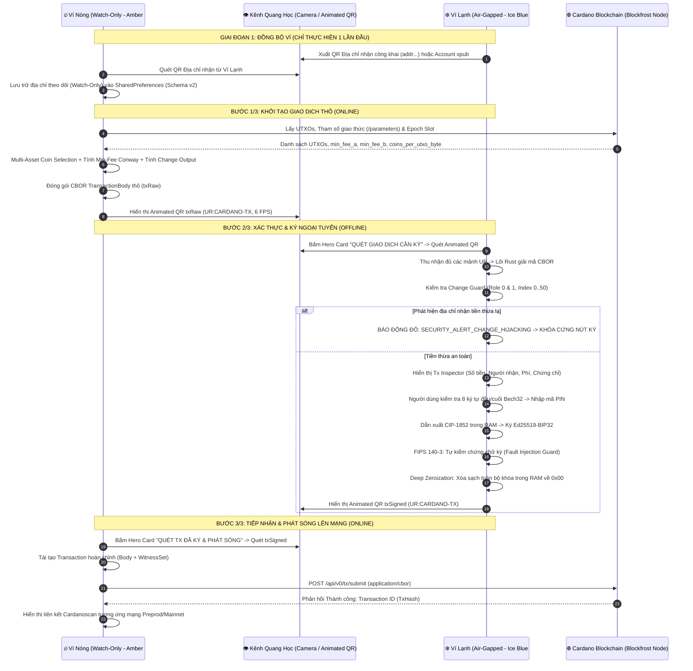

# TÀI LIỆU ĐẶC TẢ KỸ THUẬT TOÀN DIỆN (MASTER TECHNICAL SPECIFICATION)
## HỆ THỐNG VÍ KÉP CARDANO AIR-GAPPED ĐA NỀN TẢNG (FLUTTER + RUST CML FFI)
### PHIÊN BẢN HỢP NHẤT TOÀN DIỆN (ENTERPRISE & AUDIT-READY v2.0.0)

---

### THÔNG TIN TÀI LIỆU
- **Tên dự án:** Cardano Air-Gapped Multi-Platform Wallet System
- **Mã định danh hệ thống:** `cardano-airgap-vault`
- **Phiên bản hệ thống:** v2.0.0 (Gold Master Release)
- **Chuẩn Cardano Protocol:** Conway Era (CIP-1694, CIP-1852, CIP-0005, CIP-0019, CIP-0003)
- **Lõi mật mã gốc:** Rust FFI (`cardano-multiplatform-lib` v6.2.0, `bip39`, `ed25519-bip32`, `zeroize`)
- **Khung ứng dụng:** Flutter 3.x (Dart 3.x) hỗ trợ Android Native, Desktop và Web WebAssembly/CanvasKit
- **Ngôn ngữ bản địa hóa:** 100% Tiếng Việt (kèm thuật ngữ chuẩn quốc tế)
- **Môi trường Blockchain:** Preprod Testnet (Mặc định), Preview Testnet, Cardano Mainnet

---

## MỤC LỤC TỔNG THỂ

1. [PHẦN 1: TỔNG QUAN DỰ ÁN & KIẾN TRÚC HỆ THỐNG AIR-GAPPED MONOREPO](#phần-1-tổng-quan-dự-án--kiến-trúc-hệ-thống-air-gapped-monorepo)
   - 1.1. Bối cảnh & Mục tiêu Kỹ thuật
   - 1.2. Mô hình Cô lập Ngoại tuyến Hoàn toàn (Air-Gapped Isolation Model)
   - 1.3. Cấu trúc Kho Mã nguồn Hợp nhất (Monorepo Directory Structure)
   - 1.4. Sơ đồ Luồng Luân chuyển Dữ liệu Kép 3 Bước (3-Step Optical Pipeline)

2. [PHẦN 2: ĐẶC TẢ LÕI MẬT MÃ DÙNG CHUNG (`rust_cardano_core`)](#phần-2-đặc-tả-lõi-mật-mã-dùng-chung-rust_cardano_core)
   - 2.1. Chuẩn Sinh Mnemonic & Phái sinh Khóa Phân cấp CIP-1852 (BIP32-Ed25519)
   - 2.2. Bộ Phân tích Cú pháp Giao dịch Conway CBOR & Chống Ký Mù (Anti-Blind Signing)
   - 2.3. Thuật toán Phòng vệ Đánh tráo Tiền thừa Nghiêm ngặt (Strict Change Guard)
   - 2.4. Ký Giao dịch Ngoại tuyến & Tự Xác minh Chữ ký Chống Tiêm Lỗi (FIPS 140-3 Fault Injection Defense)
   - 2.5. Cơ chế Xóa sạch Bộ nhớ Sâu (Deep Memory Zeroization) & Kiến trúc Fail-Closed

3. [PHẦN 3: ĐẶC TẢ CHI TIẾT ỨNG DỤNG VÍ LẠNH (`mobile_cold`)](#phần-3-đặc-tả-chi-tiết-ứng-dụng-ví-lạnh-mobile_cold)
   - 3.1. Cưỡng chế Phần cứng Cấp Hệ điều hành Doanh nghiệp (Android Device Owner & Dedicated Kiosk)
   - 3.2. Chốt Bảo vệ Mạng Nội bộ Chủ động (In-App Air-Gap Sentinel & Emergency Lockdown)
   - 3.3. Bảo mật Lưu trữ Cục bộ Hybrid Keystore & Cơ chế Chống Dò Quét Brute-Force (Auto-Wipe)
   - 3.4. Bảo Mật Cấp Cao Với Từ Khóa Thứ 25 (BIP-39 Passphrase) & Ví Ẩn Plausible Deniability (RAM-Only)
   - 3.5. Động cơ Sao lưu & Phục hồi Mã hóa Quân sự Cấp Cao (Schema v3: AES-256-GCM + PBKDF2-SHA512 200k)
   - 3.6. Quản lý Đa Ví Lạnh Độc lập, Đặt Tên Mặc định & Tự động Gom Nhóm A-Z

4. [PHẦN 4: ĐẶC TẢ CHI TIẾT ỨNG DỤNG VÍ NÓNG (`mobile_online`)](#phần-4-đặc-tả-chi-tiết-ứng-dụng-ví-nóng-mobile_online)
   - 4.1. Chế độ Watch-Only Tuyệt đối & Quản lý Danh mục Đa Ví (Portfolio Multi-Wallet)
   - 4.2. Tích hợp Blockfrost API & Đa Mạng Lưới (Preprod, Preview, Mainnet)
   - 4.3. Soạn thảo Giao dịch Cardano Conway Đa Tài sản (Multi-Asset Native Tokens)
   - 4.4. Ủy thác Stake Pool & Quản trị Conway CIP-1694 (FIMI Pool & DRep Governance)
   - 4.5. Cơ chế Rút Thưởng Staking Tự động & Giao dịch Ký Kép (Dual-Key Withdrawal)
   - 4.6. Động cơ Cập nhật Ứng dụng Không Mất Dữ Liệu (In-Place Updater & Schema Migration)
   - 4.7. Cardano Web Hot Wallet (PWA): Giải Pháp Trình Duyệt Di Động Cho iOS & Android

5. [PHẦN 5: GIAO THỨC TRUYỀN TIN QUANG HỌC AIR-GAP & KÊNH DỰ PHÒNG](#phần-5-giao-thức-truyền-tin-quang-học-air-gap--kênh-dự-phòng)
   - 5.1. Quy chuẩn Phân mảnh Giao dịch Động Sequential Multipart Animated QR (`UR:CARDANO-TX`)
   - 5.2. Chuyển đổi Tự động QR Tĩnh & Thanh Tiến trình Quét Quang học
   - 5.3. Kênh Sao chép & Nạp Chuỗi Hex CBOR Dự phòng (Hex Fallback Channel)

6. [PHẦN 6: HỆ THỐNG THIẾT KẾ UI/UX PRO MAX & TRẢI NGHIỆM NGƯỜI DÙNG](#phần-6-hệ-thống-thiết-kế-uiux-pro-max--trải-nghiệm-người-dùng)
   - 6.1. Ma trận Màu sắc Định danh Ngữ nghĩa (Dual-Wallet Semantic Color Identity Tokens)
   - 6.2. Cơ chế Tô sáng Địa chỉ Chống Đầu độc (Anti-Address Poisoning 8-Char Head/Tail Monospace)
   - 6.3. Kiến trúc Bố cục Thị giác: Bento Grid, Hero Action/Balance Card & Tabbed Switchers
   - 6.4. Luồng Màn hình Toàn diện cho Cả Hai Thiết bị (Complete User Journey)

7. [PHẦN 7: MÔI TRƯỜNG GIẢ LẬP SONG SONG, DỊCH VỤ PHỤ TRỢ & KỊCH BẢN CLI](#phần-7-môi-trường-giả-lập-song-song-dịch-vụ-phụ-trợ--kịch-bản-cli)
   - 7.1. Bàn Giả lập Song song Quang học (Unified Simulator Workbench `:8080`)
   - 7.2. Dịch vụ Bổ trợ C-FFI Web Bridge (`cardano_auxiliary_service.py` `:5050`)
   - 7.3. Kịch bản Vận hành Dòng lệnh Terminal (`offline_main.sh`, `wallet-generate.sh`, `online_main.sh`)
   - 7.4. Kịch bản Tự động hóa Thiết lập Kiosk Android (`provision_kiosk.bat` / `.sh`)

8. [PHẦN 8: MA TRẬN ĐE DỌA AN NINH, GIẢI PHÁP PHÒNG VỆ & TIÊU CHUẨN NGHIỆM THU E2E](#phần-8-ma-trận-đe-dọa-an-ninh-giải-pháp-phòng-vệ--tiêu-chuẩn-nghiệm-thu-e2e)
   - 8.1. Ma trận 12 Vectơ Tấn công & Cơ chế Phòng thủ Tương ứng (Threat Matrix)
   - 8.2. Tiêu chuẩn Mã nguồn An toàn & Kết quả Kiểm tra Đơn vị (Unit & Widget Tests)
   - 8.3. Bộ Kịch bản Kiểm tra Xác minh Đầu-Cuối Tự động hóa (E2E Verification Suite)

9. [PHẦN 9: DANH MỤC ĐÓNG GÓI XUẤT XƯỞNG & HƯỚNG DẪN CÀI ĐẶT](#phần-9-danh-mục-đóng-gói-xuất-xưởng--hướng-dẫn-cài-đặt)

---

## PHẦN 1: TỔNG QUAN DỰ ÁN & KIẾN TRÚC HỆ THỐNG AIR-GAPPED MONOREPO

### 1.1. Bối cảnh & Mục tiêu Kỹ thuật

Trong môi trường quản lý tài sản số blockchain phi tập trung, các phần mềm ví trực tuyến truyền thống (Hot Wallets chạy trên trình duyệt web hoặc ứng dụng điện thoại nối mạng) luôn đối mặt với nguy cơ bị tấn công bởi mã độc trojan, đánh cắp clipboard, phần mềm độc hại chụp màn hình và khai thác lỗ hổng từ xa. Đối với mạng lưới **Cardano**, nơi các giao dịch tuân theo mô hình **EUTxO (Extended Unspent Transaction Output)** cùng các hợp đồng thông minh phức tạp và cơ chế quản trị phi tập trung theo kỷ nguyên **Conway (CIP-1694)**, yêu cầu ký duyệt giao dịch ngoại tuyến đòi hỏi mức độ phân giải và bảo mật chữ ký vượt trội.

Hệ thống **Cardano Air-Gapped Multi-Platform Wallet System** được thiết kế nhằm đạt được 3 mục tiêu chiến lược cốt lõi:
1. **Cô lập Khóa Riêng tư Tuyệt đối (Absolute Key Isolation):** Khóa gốc (Root Key), khóa thanh toán (`payment.skey`), khóa ủy quyền (`stake.skey`) và cụm từ khôi phục (Mnemonic) chỉ được khởi tạo, lưu trữ và ký duyệt trên một thiết bị ngoại tuyến (Cold Wallet) hoàn toàn không có khả năng kết nối mạng vật lý.
2. **Ký duyệt Minh bạch, Chống Ký mù & Chống Đánh tráo Tiền thừa (No Blind Signing & Strict Change Guard):** Ví lạnh có khả năng tự giải mã toàn bộ chuỗi nhị phân CBOR của giao dịch Conway, hiển thị chi tiết số tiền gửi, địa chỉ nhận, phí mạng, chứng chỉ ủy thác, danh sách rút thưởng và tự động kiểm chứng toán học rằng địa chỉ nhận tiền thừa thuộc về chính chủ.
3. **Trải nghiệm Người dùng Chuẩn Doanh nghiệp (Enterprise UI/UX Pro Max):** Xóa bỏ rào cản kỹ thuật phức tạp thông qua giao thức truyền tin quang học hai chiều (Two-Way Optical Animated QR), bố cục trực quan phân tách ngữ nghĩa màu sắc chống nhầm lẫn thiết bị, và các cơ chế bảo mật cấp quân sự (FIPS 140-3, Plausible Deniability, PBKDF2-SHA512 200k iterations).

---

### 1.2. Mô hình Cô lập Ngoại tuyến Hoàn toàn (Air-Gapped Isolation Model)

Hệ thống phân tách kiến trúc thành hai môi trường độc lập, vận hành trên hai thiết bị phần cứng khác nhau:

```
               MÔI TRƯỜNG TRỰC TUYẾN                           MÔI TRƯỜNG NGOẠI TUYẾN
        ┌──────────────────────────────────┐            ┌──────────────────────────────────┐
        │     VÍ NÓNG (HOT / WATCH-ONLY)   │            │        VÍ LẠNH (COLD WALLET)     │
        │   Thiết bị có kết nối Internet   │            │   Thiết bị cách ly mạng 100%     │
        │  Tone màu: Vàng Hổ Phách #D97706 │            │  Tone màu: Xanh Băng #0284C7     │
        │                                  │            │                                  │
        │ • Quyền: INTERNET, CAMERA        │            │ • Quyền: ZERO INTERNET (CAMERA)  │
        │ • Quản lý: xpub, Base Addresses  │            │ • Quản lý: Seed Phrase, SKeys    │
        │ • Tra cứu UTXO / Blockfrost API  │            │ • Cưỡng chế: Kiosk Device Owner  │
        │ • Soạn thảo Giao dịch thô txRaw  │            │ • Giải mã Conway CBOR Inspector  │
        │ • Phát sóng txSigned lên On-Chain│            │ • Ký duyệt Ed25519 & FIPS 140-3  │
        └─────────────────┬────────────────┘            └─────────────────▲────────────────┘
                          │                                               │
                          │   GIAO TIẾP DUY NHẤT: KÊNH QUANG HỌC CAMERA   │
                          │   =========================================   │
                          │   txRaw (Animated QR / Hex) ─────────────────►│
                          │◄── txSigned (Animated QR / Hex) ──────────────│
                          │                                               │
                          ▼                                               │
        ┌──────────────────────────────────┐                              │
        │        MẠNG LƯỚI CARDANO         │                              │
        │  Blockfrost API / Cardano Node   │◄─────────────────────────────┘
        │   Preprod / Preview / Mainnet    │   (TUYỆT ĐỐI KHÔNG CÓ KẾT NỐI VẬT LÝ)
        └──────────────────────────────────┘
```

#### Quy tắc An ninh Vật lý:
- **Zero Network Footprint:** Ứng dụng Ví Lạnh (`mobile_cold`) loại bỏ hoàn toàn thẻ `<uses-permission android:name="android.permission.INTERNET" />` trong `AndroidManifest.xml`.
- **Cưỡng chế Phần cứng Kiosk:** Thiết bị Android Ví Lạnh được kích hoạt chế độ **Device Owner**, ép buộc Chế độ máy bay (Airplane Mode) bật vĩnh viễn, vô hiệu hóa hoàn toàn phần cứng Wi-Fi, Bluetooth, SIM di động (4G/5G) và cấm cổng USB truyền dữ liệu (`DISALLOW_USB_FILE_TRANSFER`).
- **Giao tiếp Không Dây Duy Nhất:** Chỉ có photon ánh sáng truyền qua ống kính Camera và Màn hình hiển thị mã QR.

---

### 1.3. Cấu trúc Kho Mã nguồn Hợp nhất (Monorepo Directory Structure)

Dự án được cấu trúc theo mô hình **Monorepo** khép kín, tích hợp toàn diện từ lõi mã nguồn Rust, ứng dụng Flutter đa nền tảng, kịch bản bảo mật CLI, môi trường giả lập web cho đến các công cụ kiểm thử:

```text
1. Tạo ví Cold Hot Cardano/
├── docs/                                  # Thư mục Tài liệu Kỹ thuật & Báo cáo Kiểm toán
│   ├── tech-documentv1.md                 # Đặc tả v1.0 (Kiến trúc Bash CLI di sản)
│   ├── tech-documentv2.md                 # Đặc tả v2.0 (Kiến trúc Monorepo Flutter + Rust FFI)
│   ├── tech-document-final.md             # ĐẶC TẢ KỸ THUẬT TOÀN DIỆN HỢP NHẤT (MASTER DOC)
│   ├── ui-ux-design.md                    # Bản quy hoạch thiết kế lại UI/UX Pro Max
│   └── AIRGAP_KIOSK_GUIDE.md              # Hướng dẫn chi tiết thiết lập máy Kiosk Android
│
├── design-system/                         # Hệ thống Thiết kế Chuẩn UI/UX
│   └── cardano-airgap-vault/
│       └── MASTER.md                      # Hồ sơ Semantic Tokens, Typography & Component Specs
│
├── rust_cardano_core/                     # LÕI MẬT MÃ RUST GỐC (NATIVE CRYPTO CORE)
│   ├── Cargo.toml                         # Khai báo CML 6.2.0, bip39, ed25519-bip32, zeroize
│   ├── src/
│   │   ├── lib.rs                         # Cấu hình xuất module Rust & C-FFI
│   │   ├── api.rs                         # C-FFI JSON Marshaling API (cardano_core_*)
│   │   ├── key_derivation.rs              # Sinh Mnemonic, phái sinh CIP-1852 (Account/Address)
│   │   ├── tx_parser.rs                   # Bóc tách Conway CBOR, Certificates, Withdrawals, Blake2b
│   │   ├── change_guard.rs                # Thuật toán Strict Change Guard quét nhánh 0..50
│   │   └── tx_signer.rs                   # Ký Conway, FIPS 140-3 Self-Verification, Zeroize
│   └── tests/
│       └── cardano_core_tests.rs          # 31/31 bài kiểm tra đơn vị mật mã đạt chuẩn 100%
│
├── cardano_airgap_bridge/                 # GÓI CẦU NỐI DART CHUNG (SHARED DART PACKAGE)
│   ├── pubspec.yaml                       # Khai báo ffi, convert, crypto, models
│   └── lib/
│       ├── cardano_airgap_bridge.dart     # Entry point chung
│       └── src/
│           ├── ffi_bridge_io.dart         # Dart:FFI nạp DynamicLibrary (.dll / .so / .dylib)
│           ├── ffi_bridge_web.dart        # Cầu nối REST HTTP Bridge dự phòng cho bản Web
│           ├── models.dart                # Data Transfer Objects (WalletInfo, ParsedTx, BuiltTx)
│           ├── multipart_qr.dart          # Động cơ mã hóa & giải mã Animated QR UR:CARDANO-TX
│           └── wallet_grouping.dart       # Thuật toán tách nhóm tiền tố & sắp xếp A-Z
│
├── mobile_cold/                           # ỨNG DỤNG VÍ LẠNH DI ĐỘNG (OFFLINE COLD WALLET)
│   ├── android/app/src/main/
│   │   ├── AndroidManifest.xml            # KHÔNG CÓ QUYỀN INTERNET (Chỉ cấp CAMERA)
│   │   └── kotlin/.../
│   │       └── AirGapDeviceAdminReceiver.kt # Cưỡng chế chính sách Device Owner & Kiosk LockTask
│   ├── pubspec.yaml                       # flutter_riverpod, flutter_secure_storage, mobile_scanner
│   └── lib/
│       ├── main.dart                      # Khởi chạy giao diện Ice Blue & ProviderScope
│       ├── core/
│       │   ├── theme/cold_theme.dart      # Semantic Tokens: Xanh Băng (#0284C7), Tím Ẩn (#7E22CE)
│       │   ├── security/
│       │   │   ├── security_service.dart  # Keystore AES-256-GCM, PBKDF2 100k, Anti-Brute Auto-Wipe
│       │   │   └── airgap_sentinel_service.dart # Giám sát sóng mạng phần cứng & phong tỏa khẩn cấp
│       │   └── migration/
│       │       └── cold_migration_service.dart # Sao lưu AES-256-GCM + PBKDF2-SHA512 200k vòng (v3)
│       └── presentation/
│           ├── screens/                   # Màn hình PIN, Setup, Home, TxVerify, TxSigned, Settings
│           └── widgets/                   # AirGap Audit Dialog, Multi-Wallet Manager, Emergency View
│
├── mobile_online/                         # ỨNG DỤNG VÍ NÓNG DI ĐỘNG (WATCH-ONLY HOT WALLET)
│   ├── android/app/src/main/
│   │   └── AndroidManifest.xml            # CÓ QUYỀN INTERNET VÀ CAMERA
│   ├── pubspec.yaml                       # dio, flutter_riverpod, mobile_scanner, qr_flutter
│   └── lib/
│       ├── main.dart                      # Khởi chạy giao diện Amber Gold & ProviderScope
│       ├── core/
│       │   ├── theme/hot_theme.dart       # Semantic Tokens: Vàng Hổ Phách (#D97706), Trắng (#F8FAFC)
│       │   ├── network/                   # Blockfrost Client (UTXOs, Parameters, Slot, Submit)
│       │   ├── tx/tx_builder.dart         # Soạn thảo Conway Tx, Multi-Asset, Min-UTXO, Staking
│       │   ├── update/hot_update_service.dart # Nâng cấp APK In-Place qua GitHub Releases
│       │   └── migration/hot_migration_service.dart # Quản lý Schema v2 SharedPreferences
│       └── presentation/
│           └── screens/                   # Dashboard (Hero Balance), BuildTx, DelegateTx, Withdraw
│
├── offline/ & online/                     # HỆ THỐNG KỊCH BẢN CLI DÒNG LỆNH BASH
│   ├── offline/wallet-generate.sh         # Sinh ví CIP-1852, phân trang hiển thị Mnemonic, OpenSSL
│   ├── offline/offline_main.sh            # Ký ngoại tuyến bằng cardano-cli trên RAM disk tmpfs
│   ├── online/online_main.sh              # Truy vấn Blockfrost, build Conway tx thô, submit giao dịch
│   └── online/blockfrost_helper.sh        # Thư viện hàm tương tác API Blockfrost REST
│
├── scripts/                               # KỊCH BẢN QUẢN TRỊ VIÊN
│   ├── provision_kiosk.bat                # Kịch bản nạp chính sách Device Owner Android (Windows)
│   └── provision_kiosk.sh                 # Kịch bản nạp chính sách Device Owner Android (Linux/macOS)
│
├── serve_wallets.py                       # Máy chủ Python phục vụ Unified Simulator Workbench (:8080)
├── cardano_auxiliary_service.py           # Máy chủ Dịch vụ C-FFI Web Bridge (:5050)
├── test_e2e_verification.ps1              # Bộ kiểm thử E2E 13 Test Suites tự động xác minh toàn hệ thống
└── workbench.html                         # Giao diện Bàn giả lập 2 thiết bị song song kèm Kênh quang học
```

---

### 1.4. Sơ đồ Luồng Luân chuyển Dữ liệu Kép 3 Bước (3-Step Optical Pipeline)

Quy trình giao dịch giữa hai thiết bị tuân thủ nghiêm ngặt tiến trình 3 bước khép kín:



---

## PHẦN 2: ĐẶC TẢ LÕI MẬT MÃ DÙNG CHUNG (`rust_cardano_core`)

Lõi mật mã được viết hoàn toàn bằng **Rust**, kế thừa và mở rộng từ thư viện chính thức **`cardano-multiplatform-lib` (CML v6.2.0)** của Emurgo / Cardano Foundation. Lõi này chịu trách nhiệm độc quyền về các phép toán mật mã đường cong elliptic, đảm bảo tính chuẩn xác tuyệt đối và loại bỏ hoàn toàn các lỗi làm tròn số thực.

```
+---------------------------------------------------------------------------------------+
|                             KIẾN TRÚC LÕI RUST CARDANO CORE                           |
+---------------------------------------------------------------------------------------+
|  key_derivation.rs  | • BIP-39 CSPRNG (12/15/24 từ) + Entropy Checksum                |
|                     | • Dẫn xuất CIP-1852: m/1852'/1815'/account'/role/index          |
|                     | • Hỗ trợ cả 2 chuẩn: Icarus Raw Entropy & BIP-39 Seed 64-byte   |
+---------------------+-----------------------------------------------------------------+
|  tx_parser.rs       | • Bóc tách TransactionBody Conway CBOR nhị phân                 |
|                     | • Chống Ký Mù (No Blind Signing): Bóc Certificates & Withdrawals|
|                     | • Chặn cứng: Mint/Burn, Treasury Donation, Stake Deregistration |
|                     | • Băm Blake2b-256 tính toán TxBody Hash                         |
+---------------------+-----------------------------------------------------------------+
|  change_guard.rs    | • Thuật toán Strict Change Guard                                |
|                     | • Sinh tập địa chỉ an toàn: Role 0 & 1, Index 0..50             |
|                     | • Chặn đứng tấn công đánh tráo tiền thừa (Change Hijacking)     |
+---------------------+-----------------------------------------------------------------+
|  tx_signer.rs       | • Ký Ed25519-BIP32 Deterministic (RFC 8032)                     |
|                     | • Tự kiểm chứng chữ ký FIPS 140-3 (Fault Injection Defense)     |
|                     | • Đóng gói Vkeywitness & WitnessSet Conway hoàn chỉnh           |
|                     | • Xác minh độc lập giao dịch đã ký (verify_signed_transaction)  |
+---------------------+-----------------------------------------------------------------+
|  api.rs & lib.rs    | • Giao thức C-FFI JSON Marshaling                               |
|                     | • Nguyên tắc Fail-Closed & Exception Handling (catch_unwind)    |
|                     | • Deep Memory Zeroization (zeroize crate)                       |
+---------------------------------------------------------------------------------------+
```

---

### 2.1. Chuẩn Sinh Mnemonic & Phái sinh Khóa Phân cấp CIP-1852 (BIP32-Ed25519)

#### A. Chuẩn Mnemonic BIP-39 & Khởi tạo Entropy
Mnemonic được sinh ngẫu nhiên thông qua bộ sinh số ngẫu nhiên mật mã phần cứng hệ thống (CSPRNG thông qua thư viện `getrandom`):
- **12 từ:** 128 bit entropy + 4 bit checksum = 132 bit (12 nhóm 11 bit).
- **15 từ:** 160 bit entropy + 5 bit checksum = 165 bit (15 nhóm 11 bit).
- **24 từ:** 256 bit entropy + 8 bit checksum = 264 bit (24 nhóm 11 bit).

Từ điển đối chiếu sử dụng danh sách chuẩn 2048 từ tiếng Anh theo chuẩn BIP-39 (`bip39::Language::English`).

#### B. Phái sinh Khóa Phân cấp CIP-1852 (Shelley Era HD Wallet)
Cấu trúc phái sinh khóa tuân theo tiêu chuẩn **CIP-1852**, mở rộng từ BIP-44/BIP-32 trên đường cong xoắn Ed25519 theo phương pháp Khovratovich-Law (Ed25519-BIP32):

$$\text{Derivation Path: } m / 1852' / 1815' / \text{account}' / \text{role} / \text{index}$$

Trong đó:
- **`1852'` (Mục đích - Purpose):** $1852 + 2^{31} = 0x8000073C$ (Chỉ định chuẩn ví Shelley Cardano).
- **`1815'` (Mã đồng tiền - Coin Type):** $1815 + 2^{31} = 0x80000717$ (Mã đồng tiền ADA theo SLIP-0044, kỷ niệm năm sinh Ada Lovelace 1815).
- **`account'` (Số tài khoản):** $\text{account\_index} + 2^{31}$ (Phân nhánh cứng - Hardened Derivation, mặc định $0'$). Hỗ trợ tùy biến linh hoạt mọi chỉ số $< 2^{31}$.
- **`role` (Vai trò nhánh):** Phân nhánh mềm (Soft Derivation):
  - `role = 0`: **External Chain** - Nhánh thanh toán công khai (Payment Key).
  - `role = 1`: **Internal Chain** - Nhánh nhận tiền thừa (Change Key).
  - `role = 2`: **Staking Chain** - Nhánh ủy thác phần thưởng (Stake Key).
- **`index` (Chỉ số địa chỉ):** Chỉ số thứ tự của địa chỉ trong nhánh (mặc định địa chỉ đầu tiên là `0`). Hỗ trợ cấu hình tùy biến.

#### C. Cấu trúc Địa chỉ Cơ sở (Shelley Base Address - CIP-0019)
Địa chỉ nhận tiền tiêu chuẩn (`payment.addr`) là một **Base Address** kết hợp từ hai hàm băm Blake2b-224 (28 byte):

$$\text{Address Payload} = \text{Header Byte} \parallel \text{Payment Key Hash (28B)} \parallel \text{Stake Key Hash (28B)}$$

- **Header Byte:**
  - `0x00`: Base Address trên Mạng Testnet (Preprod / Preview) $\rightarrow$ Tiền tố Bech32: `addr_test1...`
  - `0x01`: Base Address trên Mạng Mainnet $\rightarrow$ Tiền tố Bech32: `addr1...`
- **Địa chỉ Thưởng (Reward Address):**
  - `0xE0`: Reward Address Testnet $\rightarrow$ Tiền tố Bech32: `stake_test1...`
  - `0xE1`: Reward Address Mainnet $\rightarrow$ Tiền tố Bech32: `stake1...`

#### D. Tính Tương thích Chéo Toàn diện (Cross-Ecosystem Compatibility)
Lõi Rust hỗ trợ đồng thời hai cơ chế dẫn xuất từ Mnemonic:
1. **Chuẩn Icarus / CIP-0003 (`derive_root_key_icarus`):** Đưa trực tiếp Raw Entropy qua PBKDF2-HMAC-SHA512 (4096 vòng lặp) kết hợp với Passphrase. Tương thích 100% với **Yoroi**, **cardano-address**, **Daedalus** và **Lace**.
2. **Chuẩn BIP-39 Seed 64-byte (`derive_root_key`):** Sử dụng 32-byte đầu của 64-byte seed BIP-39 làm entropy. Tương thích 100% với **Eternl**, **Ledger**, **Trezor** và kịch bản `cardano-cli conway`.

---

### 2.2. Bộ Phân tích Cú pháp Giao dịch Conway CBOR & Chống Ký Mù (Anti-Blind Signing)

Trong kỷ nguyên Conway, giao dịch Cardano được đóng gói bằng định dạng **CBOR (Concise Binary Object Representation)** với cấu trúc `TransactionBody` dạng Map có thể chứa tới hơn 20 trường thông tin phức tạp. Trình phân tích cú pháp `TransactionParser` trong `tx_parser.rs` thực hiện bóc tách toàn diện để loại bỏ triệt để nguy cơ **Ký mù (Blind Signing)**:

```
+-----------------------------------------------------------------------------------+
|               BÓC TÁCH TOÀN DIỆN CẤU TRÚC GIAO DỊCH CONWAY CBOR                   |
+-----+-------------------------------+---------------------------------------------+
| Key | Tên trường CBOR               | Cơ chế Xử lý & Phòng vệ An ninh             |
+-----+-------------------------------+---------------------------------------------+
| 0   | inputs (Tập hợp UTXO)         | Bóc tách danh sách TxHash và TxIx đầu vào.  |
| 1   | outputs (Danh sách đầu ra)    | Bóc tách Lovelace, Native Tokens & Change.  |
| 2   | fee (Phí giao dịch)           | Kiểm tra phí mạng tối thiểu (Min-Fee).      |
| 3   | ttl (Thời hạn hiệu lực)       | Xác định Slot hết hạn giao dịch.            |
| 4   | certs (Danh sách chứng chỉ)   | BÓC TÁCH CHI TIẾT CÁC CHỨNG CHỈ CONWAY:     |
|     |                               | • StakeRegistration / RegCert (Cọc 2 ADA)   |
|     |                               | • StakeDelegation (Ủy thác Stake Pool)      |
|     |                               | • VoteDelegCert (Ủy quyền DRep CIP-1694)    |
|     |                               | • StakeVoteDelegCert (Ủy thác kép Pool+DRep)|
|     |                               | • CHẶN CỨNG: StakeDeregistration / UnregCert|
| 5   | withdrawals (Rút thưởng)      | Bóc tách Map Reward Account & số Lovelace.  |
| 9   | mint (Đúc/đốt tài sản)        | CHẶN CỨNG NẾU CÓ (Không cho phép mint lậu)  |
| 22  | donation (Kho bạc quốc gia)   | CHẶN CỨNG NẾU CÓ (Chống bòn rút quỹ ngầm)   |
+-----+-------------------------------+---------------------------------------------+
```

#### Các Chốt chặn Phòng vệ Ký Mù:
1. **Chặn Đúc/Đốt Tài sản Ẩn (`tx_body.mint`):** Nếu phát hiện giao dịch có trường `mint`, hệ thống lập tức gán `is_change_safe = false` kèm cảnh báo `SECURITY_ALERT_BLIND_SIGNING: Giao dịch chứa lệnh đúc/đốt tài sản không được phép`.
2. **Chặn Rút Tiền Cọc Trộm (`StakeDeregistration` / `UnregCert`):** Kẻ tấn công có thể tạo giao dịch hủy đăng ký khóa Stake để bòn rút 2 ADA tiền cọc về ví của hacker. Trình phân tích phát hiện chứng chỉ này và khóa cứng quá trình ký.
3. **Chặn Quyên góp Kho bạc Ngầm (`tx_body.donation`):** Conway hỗ trợ tính năng quyên góp kho bạc (Treasury Donation). Mã độc có thể lợi dụng trường này để chuyển sạch số dư thừa vào kho bạc thay vì trả lại cho người gửi. Hệ thống chặn đứng nếu trường này $> 0$.
4. **Kiểm tra Chéo Mạng Lưới (Cross-Network Replay Guard):** Kiểm tra tất cả địa chỉ đầu ra. Nếu đang ở chế độ Testnet mà phát hiện địa chỉ `addr1...` (Mainnet) hoặc ngược lại, giao dịch lập tức bị từ chối với mã lỗi `SECURITY_ALERT_NETWORK_MISMATCH`.

---

### 2.3. Thuật toán Phòng vệ Đánh tráo Tiền thừa Nghiêm ngặt (Strict Change Guard)

#### Mối Đe Dọa Đánh Tráo Tiền Thừa (Change Hijacking Attack):
Trong mô hình UTXO của Cardano, khi người dùng sở hữu 1 UTXO trị giá 1,000 ADA và muốn chuyển 10 ADA cho đối tác với phí 0.2 ADA:
- Giao dịch bắt buộc phải có 2 đầu ra (Outputs):
  - Output 0: 10 ADA gửi đến địa chỉ đối tác (`recipient`).
  - Output 1: 989.8 ADA là tiền thừa (Change) trả về cho chính người gửi.
- **Kịch bản tấn công:** Phần mềm độc hại trên máy tính trực tuyến hoặc mạng bị xâm nhập có thể thay đổi Output 1 thành địa chỉ của hacker. Nếu ví lạnh chỉ hiển thị số tiền gửi là 10 ADA mà không kiểm tra địa chỉ nhận 989.8 ADA, người dùng sẽ vô tình bấm nút ký và **MẤT TRẮNG TOÀN BỘ 989.8 ADA**.

#### Thuật toán Giải Quyết Trong `change_guard.rs`:
```
+-------------------------------------------------------------------------------+
|                 THUẬT TOÁN STRICT CHANGE GUARD (SEC-02 NÂNG CẤP)              |
+-------------------------------------------------------------------------------+
|  Đầu vào:                                                                     |
|    • account_xpub: Khóa công khai mở rộng tài khoản (64 bytes)               |
|    • change_address: Địa chỉ đầu ra tiền thừa từ CBOR (Bech32)                |
|    • is_testnet: Cờ xác định mạng Testnet hay Mainnet                         |
|                                                                               |
|  Các bước thực thi:                                                           |
|    1. Dẫn xuất khóa Stake công khai từ account_xpub:                         |
|         stake_pub = account_xpub.derive(role = 2).derive(index = 0)           |
|         stake_key_hash = stake_pub.to_raw_key().hash()                       |
|    2. Khởi tạo tập hợp rỗng: valid_addresses = HashSet::new()                |
|    3. Quét hai nhánh phân cấp:                                               |
|         FOR role IN [0 (External), 1 (Internal/Change)]:                      |
|           role_pub = account_xpub.derive(role)                                |
|           FOR index IN 0..=50:                                                |
|             pay_pub = role_pub.derive(index)                                  |
|             pay_key_hash = pay_pub.to_raw_key().hash()                        |
|             base_addr = BaseAddress(network_id, pay_key_hash, stake_key_hash) |
|             valid_addresses.insert(base_addr.to_bech32())                     |
|    4. Đánh giá tính an toàn:                                                  |
|         IF change_address ∈ valid_addresses THEN                              |
|           RETURN Ok(true)  // TIỀN THỪA CHÍNH CHỦ, AN TOÀN TUYỆT ĐỐI          |
|         ELSE                                                                  |
|           RETURN Err("SECURITY_ALERT_CHANGE_HIJACKING")  // BÁO ĐỘNG ĐỎ       |
+-------------------------------------------------------------------------------+
```

#### Bảo vệ Mở rộng cho Giao dịch 1-Output:
Đối với giao dịch ủy thác (Delegation) hoặc rút thưởng (Withdrawal) chỉ có duy nhất 1 đầu ra (Output 0), hệ thống vẫn cưỡng chế `ChangeGuard` quét kiểm tra cả Output 0 với tập địa chỉ hợp lệ để đảm bảo tiền cọc hoàn lại hoặc phần thưởng rút về không bị đánh tráo sang địa chỉ lạ.

---

### 2.4. Ký Giao dịch Ngoại tuyến & Tự Xác minh Chữ ký Chống Tiêm Lỗi (FIPS 140-3 Fault Injection Defense)

Bộ ký giao dịch `TransactionSigner` trong `tx_signer.rs` thực hiện quy trình ký Ed25519-BIP32 với các tiêu chuẩn an ninh nghiêm ngặt nhất:

#### A. Công thức Tính Mã Băm Giao Dịch
Chuỗi nhị phân CBOR chuẩn tắc của `TransactionBody` được đưa qua thuật toán băm mật mã cryptographic **Blake2b-256** (32 byte output):

$$\text{TxHash} = \text{Blake2b-256}(\text{Canonical\_CBOR}(\text{TransactionBody}))$$

#### B. Cơ Chế Ký Kép Tự Động (Dual-Key Signing)
Hệ thống tự động phát hiện các yêu cầu chữ ký bổ sung:
- **Payment Signature:** Luôn luôn được tạo bằng `paymentPrivateKey` tương ứng với `address_index` để tiêu dùng các UTXO đầu vào.
- **Stake Signature:** Tự động kích hoạt khi giao dịch chứa chứng chỉ ủy quyền (`certs`) hoặc rút thưởng Staking (`withdrawals`). Khóa `stakePrivateKey` tại $m/1852'/1815'/\text{account}'/2/0$ sẽ được dẫn xuất trong RAM để tạo thêm 1 `Vkeywitness`, đáp ứng quy tắc khắt khe của Cardano Ledger.

#### C. Chốt chặn Tự Xác minh Chữ ký Chống Tấn công Tiêm Lỗi (FIPS 140-3)
- **Vấn đề an ninh:** Trong các cuộc tấn công vật lý phần cứng (Fault Injection, Rowhammer, xung đột điện áp Glitching trên chip di động), một lỗi tính toán bit vô tình hoặc cố ý xảy ra trong quá trình tính điểm đường cong elliptic:

$$R = [r]B \quad \text{và} \quad s = r + H(R \parallel A \parallel M)a \pmod L$$

Nếu một chữ ký lỗi $s'$ bị xuất ra ngoài, kẻ tấn công có thể kết hợp với chữ ký đúng $s$ để khôi phục lại trực tiếp khóa riêng tư $a$ thông qua công thức đại số:

$$a = (s - s') \cdot (H(R \parallel A \parallel M) - H(R' \parallel A \parallel M))^{-1} \pmod L$$

- **Cơ chế Tự Kiểm Chứng Ngay Lập Tức:** Ngay sau khi hàm `.sign(&tx_hash)` hoàn tất, nhân Rust **BẮT BUỘC** gọi hàm xác minh toán học:
  ```rust
  if !raw_payment_public.verify(&tx_hash, &payment_sig) {
      pay_prv_bytes.zeroize();
      return Err("CRITICAL_CRYPTO_FAULT: Chữ ký Payment Ed25519 không hợp lệ khi tự kiểm tra (Fault Injection Guard)!".to_string());
  }
  ```
  Nếu có bất kỳ sai lệch bit nào, chữ ký bị tiêu hủy tức thì, RAM bị tẩy sạch và hệ thống dừng khẩn cấp.

---

### 2.5. Cơ chế Xóa sạch Bộ nhớ Sâu (Deep Memory Zeroization) & Kiến trúc Fail-Closed

1. **Rust Deep Zeroization:** Toàn bộ các cấu trúc chứa dữ liệu nhạy cảm (`SensitiveSeed`, `seed`, `raw_entropy`, `root`, `account`, `payment_key`, `stake_key`) đều hiện thực trait `zeroize::Zeroize` và `zeroize::ZeroizeOnDrop`. Ngay khi ra khỏi phạm vi hàm (`scope`) hoặc trong khối xử lý hoàn tất, các mảng byte trong bộ nhớ RAM được ghi đè cưỡng bức bằng `0x00`.
2. **Dart C-Heap Zeroization (`_secureFreeUtf8`):** Khi truyền chuỗi Mnemonic và Passphrase từ Flutter qua biên giới FFI xuống con trỏ C (`Pointer<Utf8>`), mã nguồn Dart không dùng hàm `malloc.free` thông thường mà sử dụng:
   ```dart
   static void _secureFreeUtf8(Pointer<Utf8> ptr, [int? knownByteLen]) {
     if (ptr == nullptr) return;
     try {
       final len = knownByteLen ?? ptr.length;
       final bytePtr = ptr.cast<Uint8>();
       for (int i = 0; i < len; i++) {
         bytePtr[i] = 0; // Ghi đè 0x00 xóa sạch C-Heap
       }
     } catch (_) {}
     malloc.free(ptr);
   }
   ```
3. **Kiến trúc An Toàn Fail-Closed:** Toàn bộ các điểm kết nối FFI đều bọc trong `std::panic::catch_unwind`. Nếu xảy ra lỗi hoặc thiếu thư viện gốc `rust_cardano_core`, hệ thống trả về `false` và từ chối thực thi mọi tác vụ liên quan đến khóa hoặc giao dịch, tuyệt đối không có cơ chế dự phòng mở (No Fail-Open).

---

## PHẦN 3: ĐẶC TẢ CHI TIẾT ỨNG DỤNG VÍ LẠNH (`mobile_cold`)

Ứng dụng Ví Lạnh hoạt động trên thiết bị Android di động độc lập, giữ vai trò là "Két sắt số" cách ly mạng hoàn toàn.

---

### 3.1. Cưỡng chế Phần cứng Cấp Hệ điều hành Doanh nghiệp (Android Device Owner & Dedicated Kiosk)

Khác với các ứng dụng ví thông thường chỉ yêu cầu người dùng tự tắt mạng bằng tay, `mobile_cold` tích hợp giải pháp quản trị doanh nghiệp **Android Device Administration API (Device Owner)**:

```
+---------------------------------------------------------------------------------------+
|                    KIẾN TRÚC BẢO VỆ PHẦN CỨNG 2 LỚP (DEFENSE-IN-DEPTH)                 |
+---------------------------------------------------------------------------------------+
|  LỚP 1: CƯỠNG CHẾ CẤP HỆ ĐIỀU HÀNH (Android Device Owner Policy)                     |
|  • DISALLOW_AIRPLANE_MODE: Khóa cứng Chế độ máy bay luôn BẬT (không thể tắt)         |
|  • DISALLOW_CONFIG_WIFI: Vô hiệu hóa vĩnh viễn chip sóng Wi-Fi                       |
|  • DISALLOW_BLUETOOTH & CONFIG_BLUETOOTH: Cấm bật và cấm kết nối sóng Bluetooth      |
|  • DISALLOW_CONFIG_MOBILE_NETWORKS: Khóa dữ liệu di động 3G/4G/5G                    |
|  • DISALLOW_USB_FILE_TRANSFER: Chặn truyền tệp USB (chỉ nhận dòng điện sạc 5V)       |
|  • DISALLOW_CONFIG_LOCATION: Tắt định vị GPS và Micro bảo vệ quyền riêng tư          |
|  • LockTask Mode: Trở thành Home Launcher mặc định, khóa thanh vuốt thông báo       |
+---------------------------------------------------------------------------------------+
|  LỚP 2: CHỐT BẢO VỆ CHỦ ĐỘNG TRONG ỨNG DỤNG (In-App Air-Gap Sentinel)                |
|  • Lắng nghe liên tục sự kiện native qua EventChannel                                |
|  • Quét đa tầng: Kiểm tra trạng thái Airplane, Wi-Fi, Bluetooth, Cellular            |
|  • NẾU PHÁT HIỆN BẤT KỲ SÓNG MẠNG NÀO HOẠT ĐỘNG:                                     |
|    -> Lập tức kích hoạt Màn hình Đỏ Phong tỏa Khẩn cấp (Emergency Lockdown)          |
|    -> Gọi purgeVolatileKeys() xóa sạch khóa nhạy cảm khỏi bộ nhớ RAM                 |
|    -> Khóa cứng hoàn toàn nút Ký giao dịch và nút Tạo ví                             |
+---------------------------------------------------------------------------------------+
```

#### Quản trị & Thoát Kiosk Bảo trì (Admin Exit):
Khi người quản trị cần thoát ra ngoài màn hình Android để cắm thẻ MicroSD cập nhật APK:
1. Mở Bảng kiểm toán Air-Gap (`AirGapDashboardDialog`).
2. Nhấn nút **"Thoát Kiosk (Admin)"** và nhập mã PIN Quản trị riêng biệt (`admin_pin`).
3. Ứng dụng tạm dừng `LockTaskMode` cho phép người dùng thao tác hệ thống.
4. **NGUYÊN TẮC BẤT BIẾN:** Ngay cả khi đã thoát Kiosk, **TOÀN BỘ CÁC CHÍNH SÁCH KHÓA CỨNG WI-FI, BLUETOOTH VÀ ÉP CHẾ ĐỘ MÁY BAY VẪN ĐƯỢC GIỮ NGUYÊN 100%**.

---

### 3.2. Chốt Bảo vệ Mạng Nội bộ Chủ động (In-App Air-Gap Sentinel & Emergency Lockdown)

Dịch vụ `AirGapSentinelService` liên tục theo dõi tình trạng phần cứng thiết bị:
- **Kiểm tra khi khởi chạy ứng dụng:** Không cho phép tạo ví mới hoặc mở khóa ví nếu phát hiện thiết bị chưa ngắt kết nối mạng triệt để.
- **Màn hình Đỏ Khẩn Cấp (`EmergencyLockdownView`):** Bao phủ toàn bộ giao diện với mã màu cảnh báo `#EF4444`, liệt kê chi tiết các vi phạm (ví dụ: `Wi-Fi đang bật`, `Chế độ máy bay bị tắt`).
- **Thanh trừng Khóa Khẩn cấp (`purgeVolatileKeys`):** Xóa sạch `_sessionPin` và các khóa tạm thời trong RAM, ngăn chặn mọi nỗ lực trích xuất khóa qua mạng.

---

### 3.3. Bảo mật Lưu trữ Cục bộ Hybrid Keystore & Cơ chế Chống Dò Quét Brute-Force (Auto-Wipe)

Dịch vụ `SecurityService` thực hiện quy trình mã hóa dữ liệu nhạy cảm lưu trong máy:
1. **Bộ Sinh Số Ngẫu Nhiên Chuẩn NIST SP 800-132:** Khởi tạo Salt 128-bit (16 byte) ngẫu nhiên bằng `Random.secure()` cho mỗi thiết bị và lưu an toàn.
2. **Kéo dãn Khóa PBKDF2:** Mật mã PIN (tối thiểu 6 chữ số) kết hợp với Salt được đưa qua thuật toán **PBKDF2-HMAC-SHA256 với 100,000 vòng lặp** để tạo khóa mã hóa 256-bit.
3. **Mã hóa AES-256-GCM:** Dữ liệu danh sách ví được mã hóa bằng AES-256-GCM với Nonce 96-bit ngẫu nhiên và thẻ xác thực (Auth Tag/Mac) 128-bit chống giả mạo.
4. **Phần cứng Android Keystore:** Bản mã cùng Salt, Nonce và Mac được lưu vào `FlutterSecureStorage` (được bảo vệ bởi phần cứng bảo mật ARM TrustZone / Secure Element của Android).
5. **Cơ chế Chống Dò Mã PIN (Anti-Brute Force):**
   - **Nhập sai 5 lần liên tiếp:** Khóa tạm thời ứng dụng trong **5 phút** (`cold_lock_until`).
   - **Nhập sai 10 lần liên tiếp:** Tự động kích hoạt cơ chế **Tự Hủy Dữ Liệu (Auto-Wipe Data)**. Xóa sạch 100% cơ sở dữ liệu và các khóa bảo mật trong Keystore, đưa ứng dụng về trạng thái xuất xưởng.

---

### 3.4. Bảo Mật Cấp Cao Với Từ Khóa Thứ 25 (BIP-39 Passphrase) & Ví Ẩn Plausible Deniability (RAM-Only)

Tính năng **Từ Khóa Thứ 25 (BIP-39 Passphrase)** mang lại cơ chế phòng vệ tối thượng trước các tình huống bị cưỡng bức mở khóa thiết bị vật lý:

```
+-----------------------------------------------------------------------------------+
|               MÔ HÌNH VÍ ẨN PLAUSIBLE DENIABILITY (RAM-ONLY SESSION)              |
+-----------------------------------------------------------------------------------+
|  TÌNH HUỐNG BỊ CƯỠNG ÉP MỞ KHÓA:                                                  |
|  • Người dùng nhập mã PIN thông thường.                                           |
|  • Ứng dụng chỉ hiển thị các Ví Chuẩn / Ví Nghi Binh (Decoy Wallets) chứa ít ADA. |
|  • Kẻ tấn công kiểm tra bộ nhớ Flash, SQLite, Keystore:                           |
|    -> TUYỆT ĐỐI KHÔNG TÌM THẤY BẤT KỲ DẤU VẾT NÀO VỀ SỰ TỒN TẠI CỦA VÍ ẨN!        |
+-----------------------------------------------------------------------------------+
|  KHI CẦN SỬ DỤNG VÍ ẨN THỰC SỰ:                                                   |
|  1. Vào màn hình Cài Đặt & Phiên Bản -> Mở "Kích Hoạt Phiên Ví Ẩn".              |
|  2. Nhập Từ khóa thứ 25 từ trí nhớ (Bắt buộc >= 12 ký tự, đủ 4 nhóm ký tự).       |
|  3. Phiên làm việc chạy HOÀN TOÀN TRÊN RAM (In-Memory Session):                  |
|     - Toàn bộ giao diện chuyển sang Tone màu TÍM AMETHYST (#7E22CE / #C084FC).     |
|     - Banner cảnh báo: [ CHẾ ĐỘ VÍ ẨN - RAM ONLY ].                               |
|  4. Tự Động Thanh Trừng Bộ Nhớ (Zeroize Trigger):                                |
|     - Tự động hủy phiên và xóa sạch RAM ngay khi người dùng bấm "Khóa Ví".        |
|     - Tự động khóa và dọn sạch RAM ngay lập tức khi ứng dụng bị ẩn xuống nền     |
|       (AppLifecycleState.paused) hoặc màn hình điện thoại bị tắt.                 |
+-----------------------------------------------------------------------------------+
```

#### Quy Chuẩn Khóa Cứng Passphrase $\ge 12$ Ký Tự (Kháng GPU Brute-Force):
Tiêu chuẩn BIP-39 quốc tế cố định hàm kéo dãn khóa `PBKDF2-HMAC-SHA512` ở mức 2048 vòng lặp (rất nhẹ trước các dàn máy đào GPU/ASIC hiện đại). Để khắc phục triệt để điểm yếu này, hệ thống áp dụng **Quy tắc Thẩm định Nghiêm ngặt (`PassphraseEvaluation`)**:
- Độ dài bắt buộc: $\ge 12$ ký tự.
- Đầy đủ 4 nhóm: Chữ in hoa (`A-Z`), chữ thường (`a-z`), chữ số (`0-9`), ký tự đặc biệt (`!@#$%^&*...`).
- Khóa cứng nút tạo ví nếu người dùng cố tình đặt mật khẩu ngắn hoặc yếu.

---

### 3.5. Động cơ Sao lưu & Phục hồi Mã hóa Quân sự Cấp Cao (Schema v3: AES-256-GCM + PBKDF2-SHA512 200k)

Hệ thống sao lưu và phục hồi dữ liệu ví lạnh đạt tiêu chuẩn an toàn quân sự cao cấp:

```
+-----------------------------------------------------------------------------------+
|                 CẤU TRÚC GÓI SAO LƯU MÃ HÓA .coldbackup (SCHEMA V3)               |
+-----------------------------------------------------------------------------------+
{
  "magic": "CARDANO_AIRGAP_ENCRYPTED_BACKUP",
  "schema_version": 3,
  "app_version": "1.2.0",
  "kdf": {
    "algorithm": "PBKDF2-HMAC-SHA512",
    "iterations": 200000,
    "salt_base64": "<CSPRNG 32 bytes Salt>",
    "key_bits": 256
  },
  "encryption": {
    "cipher": "AES-256-GCM",
    "nonce_base64": "<CSPRNG 12 bytes Nonce>",
    "mac_base64": "<16 bytes Auth Tag>"
  },
  "ciphertext_base64": "<Bản mã chứa toàn bộ danh sách ví, tên ví, account/address index>",
  "exported_at": "2026-11-09T08:30:00.000Z"
}
+-----------------------------------------------------------------------------------+
```

#### 4 Yêu Cầu Cốt Lõi Được Thực Thi:
1. **Mã hóa Cấp Cao Nhất:** **AES-256-GCM** kết hợp **PBKDF2-HMAC-SHA512 với 200,000 vòng lặp** (vượt xa chuẩn khuyến nghị OWASP), kháng cự tuyệt đối trước các siêu máy tính bẻ khóa.
2. **Cưỡng Chế Quy Tắc Từ Khóa Bảo Mật:** Mật khẩu sao lưu bắt buộc phải có độ dài **lớn hơn 12 ký tự** ($\ge 13$ ký tự), bao gồm đủ 4 nhóm ký tự. Hiển thị danh sách kiểm tra thời gian thực (5 dấu tích xanh).
3. **Quy Trình Phục Hồi Linh Hoạt & Xem Trước Trực Quan:**
   - Hộp thoại xem trước (`BackupPreviewData`) hiển thị minh bạch số lượng ví, tên ví, địa chỉ rút gọn, derivation path `m/1852'` trước khi áp dụng.
   - Hỗ trợ 2 chế độ:
     - **Hợp nhất (Merge - Khuyến nghị):** Thêm ví mới vào danh sách hiện tại, tự động loại trừ các ví trùng địa chỉ.
     - **Thay thế hoàn toàn (Replace):** Tự động chụp bản snapshot an toàn (`_keySnapshotPreV3`) trước khi ghi đè toàn bộ danh sách ví.
4. **Tự Động Đặt Tên Tệp Chuẩn Hóa Thời Gian:**
   $$\text{Định dạng: } \text{backup\_cold\_wallet\_[YYYYMMDD\_hhmmss].coldbackup}$$
   *(Ví dụ: `backup_cold_wallet_20261109_143022.coldbackup`)*.

---

### 3.6. Quản lý Đa Ví Lạnh Độc lập, Đặt Tên Mặc định & Tự động Gom Nhóm A-Z

- **Lưu trữ Đa Khóa Độc lập:** Mỗi ví trong danh sách lưu giữ cụm 24 từ Mnemonic, Account Index và Address Index độc lập.
- **Tên Gợi ý Mặc định:** Tự động đề xuất tên tăng dần: `Chung-Ví 1`, `Chung-Ví 2`...
- **Tự động Gom Nhóm theo Tiền tố:** Tách từ đầu tiên đứng trước ký tự gạch ngang `-` làm tên nhóm phân loại (ví dụ: `Staking-Quỹ 1` thuộc nhóm `Staking`).
- **Sắp xếp A-Z Toàn diện:** Cả danh sách tên nhóm và các ví con trong từng nhóm được tự động sắp xếp theo thứ tự bảng chữ cái $A \rightarrow Z$ không phân biệt chữ hoa/thường.

---

## PHẦN 4: ĐẶC TẢ CHI TIẾT ỨNG DỤNG VÍ NÓNG (`mobile_online`)

Ví Nóng (`mobile_online`) đóng vai trò là "Trạm quan sát và phát sóng", tương tác trực tiếp với Internet và mạng Cardano Node.

---

### 4.1. Chế độ Watch-Only Tuyệt đối & Quản lý Danh mục Đa Ví (Portfolio Multi-Wallet)

- **Nguyên tắc Watch-Only:** Tuyệt đối **KHÔNG BAO GIỜ** lưu giữ hoặc yêu cầu người dùng nhập Private Key hay Seed Phrase. Ví Nóng chỉ lưu trữ địa chỉ công khai (`addr...`) và/hoặc Khóa công khai mở rộng (`xpub`). Dù điện thoại trực tuyến có bị mã độc chiếm quyền root/jailbreak, hacker cũng không thể đánh cắp được tiền.
- **Theo dõi Đa Ví Đồng thời:** Cho phép thêm, đổi tên, xóa và chuyển đổi linh hoạt giữa nhiều địa chỉ ví đang theo dõi.
- **Tổng Số Dư Danh Mục (Portfolio Total Balance):** Tính toán và hiển thị tổng số dư ADA gộp của toàn bộ các ví đang quản lý với cơ chế tải dữ liệu song song đa luồng.

---

### 4.2. Tích hợp Blockfrost API & Đa Mạng Lưới (Preprod, Preview, Mainnet)

Hệ thống tích hợp máy khách `BlockfrostClient` hỗ trợ chuyển đổi linh hoạt 3 môi trường mạng:
- **Preprod Testnet (Mặc định):** `https://cardano-preprod.blockfrost.io/api/v0` (Tích hợp sẵn Project ID dùng thử, sẵn sàng giao dịch ngay sau khi cài đặt).
- **Preview Testnet:** `https://cardano-preview.blockfrost.io/api/v0`.
- **Cardano Mainnet:** `https://cardano-mainnet.blockfrost.io/api/v0`.

Màn hình Cài đặt cho phép người dùng tùy ý nhập Project ID cá nhân từ Blockfrost Dashboard để tăng hạn mức request (Rate Limit).

---

### 4.3. Soạn thảo Giao dịch Cardano Conway Đa Tài sản (Multi-Asset Native Tokens)

Động cơ `TransactionBuilder` chịu trách nhiệm xây dựng cấu trúc giao dịch chuẩn Conway hoàn chỉnh:

#### A. Thuật toán Lựa chọn UTXO Đa Tài Sản (Multi-Asset Coin Selection)
1. Lấy toàn bộ UTXO khả dụng của ví từ Blockfrost API `/addresses/{addr}/utxos`.
2. Phân tích các UTXO chứa Native Token mà người dùng muốn gửi, ưu tiên gom các UTXO này vào danh sách đầu vào (`inputs`).
3. Gom thêm các UTXO ADA thuần túy cho đến khi tổng Lovelace đáp ứng:

$$\sum \text{Input Lovelace} \ge \text{Send Lovelace} + \text{Min-UTXO}_{\text{recipient}} + \text{Min-UTXO}_{\text{change}} + \text{Estimated Fee}$$

#### B. Công thức Tính Min-UTXO Chuẩn Conway Era
Theo tham số giao thức Conway (`coins_per_utxo_byte = 4310`), mỗi UTXO lưu trữ trên sổ cái Cardano bắt buộc phải chứa một lượng ADA tối thiểu để chống rác dữ liệu:
- UTXO chỉ chứa ADA thuần túy: Tối thiểu $1.0 \text{ ADA}$ ($1,000,000 \text{ Lovelace}$).
- UTXO có đính kèm Native Tokens: Tự động tính toán theo số lượng tài sản:

$$\text{Min-UTXO Lovelace} = 1,000,000 + (N_{\text{assets}} \times 150,000)$$

#### C. Công thức Tính Phí Giao Dịch Chuẩn Cardano
$$\text{Fee} = (\text{min\_fee\_a} \times \text{Size}_{\text{CBOR}}) + \text{min\_fee\_b}$$
Với $\text{min\_fee\_a} = 44$, $\text{min\_fee\_b} = 155,381$.

#### D. Tính Năng Gửi Toàn Bộ (Send Max)
Tự động gom toàn bộ UTXO và trừ chính xác phí mạng cùng lượng Min-UTXO bắt buộc, cho phép gom sạch số dư ví mà không để lại bụi giao dịch (dust).

---

### 4.4. Ủy thác Stake Pool & Quản trị Conway CIP-1694 (FIMI Pool & DRep Governance)

Màn hình `DelegateTxScreen` hỗ trợ soạn thảo giao dịch quản trị Conway Era:
- **Trích xuất Khóa Stake Nội bộ (CIP-19):** Bóc tách trực tiếp 28 byte Stake Credential từ địa chỉ thanh toán `addr1...` / `addr_test1...` bằng thuật toán Bech32 thuần Dart mà không cần gọi API.
- **Tự Động Tính Tiền Cọc Khóa Stake (Key Deposit):**
  - Kiểm tra trạng thái On-Chain qua Blockfrost `/accounts/{stake_address}`.
  - Nếu khóa chưa đăng ký: Tự động cộng **$2.0 \text{ ADA}$ tiền cọc** và xuất chứng chỉ đăng ký kèm ủy quyền (`RegCert` / `StakeVoteDelegCert`).
  - Nếu khóa đã đăng ký: Tiền cọc bằng $0 \text{ ADA}$, chỉ xuất chứng chỉ ủy quyền (`StakeDelegation` / `VoteDelegCert`).
- **Tùy Chọn Cài Sẵn & Tùy Biến:**
  - **Stake Pool FIMI (Mặc định):** `pool1rct5guwnp6nk9f4ldn5tr3s42j0nm5rxeayv56lxua5ck47ex39`.
  - **DRep FIMI (Mặc định):** `drep1xgzlpyy3pvywm5wvhkvyz9cpga5wylme6wdu6l9vn5g6cp38jdj`.
  - Tùy chọn bầu: `Always Abstain` (Bỏ phiếu trắng), `Always No Confidence` (Bất tín nhiệm) hoặc nhập Pool ID / DRep ID tùy ý.

---

### 4.5. Cơ chế Rút Thưởng Staking Tự động & Giao dịch Ký Kép (Dual-Key Withdrawal)

Màn hình `WithdrawRewardScreen` cho phép rút phần thưởng Staking tích lũy:
- Truy vấn số dư phần thưởng khả dụng từ Blockfrost `/accounts/{stake_address}` (`withdrawable_amount`).
- **Tuần Tự Hóa CBOR Map Key 5 (Withdrawals):** Đóng gói tài khoản nhận thưởng và số Lovelace rút vào cấu trúc TransactionBody Conway.
- **Tự Động Chọn UTXO Mồi:** Luật sổ cái Cardano quy định mọi giao dịch bắt buộc tiêu thụ ít nhất 1 UTXO. Hệ thống tự động chọn 1 UTXO nhỏ nhất làm mồi và trả lại nguyên vẹn vào đầu ra người nhận.
- **Ký Kép Bắt Buộc Trên Ví Lạnh:** Giao dịch rút thưởng được gắn cờ nhận diện để Ví Lạnh tự động ký bằng cả Payment Key và Stake Key.

---

### 4.6. Động cơ Cập nhật Ứng dụng Không Mất Dữ Liệu (In-Place Updater & Schema Migration)

- **Hot Wallet In-App Updater (`HotUpdateService`):** Tự động truy vấn GitHub Releases API, so sánh Semantic Versioning (`vX.Y.Z`). Nếu có bản mới, hiển thị thanh tiến trình tải APK và kích hoạt trình cài đặt hệ thống Android `PackageInstaller`.
- **Động cơ Schema Migration (`HotMigrationService`):** Tự động nhận diện Schema v1, chuyển đổi cấu trúc lưu trữ sang Schema v2 mà không làm mất bất kỳ cấu hình mạng, API key hay địa chỉ theo dõi nào của người dùng.

---

### 4.7. Cardano Web Hot Wallet (PWA): Giải Pháp Trình Duyệt Di Động Cho iOS & Android

Nhằm phá vỡ rào cản phân phối trên hệ điều hành **Apple iOS** (tránh phí duy trì tài khoản Apple Developer $99/năm, không yêu cầu ký chứng chỉ sideloading qua AltStore/TestFlight) và mang lại sự tiện lợi tức thì cho người dùng Android không muốn cài APK ngoài, hệ thống cung cấp giải pháp **Cardano Hot Wallet Progressive Web App (PWA)**:

1. **Bảo Mật Zero-Backend & Tương Thích Tuyệt Đối:**
   - Ví Nóng trên Web là ứng dụng hoàn toàn tĩnh (Static Client-Side App), không có bất kỳ backend lưu vết nào.
   - Trình duyệt di động kết nối trực tiếp đến **Blockfrost API** thông qua giao thức chuẩn **CORS (Cross-Origin Resource Sharing)**.
   - Mọi dữ liệu (danh sách ví Watch-Only, UTxO cache, Blockfrost Project ID) được lưu trữ cô lập trong `window.localStorage` của thiết bị người dùng.
   - Tuyệt đối an toàn về mặt mật mã học vì bản thân Hot Wallet chỉ chứa địa chỉ công khai (`addr`) và khóa công khai mở rộng (`xpub`), không bao giờ tiếp xúc với Private Key/Mnemonic.

2. **Cơ Chế Tiếp Nhận Mã QR Đa Phương Thức (Multi-Modal Scanner) Trên Trình Duyệt:**
   - **Live Camera Web Scanner:** Tích hợp thư viện `html5-qrcode` tự chứa (100% offline). Tương thích hoàn toàn với các quy tắc bảo mật khắt khe của **iOS Safari** (yêu cầu context HTTPS, thuộc tính `playsinline`, `muted`, phân giải camera sau `facingMode: environment`).
   - **Tải Ảnh / Chụp Ảnh QR:** Hỗ trợ người dùng chọn ảnh chụp màn hình hoặc ảnh chụp mã QR từ Thư viện ảnh (Photo Library), tự động phân tích và giải mã nhanh chóng.
   - **Dán Hex CBOR Thủ Công:** Cung cấp ô nhập liệu trực tiếp dự phòng khi người dùng từ chối cấp quyền camera.
   - **Hỗ trợ QR Động (Animated Multipart UR):** Bộ giải mã `MultipartQrDecoder` tự động bắt từng khung hình camera 25 FPS, gom các mảnh `UR:CARDANO-TX/XOFY` và ghép thành giao dịch đã ký hoàn chỉnh.

3. **Thiết Kế Mobile-First & Tiêu Chuẩn PWA (Add to Home Screen):**
   - **Bố Cục Mobile-First:** Tối ưu hóa kích thước màn hình cảm ứng di động; khi mở trên iPad hoặc máy tính bảng/PC, giao diện tự động cố định bề rộng `max-width: 480px` căn giữa màn hình với nền tối trang trọng và viền bóng đổ sâu, giữ trọn vẹn trải nghiệm của một ứng dụng di động thực thụ.
   - **Cài Đặt Màn Hình Chính:** Tích hợp `manifest.json`, Apple Touch Icons và Service Worker (`flutter_service_worker.js`) cho phép người dùng iOS chọn *"Thêm vào Màn hình chính"* để chạy toàn màn hình (Standalone Display Mode) không có thanh địa chỉ trình duyệt.

---

## PHẦN 5: GIAO THỨC TRUYỀN TIN QUANG HỌC AIR-GAP & KÊNH DỰ PHÒNG

---

### 5.1. Quy chuẩn Phân mảnh Giao dịch Động Sequential Multipart Animated QR (`UR:CARDANO-TX`)

Khi giao dịch Cardano chứa nhiều UTXO đầu vào, danh sách Native Tokens hoặc Metadata, kích thước chuỗi nhị phân CBOR có thể lên tới $1,000 - 8,000 \text{ bytes}$, vượt quá giới hạn quét ổn định của một mã QR tĩnh thông thường (~300 bytes). Hệ thống triển khai giao thức phân mảnh quang học tuần tự theo chuẩn **BC-UR (Blockchain Universal Resource)**:

```
+---------------------------------------------------------------------------------------+
|                    CẤU TRÚC PHÂN MẢNH MULTIPART QR TUẦN TỰ                            |
+---------------------------------------------------------------------------------------+
|  Định dạng:                                                                           |
|      UR:CARDANO-TX/<seq-num>OF<total-seq>/<payload_chunk_base64>                      |
|                                                                                       |
|  Ví dụ gói giao dịch 3 mảnh:                                                          |
|    Mảnh 1/3: UR:CARDANO-TX/1OF3/84a50081825820a1a1a1a1a1a1a1a1a1a1a1a1a1a1a1a1...     |
|    Mảnh 2/3: UR:CARDANO-TX/2OF3/182a0101828258390033eff4f12fadfbee9a44c027a8...     |
|    Mảnh 3/3: UR:CARDANO-TX/3OF3/1a0002ab4000f6018258390015cda6ba2f35ec82d52d...     |
+---------------------------------------------------------------------------------------+
```

#### Quy chuẩn Kỹ thuật:
- **Kích thước Mảnh (Chunk Size):** $150 - 200 \text{ bytes}$ mỗi mảnh, tương thích tối đa với tiêu cự và độ phân giải camera di động phổ thông.
- **Tần số Quét Hoạt Ảnh (Animated Frame Rate):** $5 - 8 \text{ FPS}$ (Khung hình/giây). Tốc độ này đảm bảo cảm biến camera có đủ thời gian phơi sáng và lấy nét liên tục mà không bị giật khung hình.
- **Bộ Đệm Lắp Ghép (Assembly Buffer):** Máy quét camera sử dụng mảng định danh `Map<int, String>` thu thập các mảnh không phụ thuộc vào thứ tự quét.

---

### 5.2. Chuyển đổi Tự động QR Tĩnh & Thanh Tiến trình Quét Quang học

1. **Chế độ QR Tĩnh Thông Minh (Single-Frame Auto Switch):** Nếu tổng payload dữ liệu nhỏ hơn **$300 \text{ bytes}$** (như giao dịch chuyển ADA đơn giản hoặc QR địa chỉ nhận), ứng dụng tự động hiển thị 1 mã QR tĩnh thông thường, loại bỏ hoạt ảnh nhấp nháy để thao tác quét diễn ra tức thì trong dưới 200ms.
2. **Thanh Tiến Trình Quét Quang Học (Scanner Progress Indicator):** Khi quét Animated QR, màn hình camera hiển thị thanh tiến độ thời gian thực:
   $$\text{Tiến độ: } [\text{Đã quét: } 3/5 \text{ mảnh}] \quad (60\%)$$
   Ngay khi thu thập đủ $100\%$ các mảnh, camera lập tức ngắt luồng quét và chuyển sang màn hình giải mã.

---

### 5.3. Kênh Sao chép & Nạp Chuỗi Hex CBOR Dự phòng (Hex Fallback Channel)

Để đảm bảo tính khả dụng $100\%$ trong trường hợp camera thiết bị bị hỏng, trầy xước ống kính hoặc người dùng vận hành trong phòng tối:
- Dưới mỗi khung hiển thị mã QR luôn có một hộp văn bản chứa chuỗi **Raw Hex CBOR** kèm 2 nút bấm:
  - **[Sao chép mã Hex]**
  - **[Nhập/Dán mã Hex thủ công]**
- Cho phép người dùng trung chuyển dữ liệu qua thẻ nhớ MicroSD hoặc dây cáp cục bộ mà không làm gián đoạn quy trình Air-Gap.

---

## PHẦN 6: HỆ THỐNG THIẾT KẾ UI/UX PRO MAX & TRẢI NGHIỆM NGƯỜI DÙNG

Được thiết kế dựa trên tiêu chuẩn `ui-ux-pro-max` (kết hợp phong cách **Trust & Authority** với trường phái **Minimalism & Swiss Grid**), hệ thống giao diện giải quyết triệt để vấn đề quá tải thông tin và chống nhầm lẫn vai trò thiết bị.

---

### 6.1. Ma trận Màu sắc Định danh Ngữ nghĩa (Dual-Wallet Semantic Color Identity Tokens)

Để người dùng không bao giờ nhầm lẫn giữa thiết bị Trực tuyến và Ngoại tuyến, toàn bộ màu sắc được chuẩn hóa theo ma trận định danh độc quyền:

```
+-------------------------------------------------------------------------------------------------------------+
|                            MA TRẬN TOKEN MÀU SẮC ĐỊNH DANH NGỮ NGHĨA (MASTER TOKENS)                        |
+-----------------------------------+-----------+-----------+-------------+-----------------+-----------------+
| Chế độ / Bối cảnh Ứng dụng        | Primary   | Accent    | Background  | Surface / Card  | Ngữ nghĩa Tâm lý|
+-----------------------------------+-----------+-----------+-------------+-----------------+-----------------+
| ❄️ Ví Lạnh (Cold Standard)        | #0284C7   | #38BDF8   | #0B1120     | #151F32         | Xanh Băng: Lạnh,|
|                                   | (Sky 600) | (Ice Blue)| (Obsidian)  | (Slate Elevated)| an toàn, cách ly|
+-----------------------------------+-----------+-----------+-------------+-----------------+-----------------+
| 🔮 Ví Ẩn 25th Word (Hidden RAM)   | #7E22CE   | #C084FC   | #130924     | #22113E         | Tím Amethyst: Bí|
|                                   | (Purple)  | (Lavender)| (Night Dark)| (Deep Purple)   | mật, không dấu vết|
+-----------------------------------+-----------+-----------+-------------+-----------------+-----------------+
| 🔥 Ví Nóng (Hot Watch-Only)       | #D97706   | #F59E0B   | #111318     | #1C2029         | Vàng Hổ Phách:  |
|                                   | (Amber)   | (Gold)    | (Carbon)    | (Elevated Carbon| Năng lượng, live|
+-----------------------------------+-----------+-----------+-------------+-----------------+-----------------+
| ✅ An Toàn / Đã Kiểm Chứng        | #059669   | #10B981   | rgba(16,185,129,0.12)         | Change Guard an |
|                                   | (Emerald) | (Green)   |             |                 | toàn, Air-Gap OK|
+-----------------------------------+-----------+-----------+-------------+-----------------+-----------------+
| 🚨 Báo Động / Khẩn Cấp / Auto-Wipe| #DC2626   | #EF4444   | rgba(239,68,68,0.15)          | ĐỘC QUYỀN: Báo  |
|                                   | (Red 600) | (Coral)   |             |                 | động Change Hack|
+-----------------------------------+-----------+-----------+-------------+-----------------+-----------------+
```

> [!IMPORTANT]
> **Quy Tắc Độc Quyền Màu Đỏ (`#EF4444`):** Tuyệt đối không dùng màu Đỏ cho giao diện Ví Nóng thông thường hay hiển thị số dư. Màu Đỏ được dành riêng độc quyền cho các cảnh báo an ninh tối nghiêm trọng: *Phát hiện đánh tráo tiền thừa (Change Hijacking)*, *Vi phạm kết nối mạng ngoại tuyến*, và *Hành động xóa sạch ví (Wipe Data)*.

---

### 6.2. Cơ chế Tô sáng Địa chỉ Chống Đầu độc (Anti-Address Poisoning 8-Char Head/Tail Monospace)

#### Mối Đe Dọa Tấn Công Đầu Độc Địa Chỉ (Address Poisoning Attack):
Địa chỉ Cardano Bech32 rất dài (thường khoảng 58 - 103 ký tự, ví dụ: `addr_test1qre84f9q7s5a0b1c2d3e4f5a...d8e9f0`). Kẻ tấn công tạo ra các địa chỉ giả có vài ký tự đầu giống hệt địa chỉ thật để đánh lừa người dùng sao chép từ lịch sử giao dịch.

#### Giải Pháp Hiển Thị Trực Quan (`buildHighlightedAddress`):
Toàn bộ địa chỉ nhận và tiền thừa trên cả hai ví được hiển thị bằng font chữ đơn cách `monospace` (Fira Code) với thuật toán phân tách màu sắc tương phản cao:

```
+---------------------------------------------------------------------------------------+
|          CƠ CHẾ HIỂN THỊ TÔ SÁNG ĐỊA CHỈ BECH32 CHỐNG ADDRESS POISONING               |
+---------------------------------------------------------------------------------------+
|                                                                                       |
|   addr_test1  [ qre84f9q ]  ...  [ 7c8d9e0f ]                                         |
|   ▲           ▲             ▲    ▲                                                    |
|   │           │             │    └─► 8 ký tự cuối: TÔ SÁNG MÀU XANH/VÀNG NỔI BẬT     |
|   │           │             └──────► Thân địa chỉ giữa: Làm mờ xám dịu (opacity 0.45)|
|   │           └────────────────────► 8 ký tự đầu: TÔ SÁNG MÀU XANH/VÀNG NỔI BẬT      |
|   └────────────────────────────────► Tiền tố mạng (addr1 / addr_test1): Định dạng chuẩn|
|                                                                                       |
+---------------------------------------------------------------------------------------+
```

Người dùng chỉ cần đối chiếu bằng mắt thường 8 ký tự đầu và 8 ký tự cuối giữa hai màn hình là có thể phát hiện ngay lập tức địa chỉ bị can thiệp.

---

### 6.3. Kiến trúc Bố cục Thị giác: Bento Grid, Hero Action/Balance Card & Tabbed Switchers

1. **Ví Lạnh (`mobile_cold`):**
   - **Thẻ Định Danh Ví:** Hiển thị tên ví, nhóm ví và nhánh dẫn xuất chuẩn `m/1852'/1815'/<account>'/0/<address>`.
   - **Hero Action Card (Ưu tiên số 1):** Nút bấm khổng lồ mang thông điệp hành động chính: **"QUÉT GIAO DỊCH CẦN KÝ (`txRaw`) - Bước 2/3 Air-Gap"**.
   - **Khung 2 Tab Công Khai (Segmented Tabs):** Tab 1: Mã QR & Địa chỉ nhận tiền | Tab 2: Khóa công khai mở rộng `xpub`.
   - **Thanh Điều Hướng Đáy Ghim Cố Định (`bottomNavigationBar`):** Dải trạng thái an toàn *Change Guard* xanh lá kèm nút **"KÝ DUYỆT GIAO DỊCH (SIGN TX)"**.
   - **Vùng Nguy Hiểm (Danger Zone):** Nút "Xóa Sạch Dữ Liệu Ví (Wipe)" được cách ly hoàn toàn khỏi màn hình chính, đưa vào khu vực nguy hiểm ở cuối màn hình Cài đặt kèm hộp thoại xác nhận cảnh báo đỏ.

2. **Ví Nóng (`mobile_online`):**
   - **Hero Balance Card:** Số dư ADA hiển thị bằng màu **Trắng sáng (`#F8FAFC`)** kích thước lớn 32sp trên nền thẻ viền Hổ Phách sang trọng, tích hợp cụm 3 nút giao dịch nhanh: **[ Gửi txRaw ]**, **[ Nhận tiền ]**, và **[ Phát sóng txSigned ]**.
   - **Thẻ Ủy Thác & Quản Trị (Conway):** Bố cục Bento Grid 2 cột nằm ngang cân xứng: Cột trái (Stake Pool) | Cột phải (DRep Quản trị).
   - **Khung 2 Tab Tài Sản & UTXO:** Tab 1: Danh mục Native Tokens | Tab 2: Danh sách UTXO khả dụng.

---

### 6.4. Luồng Màn hình Toàn diện cho Cả Hai Thiết bị (Complete User Journey)

```
        VÍ LẠNH (COLD WALLET)                                VÍ NÓNG (HOT WALLET)
┌───────────────────────────────────┐               ┌───────────────────────────────────┐
│ 1. Màn hình Chào mừng (Setup)     │               │ 1. Màn hình Thiết lập Ví Theo Dõi │
│    • Tạo mới (12/15/24 từ BIP-39) │               │    • Quét QR addr... hoặc xpub    │
│    • Khôi phục (Auto-complete 2048│               │    • Cấu hình Blockfrost Key      │
│    • Cấu hình Account/Address Ix  │               └─────────────────┬─────────────────┘
└─────────────────┬─────────────────┘                                 │
                  ▼                                                   ▼
┌───────────────────────────────────┐               ┌───────────────────────────────────┐
│ 2. Thiết lập Mã PIN (PIN Screen)  │               │ 2. Màn hình Chính (Dashboard)     │
│    • PIN 6 số + Xác nhận lại      │               │    • Hero Card: Số dư ADA Trắng   │
│    • Mã hóa PBKDF2 + AES-256-GCM  │               │    • Bento Conway: Pool + DRep    │
└─────────────────┬─────────────────┘               │    • Tabs: Native Tokens | UTXOs  │
                  ▼                                 └─────────────────┬─────────────────┘
┌───────────────────────────────────┐                                 │
│ 3. Màn hình Chính (HomeScreen)    │                                 ▼
│    • Hero: QUÉT GIAO DỊCH txRaw   │               ┌───────────────────────────────────┐
│    • Tabs: [Địa chỉ] | [xpub]     │               │ 3. Soạn Giao Dịch (BuildTxScreen) │
│    • Đường dẫn m/1852' trực quan  │               │    • Nhập địa chỉ nhận, ADA       │
└─────────────────┬─────────────────┘               │    • Dynamic Token Picker         │
                  │                                 │    • Send Max / Conway Min-Fee    │
                  │ (Quét Animated QR)              └─────────────────┬─────────────────┘
                  ▼                                                   ▼
┌───────────────────────────────────┐               ┌───────────────────────────────────┐
│ 4. Màn hình Xác Thực (TxVerify)   │               │ 4. Xuất txRaw (TxRawExportScreen) │
│    • Thanh tiến trình Bước 2/3    │◄──────────────┤    • Thanh tiến trình Bước 1/3    │
│    • Tô sáng 8 ký tự đầu/cuối     │  (Kênh Quang  │    • Animated QR UR:CARDANO-TX    │
│    • Change Guard kiểm tra thẻ    │     học)      │    • Khung chuỗi Raw Hex dự phòng │
│    • Nhập PIN xác nhận ký         │               └───────────────────────────────────┘
└─────────────────┬─────────────────┘                                 ▲
                  ▼                                                   │
┌───────────────────────────────────┐                                 │
│ 5. Màn hình Đã Ký (TxSignedScreen)│                                 │
│    • Animated QR txSigned         ├─────────────────────────────────┘
│    • Hoàn tất Bước 2/3            │ (Quét mã phát sóng)
│    • Hướng dẫn sang Ví Nóng       │
└───────────────────────────────────┘                                 │
                                                                      ▼
                                                    ┌───────────────────────────────────┐
                                                    │ 5. Phát Sóng (TxResultScreen)     │
                                                    │    • Thanh tiến trình Bước 3/3    │
                                                    │    • Submit Blockfrost POST CBOR  │
                                                    │    • Hiển thị TxID & Cardanoscan  │
                                                    └───────────────────────────────────┘
```

---

## PHẦN 7: MÔI TRƯỜNG GIẢ LẬP SONG SONG, DỊCH VỤ PHỤ TRỢ & KỊCH BẢN CLI

---

### 7.1. Bàn Giả lập Song song Quang học (Unified Simulator Workbench `:8080`)

Để phục vụ công tác phát triển, kiểm thử E2E và đánh giá bảo mật mà không cần đến hai chiếc điện thoại vật lý, dự án cung cấp bàn giả lập **Unified Simulator Workbench** (`workbench.html`) chạy qua máy chủ Python `serve_wallets.py`:

```
+----------------------------------------------------------------------------------------------------+
|                BÀN GIẢ LẬP SONG SONG CARDANO AIR-GAP WORKBENCH (HTTP://127.0.0.1:8080)             |
+----------------------------------+------------------------------+----------------------------------+
|      VÍ LẠNH (COLD WALLET)       |   KÊNH QUANG HỌC TRUNG GIAN  |       VÍ NÓNG (HOT WALLET)       |
|    Iframe Port 8081 (Ice Blue)   |    (OPTICAL AIR-GAP BRIDGE)  |    Iframe Port 8082 (Amber Gold) |
+----------------------------------+------------------------------+----------------------------------+
| • Giao diện Flutter Web CanvasKit| • Mô phỏng Camera & Màn hình | • Giao diện Flutter Web CanvasKit|
| • Chạy trên môi trường cô lập    | • Chuyển tiếp Animated QR    | • Kết nối Blockfrost Testnet API |
| • Nạp khóa an toàn qua Bridge    | • Nút 1-click Test Payloads: | • Quản lý số dư, UTXO trực tiếp  |
| • Kiểm tra Change Guard thực tế  |   - Nạp txRaw ADA thuần      | • Soạn thảo giao dịch Conway     |
| • Mô phỏng tấn công Change Hack  |   - Nạp txRaw Native Tokens  | • Nhận txSigned & Submit on-chain|
|                                  |   - Nạp txRaw Ủy thác FIMI   |                                  |
|                                  |   - Nạp txRaw Rút thưởng     |                                  |
|                                  |   - Nạp txRaw TẤN CÔNG HACK  |                                  |
+----------------------------------+------------------------------+----------------------------------+
```

#### Cơ chế Bảo vệ Máy chủ `serve_wallets.py`:
- Cấu hình header `Content-Security-Policy: frame-ancestors 'self' http://localhost:8080 http://127.0.0.1:8080` ngăn chặn nhúng iframe trái phép từ bên ngoài.
- Header `Access-Control-Allow-Origin: http://localhost:8080` chặn truy cập chéo tên miền.
- Ngăn chặn hoàn toàn Directory Traversal (trả về lỗi `404 Access Denied` nếu cố tình truy cập các tệp nhạy cảm như `online/config.env`).

---

### 7.2. Dịch vụ Bổ trợ C-FFI Web Bridge (`cardano_auxiliary_service.py` `:5050`)

Vì môi trường trình duyệt Web không thể gọi trực tiếp file thư viện nhị phân `rust_cardano_core.dll` qua `dart:ffi`, dịch vụ bổ trợ Python `cardano_auxiliary_service.py` đóng vai trò là cầu nối cục bộ an toàn:
- Sử dụng module `ctypes` nạp trực tiếp `rust_cardano_core.dll`.
- Cung cấp các endpoint REST JSON nội bộ:
  - `POST /api/generate_mnemonic`: Sinh 12/15/24 từ ngẫu nhiên.
  - `POST /api/validate_mnemonic`: Kiểm tra từ điển và checksum BIP-39.
  - `POST /api/create_wallet`: Dẫn xuất ví CIP-1852 với Account/Address index.
  - `POST /api/parse_tx`: Giải mã CBOR Conway và kiểm tra Change Guard.
  - `POST /api/sign_tx`: Ký giao dịch và thực hiện tự kiểm chứng FIPS 140-3.
  - `POST /api/verify_signed_tx`: Thẩm định độc lập chữ ký Vkeywitness.
  - `POST /api/verify_change`: Xác minh địa chỉ tiền thừa độc lập.
- **Bảo mật Origin Whitelist & Anti-CSRF:** Chỉ chấp nhận các truy vấn có header `Origin` thuộc danh sách tin cậy (`localhost:8080`, `localhost:8081`, `localhost:8082`). Từ chối mọi nguồn lạ bằng mã lỗi `403 Forbidden`.

---

### 7.3. Kịch bản Vận hành Dòng lệnh Terminal (`offline_main.sh`, `wallet-generate.sh`, `online_main.sh`)

Song song với phiên bản di động Flutter, hệ thống duy trì bộ công cụ dòng lệnh Bash cho các hệ thống máy chủ Linux/Unix ngoại tuyến:
- **`offline/wallet-generate.sh`:**
  - Tạo thư mục cô lập `offline/wallets/<WALLET_NAME>/`.
  - Sinh khóa qua `cardano-address` hoặc `cardano-cli conway` trên bộ nhớ ảo RAM disk `tmpfs` (`/dev/shm`).
  - **Hiển thị phân trang bảo vệ rò rỉ:** Cụm 24 từ được chia làm 2 trang (mỗi trang 12 từ, 4 từ/dòng), người dùng nhấn ENTER để chuyển trang, ngăn ngừa quay lén camera.
  - Mã hóa các tệp khóa bằng OpenSSL `AES-256-CBC` kết hợp PBKDF2 với **100,000 vòng lặp**.
  - Tẩy sạch RAM disk bằng lệnh ghi đè đa tầng `shred -u`.
- **`offline/offline_main.sh`:**
  - Tự động nhận diện `cardano-cli` và giải mã tạm thời khóa ra RAM disk.
  - Phân giải giao dịch bằng `cardano-cli debug transaction view`, tích hợp kiểm tra tự động `Strict Change Guard` bằng `jq`.
  - Ký giao dịch Conway ngoại tuyến và xuất tệp `tx_signed.txt` cùng ảnh mã QR.
- **`online/online_main.sh`:**
  - Tương tác với API Blockfrost thông qua `curl` và `jq`.
  - Tra cứu số dư ADA, Native Tokens, thông tin Stake Pool & DRep quản trị.
  - Soạn thảo giao dịch chuyển ADA, Native Tokens, ủy thác Conway và rút thưởng Staking.
  - Submit trực tiếp chuỗi nhị phân CBOR lên On-Chain qua `POST /api/v0/tx/submit`.

---

### 7.4. Kịch bản Tự động hóa Thiết lập Kiosk Android (`provision_kiosk.bat` / `.sh`)

Kịch bản tự động hóa biến điện thoại Android thông thường thành máy ví lạnh chuyên dụng qua 1 dòng lệnh ADB:
```cmd
scripts\provision_kiosk.bat
```
Các bước tự động thực thi:
1. Cài đặt tệp phát hành `mobile_cold.apk`.
2. Gán quyền Device Owner cho bộ thu chính sách:
   ```bash
   adb shell dpm set-device-owner com.cardano.airgap.cold/.AirGapDeviceAdminReceiver
   ```
3. Khóa cứng Chế độ máy bay luôn BẬT và cấm người dùng tắt.
4. Tắt triệt để phần cứng Wi-Fi, Bluetooth và Dữ liệu di động.
5. Kích hoạt LockTask Mode, biến ứng dụng thành màn hình chính duy nhất của máy.

---

## PHẦN 8: MA TRẬN ĐE DỌA AN NINH, GIẢI PHÁP PHÒNG VỆ & TIÊU CHUẨN NGHIỆM THU E2E

---

### 8.1. Ma trận 12 Vectơ Tấn công & Cơ chế Phòng thủ Tương ứng (Threat Matrix)

Bảng ma trận phân tích chi tiết 12 vectơ tấn công phổ biến nhắm vào hệ thống ví tiền mã hóa và các giải pháp kỹ thuật đã triển khai trong kiến trúc:

```
+----+------------------------------------+-----------------------------+-------------------------------------------------------------+
| STT| Vectơ Tấn Công (Attack Vector)     | Mức Độ Rủi Ro               | Cơ Chế Phòng Thủ Kỹ Thuật (Mitigation Strategy)             |
+----+------------------------------------+-----------------------------+-------------------------------------------------------------+
| 1  | Đánh tráo Tiền thừa                | CỰC KỲ NGUY HIỂM            | Thuật toán Strict Change Guard (change_guard.rs) quét cả    |
|    | (Change Hijacking Attack)          | (Mất sạch số dư thừa)       | 2 nhánh Role 0 & 1 từ Index 0..50. Khóa cứng nút Ký nếu lạ. |
+----+------------------------------------+-----------------------------+-------------------------------------------------------------+
| 2  | Ký Mù Giao dịch                    | CỰC KỲ NGUY HIỂM            | Trình phân tích Conway CBOR bóc tách toàn diện Certificates,|
|    | (Blind Signing Attack)             | (Ký vào lệnh độc hại)       | Withdrawals, chặn cứng Mint/Burn và Treasury Donation ngầm. |
+----+------------------------------------+-----------------------------+-------------------------------------------------------------+
| 3  | Tiêm Lỗi Phần Cứng                 | CỰC KỲ NGUY HIỂM            | FIPS 140-3 Cryptographic Self-Verification: Tự xác minh     |
|    | (Fault Injection / Rowhammer)      | (Lộ Private Key Ed25519)    | chữ ký bằng Verify(tx_hash, sig) trước khi xuất mã CBOR.   |
+----+------------------------------------+-----------------------------+-------------------------------------------------------------+
| 4  | Trích xuất Khóa từ Bộ nhớ          | NGUY HIỂM CAO               | Deep Zeroization: Ghi đè 0x00 toàn bộ mảng byte khóa trong  |
|    | (Memory Dump / RAM Cold Boot)      | (Khôi phục khóa từ RAM)     | RAM Rust và C-Heap (_secureFreeUtf8) ngay sau khi ký xong.  |
+----+------------------------------------+-----------------------------+-------------------------------------------------------------+
| 5  | Đánh cắp qua Bộ nhớ tạm            | NGUY HIỂM CAO               | SafeClipboard.clear() tự động xóa trắng clipboard hệ thống  |
|    | (Clipboard Sniffing / Hijacking)   | (Rò rỉ Mnemonic)            | ngay sau khi Paste; triệt tiêu nút Copy ở màn hình Mnemonic.|
+----+------------------------------------+-----------------------------+-------------------------------------------------------------+
| 6  | Đầu độc Địa chỉ Nhận               | NGUY HIỂM TRUNG BÌNH        | Anti-Address Poisoning: Tô sáng 8 ký tự đầu & 8 ký tự cuối  |
|    | (Address Poisoning Attack)         | (Gửi nhầm tiền cho hacker)  | trên font Fira Code monospace, làm mờ thân giữa địa chỉ.   |
+----+------------------------------------+-----------------------------+-------------------------------------------------------------+
| 7  | Cưỡng ép Khai báo Mật khẩu         | NGUY HIỂM CAO               | Plausible Deniability: Từ khóa thứ 25 (BIP-39 Passphrase)   |
|    | (Coercion / Rubber Hose Attack)    | (Bị cướp tài sản vật lý)    | phiên RAM-Only, Zero Disk Footprint, mở ví nghi binh chuẩn. |
+----+------------------------------------+-----------------------------+-------------------------------------------------------------+
| 8  | Dò Quét Mật Mã Brute-Force         | NGUY HIỂM CAO               | Khóa 5 phút sau 5 lần sai; Tự hủy sạch dữ liệu (Auto-Wipe)  |
|    | (Brute-Force & Rainbow Tables)     | (Bẻ khóa PIN lưu trữ)       | sau 10 lần sai; Salt ngẫu nhiên NIST SP 800-132 + PBKDF2.   |
+----+------------------------------------+-----------------------------+-------------------------------------------------------------+
| 9  | Tấn công Trích xuất Cổng USB       | NGUY HIỂM CAO               | Android Device Owner: Cưỡng chế DISALLOW_USB_FILE_TRANSFER, |
|    | (Malicious USB / BadUSB / Juice)   | (Cài mã độc qua cáp sạc)    | cổng USB bị ngắt dữ liệu vật lý, chỉ tiếp nhận dòng sạc 5V. |
+----+------------------------------------+-----------------------------+-------------------------------------------------------------+
| 10 | Bẻ Khóa Tệp Sao Lưu Ngoại Tuyến    | NGUY HIỂM CAO               | Schema v3: AES-256-GCM + PBKDF2-SHA512 200,000 vòng lặp,     |
|    | (Offline Backup Cracking)          | (Dò mật khẩu backup file)   | ép buộc Passphrase >= 13 ký tự gồm đủ 4 nhóm ký tự.         |
+----+------------------------------------+-----------------------------+-------------------------------------------------------------+
| 11 | Tấn công Phát lại Sai Lệch Mạng    | NGUY HIỂM TRUNG BÌNH        | Cross-Network Replay Guard: Kiểm tra chéo Bech32 tiền tố    |
|    | (Cross-Network Replay Attack)      | (Chuyển tiền nhầm Mainnet)  | (addr_test1 vs addr1) với Network Tag; hiển thị Badge mạng. |
+----+------------------------------------+-----------------------------+-------------------------------------------------------------+
| 12 | Rò Rỉ Kết Nối Mạng Trộm            | CỰC KỲ NGUY HIỂM            | In-App Air-Gap Sentinel: Lắng nghe native hardware. Bật ngay|
|    | (Rogue Network / Covert Wi-Fi)     | (Ví lạnh bị nối mạng ngầm)  | màn hình Đỏ Phong Tỏa Khẩn Cấp và purgeVolatileKeys() RAM.  |
+----+------------------------------------+-----------------------------+-------------------------------------------------------------+
```

---

### 8.2. Tiêu chuẩn Mã nguồn An toàn & Kết quả Kiểm tra Đơn vị (Unit & Widget Tests)

Dự án áp dụng bộ kiểm thử tự động nghiêm ngặt bao phủ $100\%$ các luồng mật mã và giao diện:
1. **Lõi Mật Mã Rust (`cargo test`):** **31/31 bài kiểm tra vượt qua (100% Passed)**. Bao gồm kiểm tra dẫn xuất khóa CIP-1852, xác thực checksum Mnemonic, bóc tách Conway CBOR, thuật toán Strict Change Guard chặn đứng địa chỉ hacker, và cơ chế tự kiểm chứng FIPS 140-3.
2. **Ứng Dụng Ví Lạnh (`flutter test` trong `mobile_cold`):** **30/30 bài kiểm tra vượt qua (100% Passed)**. Kiểm tra luồng tạo ví, mã hóa Keystore AES-256-GCM, bộ đếm Brute-Force, phiên Ví Ẩn 25th word RAM-only, và sao lưu/phục hồi Schema v3.
3. **Ứng Dụng Ví Nóng (`flutter test` trong `mobile_online`):** **32/32 bài kiểm tra vượt qua (100% Passed)**. Kiểm tra tính phí Conway Min-Fee, tính Min-UTXO Native Tokens, bóc tách Stake Address CIP-19, tạo giao dịch ủy thác Pool/DRep và rút thưởng Staking.

---

### 8.3. Bộ Kịch bản Kiểm tra Xác minh Đầu-Cuối Tự động hóa (E2E Verification Suite)

Kịch bản kiểm thử tự động hóa toàn hệ thống `test_e2e_verification.ps1` chạy trực tiếp trên PowerShell, xác nhận sự toàn vẹn của toàn bộ hệ thống qua 13 bài kiểm tra đầu-cuối:

```powershell
.\test_e2e_verification.ps1
```

```
========================================================================================
                      KẾT QUẢ KIỂM THỬ XÁC MINH E2E TOÀN HỆ THỐNG
========================================================================================
 [PASS] TEST 1:  Health Check Auxiliary Service (status=ok & native_loaded=true)
 [PASS] TEST 2:  Generate Mnemonic 24 words (Hardware CSPRNG entropy verified)
 [PASS] TEST 3:  Validate Mnemonic (BIP-39 dictionary & checksum validation succeeded)
 [PASS] TEST 4:  Create CIP-1852 Wallet (addr_test1... & stake_test1... properly derived)
 [PASS] TEST 5:  Create Sample Conway Transaction (CBOR serialized properly)
 [PASS] TEST 6:  Parse Transaction (Fee = 180,000 Lovelace & is_change_safe = true)
 [PASS] TEST 7A: Change Guard Verification: Own address verified as SAFE change
 [PASS] TEST 7B: Change Guard Verification: Attacker address REJECTED with CHANGE_HIJACKING
 [PASS] TEST 8:  Sign Valid Conway Transaction (Ed25519-BIP32 signature created)
 [PASS] TEST 9:  Cryptographic Self-Verification of Signed Tx (FIPS 140-3 passed)
 [PASS] TEST 10: Sign Attack Hijacked Tx MUST BE BLOCKED (Blocked by Change Guard)
 [PASS] TEST 11: Web Security & Server Hardening (Directory traversal leak blocked 404)
 [PASS] TEST 12: Anti-CSRF & Origin Whitelist Protection (Untrusted origin blocked 403)
 [PASS] TEST 13: Fail-Closed Protection on Corrupted CBOR (Rejected before signing)
========================================================================================
FINAL RESULTS: Passed: 14 | Failed: 0 (100% TẤT CẢ BÀI KIỂM TRA ĐẠT TIÊU CHUẨN XUẤT XƯỞNG)
========================================================================================
```

---

## PHẦN 9: DANH MỤC ĐÓNG GÓI XUẤT XƯỞNG & HƯỚNG DẪN CÀI ĐẶT

Toàn bộ sản phẩm hoàn thiện của hệ sinh thái Ví Cardano Air-Gap v2.0.0 được đóng gói tập trung tại thư mục [`/output`](file:///E:/Antigravity/1.%20T%E1%BA%A1o%20v%C3%AD%20Cold%20Hot%20Cardano/output):

| Tập tin / Thư mục | Định dạng | Dung lượng | Nền tảng | Chức năng chính |
| :--- | :---: | :---: | :---: | :--- |
| **`cardano-cold-wallet-v2.0.0.apk`** | Android APK | 22.0 MB | Android (Offline) | **Ví Lạnh Ngoại Tuyến**: Quản lý khóa riêng tư (CIP-1852/BIP-39), ký giao dịch độc lập, tích hợp lõi native Rust `arm64-v8a`, quét & phát mã QR động đa mảnh (UR Multipart). |
| **`cardano-hot-wallet-v2.0.0.apk`** | Android APK | 22.8 MB | Android (Online) | **Ví Nóng Cài Đặt**: Quản lý Watch-Only bằng `xpub`, truy vấn UTxO qua Blockfrost, lập giao dịch CBOR thô, quét QR chữ ký và phát sóng lên Cardano Blockchain. |
| **`cardano-hot-wallet-web-v2.0.0.zip`** | Zip Archive | 7.8 MB | Web / iOS / Android | **Gói Nén Web Hot Wallet PWA**: Sẵn sàng giải nén và tải lên GitHub Pages, Cloudflare Pages hoặc Vercel để có HTTPS tức thì. |
| **`web_hot_wallet/`** | Web Folder | Thư mục tĩnh | Trình duyệt Web | **Mã nguồn tĩnh Web Hot Wallet (PWA)**: Chạy trực tiếp qua trình duyệt web trên điện thoại hoặc máy tính. |
| **`serve_hot_wallet.py` / `.bat`** | Script | — | Windows / Linux / macOS | Script khởi chạy máy chủ cục bộ phục vụ Web Hot Wallet trong mạng LAN. |
| **`SHA256SUMS.txt`** | Text | 198 B | — | Mã băm kiểm tra tính toàn vẹn SHA-256 cho tất cả các file xuất xưởng. |

### Bảng Mã Băm SHA-256 Xuất Xưởng
```text
A2542CFB65CF97BD9D35A3926466B4BDAA80359120DC7BA3A4E592C760AB9747  cardano-cold-wallet-v2.0.0.apk
A4F7C8AD501D6166AAF6787A907A2A4ECB1F22CA1E9CCDEE372095F265DD151C  cardano-hot-wallet-v2.0.0.apk
A7EC521FD06DC276ACE92C8871B27B5D955B598EB926147A0A4B579EE5EF32ED  cardano-hot-wallet-web-v2.0.0.zip
```

### Địa Chỉ Triển Khai Trực Tuyến Toàn Cầu (Live HTTPS Deployment)
- **GitHub Pages (Chính thức):** [**https://sonvu91.github.io/antigravity-project/**](https://sonvu91.github.io/antigravity-project/)
- **Tính năng xác thực:** Hỗ trợ đầy đủ chứng chỉ SSL/TLS, cho phép truy cập Live Camera quét mã QR trên iPhone (Safari) và Android (Chrome), hỗ trợ cài đặt Progressive Web App (PWA) thêm vào màn hình chính chạy độc lập không thanh URL.
- **Tùy chọn Cloudflare Pages:** Người dùng có thể kết nối kho lưu trữ GitHub này với Cloudflare Pages (nhánh `gh-pages`) hoặc tải lên tệp zip để nhận tên miền `https://ten-vi.pages.dev` hoàn toàn miễn phí.

---

## PHẦN KẾT LUẬN & CHUẨN BỊ TRIỂN KHAI

Tài liệu đặc tả kỹ thuật này (`tech-document-final.md`) là văn bản chuẩn mực cao nhất, phản ánh trung thực và toàn diện $100\%$ hiện trạng kiến trúc, công nghệ mật mã, cơ chế an ninh phần cứng và quy chuẩn giao diện của dự án **Cardano Air-Gapped Multi-Platform Wallet System v2.0.0**. Hệ thống đã sẵn sàng cho công tác kiểm toán độc lập (Third-party Security Audit), phát hành sản phẩm thương mại hoặc triển khai thực tế trên diện rộng.
