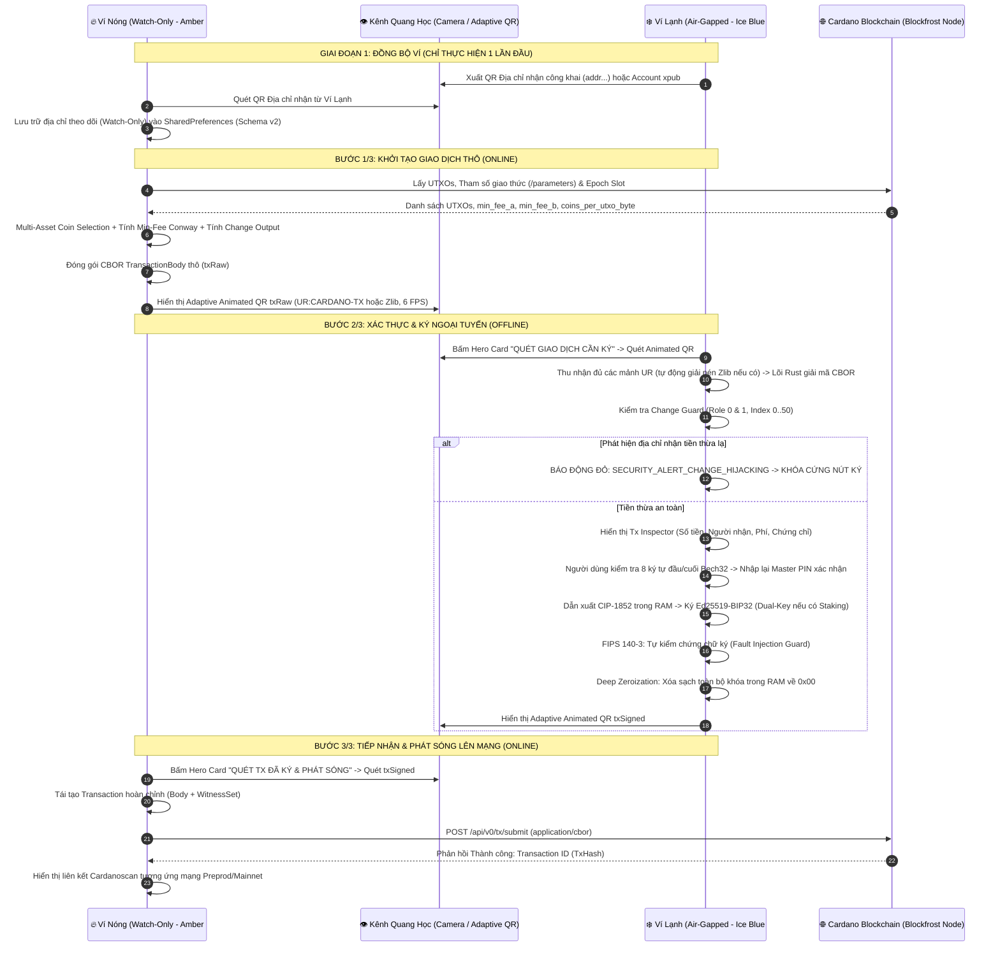

# TÀI LIỆU ĐẶC TẢ KỸ THUẬT TOÀN DIỆN (MASTER TECHNICAL SPECIFICATION v2.0)
## HỆ THỐNG VÍ KÉP CARDANO AIR-GAPPED ĐA NỀN TẢNG (FLUTTER + RUST CML FFI)
### PHIÊN BẢN HỢP NHẤT TOÀN DIỆN & CẬP NHẬT ĐỒNG THUẬN KỸ THUẬT (ENTERPRISE v2.0.0)

---

### THÔNG TIN TÀI LIỆU
- **Tên dự án:** Cardano Air-Gapped Multi-Platform Wallet System
- **Mã định danh hệ thống:** `cardano-airgap-vault`
- **Phiên bản hệ thống:** v2.0.0 (Master Release v2 - Grill-Me Consensus Updated)
- **Chuẩn Cardano Protocol:** Conway Era (CIP-1694, CIP-1852, CIP-0005, CIP-0019, CIP-0003)
- **Lõi mật mã gốc:** Rust FFI (`cardano-multiplatform-lib` v6.2.0, `bip39`, `cml-crypto`, `cml-chain`, `zeroize`)
- **Khung ứng dụng:** Flutter 3.24+ (Dart 3.5+) hỗ trợ Android Native, Desktop (Windows/Linux/macOS) và Web PWA (CanvasKit)
- **Ngôn ngữ bản địa hóa:** 100% Tiếng Việt (kèm thuật ngữ chuẩn quốc tế)
- **Môi trường Blockchain:** Preprod Testnet (Mặc định), Preview Testnet, Cardano Mainnet
- **Chiến lược triển khai:** Xây dựng mới hoàn toàn từ đầu (*From Scratch*) theo lộ trình 5 Giai đoạn Tuần tự có Cổng nghiệm thu (Bottom-Up Gated Pipeline).

---

## MỤC LỤC TỔNG THỂ

1. [PHẦN 1: TỔNG QUAN DỰ ÁN & KIẾN TRÚC HỆ THỐNG AIR-GAPPED MONOREPO](#phần-1-tổng-quan-dự-án--kiến-trúc-hệ-thống-air-gapped-monorepo)
   - 1.1. Bối cảnh & Mục tiêu Kỹ thuật
   - 1.2. Mô hình Cô lập Ngoại tuyến Hoàn toàn (Air-Gapped Isolation Model)
   - 1.3. Cấu trúc Kho Mã nguồn Hợp nhất (Monorepo Directory Structure)
   - 1.4. Lộ trình Triển khai 5 Giai đoạn Tuần tự có Cổng Nghiệm thu (5 Gated Phases)
   - 1.5. Sơ đồ Luồng Luân chuyển Dữ liệu Kép 3 Bước (3-Step Optical Pipeline)

2. [PHẦN 2: ĐẶC TẢ LÕI MẬT MÃ DÙNG CHUNG (`rust_cardano_core`)](#phần-2-đặc-tả-lõi-mật-mã-dùng-chung-rust_cardano_core)
   - 2.1. Chuẩn Sinh Mnemonic & Phái sinh Khóa Phân cấp CIP-1852 (BIP32-Ed25519)
   - 2.2. Cơ chế Phái sinh Kép: BIP-39 Seed Mặc định & Tùy chọn Nâng cao CIP-0003 Icarus
   - 2.3. Bộ Phân tích Cú pháp Giao dịch Conway CBOR & Chống Ký Mù (Anti-Blind Signing)
   - 2.4. Thuật toán Phòng vệ Đánh tráo Tiền thừa Nghiêm ngặt (Strict Change Guard)
   - 2.5. Ký Giao dịch Ngoại tuyến & Tự Xác minh Chữ ký Chống Tiêm Lỗi (FIPS 140-3 Fault Injection Defense)
   - 2.6. Cơ chế Xóa sạch Bộ nhớ Sâu (Deep Memory Zeroization) & Kiến trúc Fail-Closed

3. [PHẦN 3: ĐẶC TẢ CHI TIẾT ỨNG DỤNG VÍ LẠNH (`mobile_cold`)](#phần-3-đặc-tả-chi-tiết-ứng-dụng-ví-lạnh-mobile_cold)
   - 3.1. Cưỡng chế Phần cứng Kiosk Cấp Hệ điều hành: Tự động phân tách Release vs Debug
   - 3.2. Chốt Bảo vệ Mạng Nội bộ Chủ động (In-App Air-Gap Sentinel & Emergency Lockdown)
   - 3.3. Bảo mật Lưu trữ Cục bộ Hybrid Keystore & Cơ chế Chống Dò Quét Brute-Force (Auto-Wipe)
   - 3.4. Luồng Xác thực Master PIN 6 Số & Tái Xác thực Ký Duyệt (Re-authentication)
   - 3.5. Bảo Mật Cấp Cao Với Từ Khóa Thứ 25 (BIP-39 Passphrase) & Ví Ẩn Plausible Deniability (RAM-Only)
   - 3.6. Động cơ Sao lưu & Phục hồi Mã hóa Quân sự Cấp Cao (Schema v3: AES-256-GCM + PBKDF2-SHA512 200k)
   - 3.7. Quản lý Đa Ví Lạnh Độc lập, Đặt Tên Mặc định & Tự động Gom Nhóm A-Z

4. [PHẦN 4: ĐẶC TẢ CHI TIẾT ỨNG DỤNG VÍ NÓNG (`mobile_online`)](#phần-4-đặc-tả-chi-tiết-ứng-dụng-ví-nóng-mobile_online)
   - 4.1. Chế độ Watch-Only Tuyệt đối & Quản lý Danh mục Đa Ví (Portfolio Multi-Wallet)
   - 4.2. Tích hợp Blockfrost API, Quản lý Key An toàn (`.env` + `--dart-define`) & Đa Mạng Lưới
   - 4.3. Động cơ Soạn thảo Giao dịch Cardano Conway Pure-Dart (`tx_builder.dart`)
   - 4.4. Ủy thác Stake Pool & Quản trị Conway CIP-1694 (FIMI Pool & DRep Governance)
   - 4.5. Cơ chế Rút Thưởng Staking Tự động & Giao dịch Ký Kép (Dual-Key Withdrawal)
   - 4.6. Động cơ Cập nhật Ứng dụng Không Mất Dữ Liệu (In-Place Updater & Schema Migration)
   - 4.7. Cardano Web Hot Wallet (PWA): Giải Pháp Trình Duyệt Di Động Cho iOS & Android

5. [PHẦN 5: GIAO THỨC TRUYỀN TIN QUANG HỌC AIR-GAP THÍCH ỨNG (ADAPTIVE QR)](#phần-5-giao-thức-truyền-tin-quang-học-air-gap-thích-ứng-adaptive-qr)
   - 5.1. Quy chuẩn Phân mảnh Thích ứng Adaptive Dual-Mode (`UR:CARDANO-TX` & `UR:CARDANO-TX-Z`)
   - 5.2. Chuyển đổi Tự động QR Tĩnh Dưới 300 Bytes & Thanh Tiến trình Quét Quang học
   - 5.3. Kênh Sao chép & Nạp Chuỗi Hex CBOR Dự phòng (Hex Fallback Channel)

6. [PHẦN 6: HỆ THỐNG THIẾT KẾ UI/UX PRO MAX & TRẢI NGHIỆM NGƯỜI DÙNG](#phần-6-hệ-thống-thiết-kế-uiux-pro-max--trải-nghiệm-người-dùng)
   - 6.1. Ma trận Màu sắc Định danh Ngữ nghĩa (Dual-Wallet Semantic Color Identity Tokens)
   - 6.2. Cơ chế Tô sáng Địa chỉ Chống Đầu độc (Anti-Address Poisoning 8-Char Head/Tail Monospace)
   - 6.3. Kiến trúc Bố cục Thị giác: Bento Grid, Hero Action/Balance Card & Tabbed Switchers
   - 6.4. Luồng Màn hình Toàn diện cho Cả Hai Thiết bị (Complete User Journey)

7. [PHẦN 7: MÔI TRƯỜNG GIẢ LẬP SONG SONG, DỊCH VỤ PHỤ TRỢ & KỊCH BẢN TIỆN ÍCH](#phần-7-môi-trường-giả-lập-song-song-dịch-vụ-phụ-trợ--kịch-bản-tiện-ích)
   - 7.1. Bàn Giả lập Song song Quang học (Unified Simulator Workbench `:8080`)
   - 7.2. Dịch vụ Bổ trợ C-FFI Web Bridge (`cardano_auxiliary_service.py` `:5050`)
   - 7.3. Kịch bản Tiện ích Shell/PowerShell & Hướng dẫn Tải cardano-cli Chính Thức
   - 7.4. Kịch bản Tự động hóa Thiết lập Kiosk Android (`provision_kiosk.bat` / `.sh`)

8. [PHẦN 8: MA TRẬN ĐE DỌA AN NINH, GIẢI PHÁP PHÒNG VỆ & TIÊU CHUẨN NGHIỆM THU E2E](#phần-8-ma-trận-đe-dọa-an-ninh-giải-pháp-phòng-vệ--tiêu-chuẩn-nghiệm-thu-e2e)
   - 8.1. Ma trận 12 Vectơ Tấn công & Cơ chế Phòng thủ Tương ứng (Threat Matrix)
   - 8.2. Tiêu chuẩn Mã nguồn An toàn & Kết quả Kiểm tra Đơn vị (Unit & Widget Tests)
   - 8.3. Bộ Kịch bản Kiểm tra Xác minh Đầu-Cuối Tự động hóa 14 Test Suites (`test_e2e_verification.ps1`)

9. [PHẦN 9: DANH MỤC ĐÓNG GÓI XUẤT XƯỞNG & HƯỚNG DẪN CÀI ĐẶT](#phần-9-danh-mục-đóng-gói-xuất-xưởng--hướng-dẫn-cài-đặt)

---

## PHẦN 1: TỔNG QUAN DỰ ÁN & KIẾN TRÚC HỆ THỐNG AIR-GAPPED MONOREPO

### 1.1. Bối cảnh & Mục tiêu Kỹ thuật

Trong môi trường quản lý tài sản số blockchain phi tập trung, các phần mềm ví trực tuyến truyền thống (Hot Wallets chạy trên trình duyệt web hoặc ứng dụng điện thoại nối mạng) luôn đối mặt với nguy cơ bị tấn công bởi mã độc trojan, đánh cắp clipboard, phần mềm độc hại chụp màn hình và khai thác lỗ hổng từ xa. Đối với mạng lưới **Cardano**, nơi các giao dịch tuân theo mô hình **EUTxO (Extended Unspent Transaction Output)** cùng các hợp đồng thông minh phức tạp và cơ chế quản trị phi tập trung theo kỷ nguyên **Conway (CIP-1694)**, yêu cầu ký duyệt giao dịch ngoại tuyến đòi hỏi mức độ phân giải và bảo mật chữ ký vượt trội.

Hệ thống **Cardano Air-Gapped Multi-Platform Wallet System v2.0.0** được thiết kế nhằm đạt được 3 mục tiêu chiến lược cốt lõi:
1. **Cô lập Khóa Riêng tư Tuyệt đối (Absolute Key Isolation):** Khóa gốc (Root Key), khóa thanh toán (`payment.skey`), khóa ủy quyền (`stake.skey`) và cụm từ khôi phục (Mnemonic) chỉ được khởi tạo, lưu trữ và ký duyệt trên một thiết bị ngoại tuyến (Cold Wallet) hoàn toàn không có khả năng kết nối mạng vật lý.
2. **Ký duyệt Minh bạch, Chống Ký mù & Chống Đánh tráo Tiền thừa (No Blind Signing & Strict Change Guard):** Ví lạnh có khả năng tự giải mã toàn bộ chuỗi nhị phân CBOR của giao dịch Conway, hiển thị chi tiết số tiền gửi, địa chỉ nhận, phí mạng, chứng chỉ ủy thác, danh sách rút thưởng và tự động kiểm chứng toán học rằng địa chỉ nhận tiền thừa thuộc về chính chủ.
3. **Trải nghiệm Người dùng Chuẩn Doanh nghiệp (Enterprise UI/UX Pro Max):** Xóa bỏ rào cản kỹ thuật phức tạp thông qua giao thức truyền tin quang học hai chiều (Two-Way Optical Animated QR) với cơ chế phân mảnh thích ứng **Adaptive Zlib Compression**, bố cục trực quan phân tách ngữ nghĩa màu sắc chống nhầm lẫn thiết bị, và các cơ chế bảo mật cấp quân sự (FIPS 140-3, Plausible Deniability, PBKDF2-SHA512 200k iterations).

---

### 1.2. Mô hình Cô lập Ngoại tuyến Hoàn toàn (Air-Gapped Isolation Model)

Hệ thống phân tách kiến trúc thành hai môi trường độc lập, vận hành trên hai thiết bị phần cứng khác nhau:

```
               MÔI TRƯỜNG TRỰC TUYẾN                           MÔI TRƯỜNG NGOẠI TUYẾN
        ┌──────────────────────────────────┐            ┌──────────────────────────────────┐
        │     VÍ NÓNG (HOT / WATCH-ONLY)   │            │        VÍ LẠNH (COLD WALLET)     │
        │   Thiết bị có kết nối Internet   │            │   Thiết bị cách ly mạng 100%     │
        │  Tone màu: Vàng Hổ Phách #D97706 │            │  Tone màu: Xanh Băng #0284C7     │
        │                                  │            │                                  │
        │ • Quyền: INTERNET, CAMERA        │            │ • Quyền: ZERO INTERNET (CAMERA)  │
        │ • Quản lý: xpub, Base Addresses  │            │ • Quản lý: Seed Phrase, SKeys    │
        │ • Tra cứu UTXO / Blockfrost API  │            │ • Cưỡng chế: Kiosk Device Owner  │
        │ • Soạn thảo Giao dịch thô txRaw  │            │ • Giải mã Conway CBOR Inspector  │
        │ • Phát sóng txSigned lên On-Chain│            │ • Ký duyệt Ed25519 & FIPS 140-3  │
        └─────────────────┬────────────────┘            └─────────────────▲────────────────┘
                          │                                               │
                          │   GIAO TIẾP DUY NHẤT: KÊNH QUANG HỌC CAMERA   │
                          │   =========================================   │
                          │   txRaw (Animated QR / Hex) ─────────────────►│
                          │◄── txSigned (Animated QR / Hex) ──────────────│
                          │                                               │
                          ▼                                               │
        ┌──────────────────────────────────┐                              │
        │        MẠNG LƯỚI CARDANO         │                              │
        │  Blockfrost API / Cardano Node   │◄─────────────────────────────┘
        │   Preprod / Preview / Mainnet    │   (TUYỆT ĐỐI KHÔNG CÓ KẾT NỐI VẬT LÝ)
        └──────────────────────────────────┘
```

#### Quy tắc An ninh Vật lý:
- **Zero Network Footprint:** Ứng dụng Ví Lạnh (`mobile_cold`) loại bỏ hoàn toàn thẻ `<uses-permission android:name="android.permission.INTERNET" />` trong `AndroidManifest.xml`.
- **Cưỡng chế Phần cứng Kiosk (Release Mode):** Thiết bị Android Ví Lạnh được kích hoạt chế độ **Device Owner**, ép buộc Chế độ máy bay (Airplane Mode) bật vĩnh viễn, vô hiệu hóa hoàn toàn phần cứng Wi-Fi, Bluetooth, SIM di động (4G/5G) và cấm cổng USB truyền dữ liệu (`DISALLOW_USB_FILE_TRANSFER`).
- **Chế độ Phát triển Thân thiện (Debug Mode):** Tự động phát hiện cờ debug để hiển thị Banner cảnh báo giả lập Air-Gap, cho phép chạy thử nghiệm và gỡ lỗi trên Windows Desktop hoặc Android Emulator mà không bị chặn cứng.
- **Giao tiếp Không Dây Duy Nhất:** Chỉ có photon ánh sáng truyền qua ống kính Camera và Màn hình hiển thị mã QR.

---

### 1.3. Cấu trúc Kho Mã nguồn Hợp nhất (Monorepo Directory Structure)

Kho mã nguồn trong `2. Tạo ví Cardano v2.0` được tổ chức tối ưu, tách bạch trách nhiệm rõ ràng và loại bỏ các file nhị phân tĩnh cồng kềnh (>100MB) khỏi Git để đảm bảo kho lưu trữ nhẹ, bảo mật và tuân thủ `AGENTS.md`:

```text
2. Tạo ví Cardano v2.0/
├── docs/                                  # Thư mục Tài liệu Kỹ thuật & Báo cáo Kiểm toán
│   ├── tech-document.md                   # Tài liệu đặc tả gốc v2.0
│   ├── tech-documentv2.md                 # ĐẶC TẢ KỸ THUẬT HỢP NHẤT TOÀN DIỆN (TỆP HIỆN TẠI)
│   └── AIRGAP_KIOSK_GUIDE.md              # Hướng dẫn chi tiết thiết lập máy Kiosk Android
│
├── rust_cardano_core/                     # LÕI MẬT MÃ RUST GỐC (NATIVE CRYPTO CORE)
│   ├── Cargo.toml                         # CML 6.2.0, bip39, zeroize, serde, getrandom
│   ├── src/
│   │   ├── lib.rs                         # Cấu hình xuất module Rust & C-FFI
│   │   ├── api.rs                         # C-FFI JSON Marshaling API (cardano_core_*)
│   │   ├── key_derivation.rs              # Sinh Mnemonic, phái sinh CIP-1852 (BIP-39 & Icarus)
│   │   ├── tx_parser.rs                   # Bóc tách Conway CBOR, Certificates, Withdrawals, Blake2b
│   │   ├── change_guard.rs                # Thuật toán Strict Change Guard quét nhánh 0..50
│   │   └── tx_signer.rs                   # Ký Conway, FIPS 140-3 Self-Verification, Zeroize
│   └── tests/
│       └── cardano_core_tests.rs          # 31/31 bài kiểm tra đơn vị mật mã đạt chuẩn 100%
│
├── cardano_airgap_bridge/                 # GÓI CẦU NỐI DART CHUNG (SHARED DART PACKAGE)
│   ├── pubspec.yaml                       # Khai báo ffi, convert, crypto, archive (zlib), models
│   └── lib/
│       ├── cardano_airgap_bridge.dart     # Entry point chung
│       └── src/
│           ├── ffi_bridge_io.dart         # Dart:FFI nạp DynamicLibrary (.dll / .so / .dylib)
│           ├── ffi_bridge_web.dart        # Cầu nối REST HTTP Bridge dự phòng cho bản Web
│           ├── models.dart                # Data Transfer Objects (WalletInfo, ParsedTx, BuiltTx)
│           ├── multipart_qr.dart          # Động cơ Adaptive QR (UR:CARDANO-TX & UR:CARDANO-TX-Z)
│           └── wallet_grouping.dart       # Thuật toán tách nhóm tiền tố & sắp xếp A-Z
│
├── mobile_cold/                           # ỨNG DỤNG VÍ LẠNH DI ĐỘNG (OFFLINE COLD WALLET)
│   ├── android/app/src/main/
│   │   ├── AndroidManifest.xml            # KHÔNG CÓ QUYỀN INTERNET (Chỉ cấp CAMERA)
│   │   └── kotlin/.../
│   │       └── AirGapDeviceAdminReceiver.kt # Cưỡng chế chính sách Device Owner & Kiosk LockTask
│   ├── pubspec.yaml                       # flutter_riverpod, flutter_secure_storage, mobile_scanner
│   └── lib/
│       ├── main.dart                      # Khởi chạy giao diện Ice Blue & ProviderScope
│       ├── core/
│       │   ├── theme/cold_theme.dart      # Semantic Tokens: Xanh Băng (#0284C7), Tím Ẩn (#7E22CE)
│       │   ├── security/
│       │   │   ├── security_service.dart  # Keystore AES-256-GCM, PBKDF2 100k, Anti-Brute Auto-Wipe
│       │   │   └── airgap_sentinel_service.dart # Giám sát sóng mạng phần cứng & phong tỏa khẩn cấp
│       │   └── migration/
│       │       └── cold_migration_service.dart # Sao lưu AES-256-GCM + PBKDF2-SHA512 200k vòng (v3)
│       └── presentation/
│           ├── screens/                   # PIN Master, Setup, Home, TxVerify, TxSigned, Settings
│           └── widgets/                   # AirGap Audit Dialog, Multi-Wallet Manager, Emergency View
│
├── mobile_online/                         # ỨNG DỤNG VÍ NÓNG DI ĐỘNG (WATCH-ONLY HOT WALLET)
│   ├── android/app/src/main/
│   │   └── AndroidManifest.xml            # CÓ QUYỀN INTERNET VÀ CAMERA
│   ├── pubspec.yaml                       # dio, flutter_riverpod, mobile_scanner, qr_flutter
│   └── lib/
│       ├── main.dart                      # Khởi chạy giao diện Amber Gold & ProviderScope
│       ├── core/
│       │   ├── theme/hot_theme.dart       # Semantic Tokens: Vàng Hổ Phách (#D97706), Trắng (#F8FAFC)
│       │   ├── network/                   # Blockfrost Client (.env + --dart-define support)
│       │   ├── tx/tx_builder.dart         # Pure Dart Conway TxBuilder (Mobile + Web PWA tương thích)
│       │   ├── update/hot_update_service.dart # Nâng cấp APK In-Place qua GitHub Releases
│       │   └── migration/hot_migration_service.dart # Quản lý Schema v2 SharedPreferences
│       └── presentation/
│           └── screens/                   # Dashboard (Hero Balance), BuildTx, DelegateTx, Withdraw
│
├── scripts/                               # KỊCH BẢN QUẢN TRỊ VIÊN & TIỆN ÍCH
│   ├── provision_kiosk.bat / .sh          # Kịch bản nạp chính sách Device Owner Android qua ADB
│   └── download_cardano_cli.ps1 / .sh     # Hướng dẫn & tiện ích tải cardano-cli chính thức khi cần
│
├── serve_wallets.py                       # Máy chủ Python phục vụ Unified Simulator Workbench (:8080)
├── cardano_auxiliary_service.py           # Máy chủ Dịch vụ C-FFI Web Bridge (:5050)
├── test_e2e_verification.ps1              # Kịch bản E2E 14 Test Suites tự động xác minh toàn hệ thống
├── workbench.html                         # Giao diện Bàn giả lập 2 thiết bị song song kèm Kênh quang học
└── README.md                              # Hướng dẫn tổng quan dự án 2 v2.0.0
```

---

### 1.4. Lộ trình Triển khai 5 Giai đoạn Tuần tự có Cổng Nghiệm thu (5 Gated Phases)

Dự án được xây dựng mới hoàn toàn từ đầu (*From Scratch*) theo mô hình **Bottom-Up**, phân tách thành 5 giai đoạn tuần tự. Mỗi giai đoạn bắt buộc phải vượt qua Cổng nghiệm thu (Gate) với $100\%$ các bài kiểm tra tự động trước khi chuyển sang giai đoạn kế tiếp:

```mermaid
flowchart TD
    G1["GIAI ĐOẠN 1: Lõi Mật Mã Rust (rust_cardano_core)<br/>• CIP-1852 HD Derivation (BIP-39 & Icarus)<br/>• Conway CBOR Parser & Anti-Blind Signing<br/>• Strict Change Guard (Role 0 & 1, 0..50)<br/>• FIPS 140-3 Self-Verification & Zeroize<br/>• TIÊU CHÍ GATE 1: 31/31 Cargo Tests Passed"]
    
    G2["GIAI ĐOẠN 2: Cầu Nối Dart (cardano_airgap_bridge)<br/>• Dart FFI Binding nạp DLL / SO<br/>• Data Transfer Objects (DTOs)<br/>• Adaptive Multipart QR (UR:CARDANO-TX & Zlib)<br/>• Phân loại nhóm ví A-Z<br/>• TIÊU CHÍ GATE 2: 100% Dart Unit Tests Passed"]

    G3["GIAI ĐOẠN 3: Ứng Dụng Ví Lạnh (mobile_cold)<br/>• Kiosk Device Owner & AirGap Sentinel<br/>• Hybrid Keystore (AES-256-GCM + PBKDF2 100k)<br/>• Master PIN 6 số & Re-authentication khi ký<br/>• Ví Ẩn 25th Word (RAM-Only Amethyst #7E22CE)<br/>• Backup & Restore Schema v3 (.coldbackup)<br/>• TIÊU CHÍ GATE 3: 30/30 Flutter Tests Passed"]

    G4["GIAI ĐOẠN 4: Ứng Dụng Ví Nóng (mobile_online)<br/>• Watch-Only Architecture (xpub & Base Address)<br/>• Blockfrost Client (.env + --dart-define)<br/>• Pure Dart Conway TxBuilder (Mobile + PWA)<br/>• Staking & Governance Conway CIP-1694<br/>• TIÊU CHÍ GATE 4: 32/32 Flutter Tests Passed"]

    G5["GIAI ĐOẠN 5: Simulator Workbench & Đóng Gói Release<br/>• Unified Simulator Workbench (:8080)<br/>• Python Auxiliary Service (:5050)<br/>• Web Hot Wallet PWA (Mobile-first, CORS)<br/>• Kịch bản E2E Suite (PowerShell)<br/>• TIÊU CHÍ GATE 5: 14/14 E2E Tests Passed (100%)"]

    G1 -->|Gate 1 Passed| G2
    G2 -->|Gate 2 Passed| G3
    G3 -->|Gate 3 Passed| G4
    G4 -->|Gate 4 Passed| G5
```



---

### 1.5. Sơ đồ Luồng Luân chuyển Dữ liệu Kép 3 Bước (3-Step Optical Pipeline)

Quy trình giao dịch giữa hai thiết bị tuân thủ nghiêm ngặt tiến trình 3 bước khép kín:



---

## PHẦN 2: ĐẶC TẢ LÕI MẬT MÃ DÙNG CHUNG (`rust_cardano_core`)

Lõi mật mã được viết hoàn toàn bằng **Rust**, kế thừa và mở rộng từ thư viện chính thức **`cardano-multiplatform-lib` (CML v6.2.0)** của Emurgo / Cardano Foundation. Lõi này chịu trách nhiệm độc quyền về các phép toán mật mã đường cong elliptic, đảm bảo tính chuẩn xác tuyệt đối và loại bỏ hoàn toàn các lỗi làm tròn số thực.

```
+---------------------------------------------------------------------------------------+
|                             KIẾN TRÚC LÕI RUST CARDANO CORE                           |
+---------------------------------------------------------------------------------------+
|  key_derivation.rs  | • BIP-39 CSPRNG (12/15/24 từ) + Entropy Checksum                |
|                     | • Dẫn xuất CIP-1852: m/1852'/1815'/account'/role/index          |
|                     | • Chuẩn kép: BIP-39 Seed 64-byte (Mặc định) & Icarus CIP-0003   |
+---------------------+-----------------------------------------------------------------+
|  tx_parser.rs       | • Bóc tách TransactionBody Conway CBOR nhị phân                 |
|                     | • Chống Ký Mù (No Blind Signing): Bóc Certificates & Withdrawals|
|                     | • Chặn cứng: Mint/Burn, Treasury Donation, Stake Deregistration |
|                     | • Băm Blake2b-256 tính toán TxBody Hash                         |
+---------------------+-----------------------------------------------------------------+
|  change_guard.rs    | • Thuật toán Strict Change Guard                                |
|                     | • Sinh tập địa chỉ an toàn: Role 0 & 1, Index 0..50             |
|                     | • Chặn đứng tấn công đánh tráo tiền thừa (Change Hijacking)     |
+---------------------+-----------------------------------------------------------------+
|  tx_signer.rs       | • Ký Ed25519-BIP32 Deterministic (RFC 8032)                     |
|                     | • Tự kiểm chứng chữ ký FIPS 140-3 (Fault Injection Defense)     |
|                     | • Đóng gói Vkeywitness & WitnessSet Conway hoàn chỉnh           |
|                     | • Xác minh độc lập giao dịch đã ký (verify_signed_transaction)  |
+---------------------+-----------------------------------------------------------------+
|  api.rs & lib.rs    | • Giao thức C-FFI JSON Marshaling                               |
|                     | • Nguyên tắc Fail-Closed & Exception Handling (catch_unwind)    |
|                     | • Deep Memory Zeroization (zeroize crate)                       |
+---------------------------------------------------------------------------------------+
```

---

### 2.1. Chuẩn Sinh Mnemonic & Phái sinh Khóa Phân cấp CIP-1852 (BIP32-Ed25519)

#### A. Chuẩn Mnemonic BIP-39 & Khởi tạo Entropy
Mnemonic được sinh ngẫu nhiên thông qua bộ sinh số ngẫu nhiên mật mã phần cứng hệ thống (CSPRNG thông qua thư viện `getrandom`):
- **12 từ:** 128 bit entropy + 4 bit checksum = 132 bit (12 nhóm 11 bit).
- **15 từ:** 160 bit entropy + 5 bit checksum = 165 bit (15 nhóm 11 bit).
- **24 từ:** 256 bit entropy + 8 bit checksum = 264 bit (24 nhóm 11 bit).

Từ điển đối chiếu sử dụng danh sách chuẩn 2048 từ tiếng Anh theo chuẩn BIP-39 (`bip39::Language::English`).

#### B. Phái sinh Khóa Phân cấp CIP-1852 (Shelley Era HD Wallet)
Cấu trúc phái sinh khóa tuân theo tiêu chuẩn **CIP-1852**, mở rộng từ BIP-44/BIP-32 trên đường cong xoắn Ed25519 theo phương pháp Khovratovich-Law (Ed25519-BIP32):

$$\text{Derivation Path: } m / 1852' / 1815' / \text{account}' / \text{role} / \text{index}$$

Trong đó:
- **`1852'` (Mục đích - Purpose):** $1852 + 2^{31} = 0x8000073C$ (Chỉ định chuẩn ví Shelley Cardano).
- **`1815'` (Mã đồng tiền - Coin Type):** $1815 + 2^{31} = 0x80000717$ (Mã đồng tiền ADA theo SLIP-0044).
- **`account'` (Số tài khoản):** $\text{account\_index} + 2^{31}$ (Phân nhánh cứng - Hardened Derivation, mặc định $0'$).
- **`role` (Vai trò nhánh):** Phân nhánh mềm (Soft Derivation):
  - `role = 0`: **External Chain** - Nhánh thanh toán công khai (Payment Key).
  - `role = 1`: **Internal Chain** - Nhánh nhận tiền thừa (Change Key).
  - `role = 2`: **Staking Chain** - Nhánh ủy thác phần thưởng (Stake Key).
- **`index` (Chỉ số địa chỉ):** Chỉ số thứ tự của địa chỉ trong nhánh (mặc định địa chỉ đầu tiên là `0`).

---

### 2.2. Cơ chế Phái sinh Kép: BIP-39 Seed Mặc định & Tùy chọn Nâng cao CIP-0003 Icarus

Nhằm đạt được sự tương thích $100\%$ với toàn bộ hệ sinh thái ví Cardano quốc tế, lõi Rust hỗ trợ hai cơ chế dẫn xuất từ Mnemonic với cấu hình rõ ràng:
1. **Chuẩn BIP-39 Seed 64-byte (`derive_root_key` - MẶC ĐỊNH):**
   - Sử dụng hàm chuẩn `mnemonic.to_seed(passphrase)` tạo 64 byte seed, trích xuất 32 byte đầu làm entropy.
   - **Tương thích hoàn toàn với:** **Eternl**, **Ledger**, **Trezor**, và kịch bản chuẩn `cardano-cli conway`.
   - Được áp dụng làm chuẩn tạo ví mới mặc định trong ứng dụng `mobile_cold`.
2. **Chuẩn Icarus / CIP-0003 (`derive_root_key_icarus` - TÙY CHỌN NÂNG CAO):**
   - Đưa trực tiếp Raw Entropy (16/20/32 byte) qua thuật toán PBKDF2-HMAC-SHA512 (4096 vòng lặp) kết hợp với Passphrase.
   - **Tương thích hoàn toàn với:** **Yoroi**, **cardano-address**, **Daedalus**, và **Lace**.
   - Được cung cấp dưới dạng tùy chọn trong màn hình "Khôi phục ví từ hạt giống" khi người dùng chuyển ví cũ từ Yoroi sang.

---

### 2.3. Bộ Phân tích Cú pháp Giao dịch Conway CBOR & Chống Ký Mù (Anti-Blind Signing)

Trình phân tích cú pháp `TransactionParser` trong `tx_parser.rs` thực hiện bóc tách toàn diện để loại bỏ triệt để nguy cơ **Ký mù (Blind Signing)**:

```
+-----------------------------------------------------------------------------------+
|               BÓC TÁCH TOÀN DIỆN CẤU TRÚC GIAO DỊCH CONWAY CBOR                   |
+-----+-------------------------------+---------------------------------------------+
| Key | Tên trường CBOR               | Cơ chế Xử lý & Phòng vệ An ninh             |
+-----+-------------------------------+---------------------------------------------+
| 0   | inputs (Tập hợp UTXO)         | Bóc tách danh sách TxHash và TxIx đầu vào.  |
| 1   | outputs (Danh sách đầu ra)    | Bóc tách Lovelace, Native Tokens & Change.  |
| 2   | fee (Phí giao dịch)           | Kiểm tra phí mạng tối thiểu (Min-Fee).      |
| 3   | ttl (Thời hạn hiệu lực)       | Xác định Slot hết hạn giao dịch.            |
| 4   | certs (Danh sách chứng chỉ)   | BÓC TÁCH CHI TIẾT CÁC CHỨNG CHỈ CONWAY:     |
|     |                               | • StakeRegistration / RegCert (Cọc 2 ADA)   |
|     |                               | • StakeDelegation (Ủy thác Stake Pool)      |
|     |                               | • VoteDelegCert (Ủy quyền DRep CIP-1694)    |
|     |                               | • StakeVoteDelegCert (Ủy thác kép Pool+DRep)|
|     |                               | • CHẶN CỨNG: StakeDeregistration / UnregCert|
| 5   | withdrawals (Rút thưởng)      | Bóc tách Map Reward Account & số Lovelace.  |
| 9   | mint (Đúc/đốt tài sản)        | CHẶN CỨNG NẾU CÓ (Không cho phép mint lậu)  |
| 22  | donation (Kho bạc quốc gia)   | CHẶN CỨNG NẾU CÓ (Chống bòn rút quỹ ngầm)   |
+-----+-------------------------------+---------------------------------------------+
```

---

### 2.4. Thuật toán Phòng vệ Đánh tráo Tiền thừa Nghiêm ngặt (Strict Change Guard)

#### Mối Đe Dọa Đánh Tráo Tiền Thừa (Change Hijacking Attack):
Trong mô hình UTXO của Cardano, phần mềm độc hại trên thiết bị trực tuyến có thể thay đổi Output tiền thừa thành địa chỉ của kẻ tấn công. Nếu ví lạnh chỉ hiển thị số tiền gửi mà không kiểm tra địa chỉ tiền thừa, người dùng sẽ bị chiếm đoạt toàn bộ số dư còn lại trong UTXO.

#### Thuật toán Giải Quyết Trong `change_guard.rs`:
```
+-------------------------------------------------------------------------------+
|                 THUẬT TOÁN STRICT CHANGE GUARD (SEC-02 NÂNG CẤP)              |
+-------------------------------------------------------------------------------+
|  Đầu vào:                                                                     |
|    • account_xpub: Khóa công khai mở rộng tài khoản (64 bytes)               |
|    • change_address: Địa chỉ đầu ra tiền thừa từ CBOR (Bech32)                |
|    • is_testnet: Cờ xác định mạng Testnet hay Mainnet                         |
|                                                                               |
|  Các bước thực thi:                                                           |
|    1. Dẫn xuất khóa Stake công khai từ account_xpub:                         |
|         stake_pub = account_xpub.derive(role = 2).derive(index = 0)           |
|         stake_key_hash = stake_pub.to_raw_key().hash()                       |
|    2. Khởi tạo tập hợp: valid_addresses = HashSet::new()                     |
|    3. Quét hai nhánh phân cấp:                                               |
|         FOR role IN [0 (External), 1 (Internal/Change)]:                      |
|           role_pub = account_xpub.derive(role)                                |
|           FOR index IN 0..=50:                                                |
|             pay_pub = role_pub.derive(index)                                  |
|             pay_key_hash = pay_pub.to_raw_key().hash()                        |
|             base_addr = BaseAddress(network_id, pay_key_hash, stake_key_hash) |
|             valid_addresses.insert(base_addr.to_bech32())                     |
|    4. Đánh giá tính an toàn:                                                  |
|         IF change_address ∈ valid_addresses THEN                              |
|           RETURN Ok(true)  // TIỀN THỪA CHÍNH CHỦ, AN TOÀN TUYỆT ĐỐI          |
|         ELSE                                                                  |
|           RETURN Err("SECURITY_ALERT_CHANGE_HIJACKING")  // BÁO ĐỘNG ĐỎ       |
+-------------------------------------------------------------------------------+
```

---

### 2.5. Ký Giao dịch Ngoại tuyến & Tự Xác minh Chữ ký Chống Tiêm Lỗi (FIPS 140-3)

- **Cơ chế Ký Kép Tự Động (Dual-Key Signing):** Tự động phát hiện khi giao dịch chứa chứng chỉ ủy quyền (`certs`) hoặc rút thưởng (`withdrawals`), lõi Rust tự động dẫn xuất cả `paymentPrivateKey` và `stakePrivateKey` để đóng gói 2 chữ ký `Vkeywitness` hoàn chỉnh.
- **Chốt chặn Tự Xác minh FIPS 140-3:** Ngay sau khi ký `.sign(&tx_hash)` trên đường cong Ed25519, lõi Rust **BẮT BUỘC** gọi hàm xác minh toán học:
  ```rust
  if !raw_payment_public.verify(&tx_hash, &payment_sig) {
      pay_prv_bytes.zeroize();
      return Err("CRITICAL_CRYPTO_FAULT: Chữ ký Payment Ed25519 không hợp lệ khi tự kiểm tra (Fault Injection Guard)!".to_string());
  }
  ```
  Nếu có bất kỳ sai lệch bit nào (do tấn công phần cứng Rowhammer hoặc xung điện Glitching), chữ ký lập tức bị tiêu hủy, RAM bị tẩy sạch và dừng khẩn cấp.

---

### 2.6. Cơ chế Xóa sạch Bộ nhớ Sâu (Deep Memory Zeroization) & Kiến trúc Fail-Closed

1. **Rust Deep Zeroization:** Toàn bộ cấu trúc chứa khóa (`SensitiveSeed`, `seed`, `raw_entropy`, `root`, `payment_key`, `stake_key`) đều hiện thực trait `zeroize::Zeroize` và `zeroize::ZeroizeOnDrop`, tự động ghi đè `0x00` ngay khi ra khỏi scope.
2. **Dart C-Heap Zeroization (`_secureFreeUtf8`):** Mã Dart ghi đè byte `0` trên toàn bộ chiều dài mảng C-Heap trước khi giải phóng con trỏ `Pointer<Utf8>`.
3. **Kiến trúc Fail-Closed:** Mọi hàm FFI bọc trong `catch_unwind`. Nếu xảy ra lỗi hoặc thiếu thư viện, hệ thống từ chối thực thi, không bao giờ mở ngầm lỗi (Fail-Closed).

---

## PHẦN 3: ĐẶC TẢ CHI TIẾT ỨNG DỤNG VÍ LẠNH (`mobile_cold`)

### 3.1. Cưỡng chế Phần cứng Kiosk: Tự động phân tách Release vs Debug

Để giải quyết mâu thuẫn giữa yêu cầu an ninh tối thượng trên thiết bị thực tế và sự tiện lợi khi lập trình, phát triển và kiểm thử, ứng dụng phân tách cơ chế cưỡng chế phần cứng thành 2 chế độ:

```
+---------------------------------------------------------------------------------------+
|                    PHÂN TÁCH CƠ CHẾ BẢO VỆ PHẦN CỨNG THEO MÔI TRƯỜNG                   |
+---------------------------------------------------------------------------------------+
|  CHẾ ĐỘ XUẤT XƯỞNG (RELEASE APK / PRODUCTION)                                         |
|  • Cưỡng chế 100% Android Device Owner Policy qua AirGapDeviceAdminReceiver           |
|  • DISALLOW_AIRPLANE_MODE: Khóa Chế độ máy bay luôn BẬT vĩnh viễn                    |
|  • DISALLOW_CONFIG_WIFI & DISALLOW_BLUETOOTH: Vô hiệu hóa chip sóng Wi-Fi & Bluetooth  |
|  • DISALLOW_CONFIG_MOBILE_NETWORKS: Khóa mạng di động 4G/5G                          |
|  • DISALLOW_USB_FILE_TRANSFER: Cổng USB chỉ nhận điện sạc 5V, ngắt truyền tệp        |
|  • LockTask Mode: Ứng dụng là Home Launcher duy nhất, khóa thanh thông báo             |
|  • In-App Sentinel: Màn hình Đỏ Khẩn Cấp (#EF4444) nếu phát hiện bất kỳ sóng mạng nào |
+---------------------------------------------------------------------------------------+
|  CHẾ ĐỘ PHÁT TRIỂN & KIỂM THỬ (DEBUG / TEST / DESKTOP)                                |
|  • Tự động phát hiện cờ kDebugMode hoặc môi trường Windows/Linux/macOS               |
|  • Bỏ qua lệnh chặn cứng của Kiosk LockTask để lập trình viên tự do thao tác hệ thống  |
|  • Hiển thị Thanh Cảnh Báo Giả Lập Air-Gap màu vàng hổ phách trên đỉnh màn hình:       |
|    "⚠️ CHẾ ĐỘ PHÁT TRIỂN: Đang giả lập môi trường Air-Gap để gỡ lỗi"                |
|  • Cho phép thực hiện đầy đủ các luồng ký giao dịch, mã hóa Keystore và kiểm thử giao  |
|    diện mà không yêu cầu thiết bị vật lý phải cài đặt Device Owner                     |
+---------------------------------------------------------------------------------------+
```

---

### 3.2. Chốt Bảo vệ Mạng Nội bộ Chủ động (In-App Air-Gap Sentinel & Emergency Lockdown)

Dịch vụ `AirGapSentinelService` liên tục theo dõi tình trạng phần cứng:
- Nếu phát hiện kết nối mạng (trên bản Release): Bật ngay màn hình **Đỏ Phong Tỏa Khẩn Cấp (`EmergencyLockdownView` #EF4444)**.
- Kích hoạt hàm `purgeVolatileKeys()` xóa sạch toàn bộ khóa trong RAM, khóa cứng nút Ký giao dịch và nút Tạo ví.

---

### 3.3. Bảo mật Lưu trữ Cục bộ Hybrid Keystore & Cơ chế Chống Dò Quét Brute-Force (Auto-Wipe)

1. **Chuẩn NIST SP 800-132:** Khởi tạo Salt 128-bit ngẫu nhiên bằng `Random.secure()`.
2. **Kéo dãn Khóa:** PBKDF2-HMAC-SHA256 với **100,000 vòng lặp** tạo khóa mã hóa 256-bit từ Master PIN.
3. **Mã hóa:** AES-256-GCM với Nonce 96-bit ngẫu nhiên và Auth Tag 128-bit, lưu trong `FlutterSecureStorage` (được bảo vệ bởi ARM TrustZone).
4. **Cơ chế Chống Dò Mã PIN (Anti-Brute Force):**
   - **Nhập sai 5 lần liên tiếp:** Khóa tạm thời ứng dụng trong **5 phút** (`cold_lock_until`).
   - **Nhập sai 10 lần liên tiếp:** Tự động kích hoạt cơ chế **Tự Hủy Dữ Liệu (Auto-Wipe Data)**. Xóa sạch $100\%$ cơ sở dữ liệu và khóa bảo mật, đưa ứng dụng về trạng thái xuất xưởng.

---

### 3.4. Luồng Xác thực Master PIN 6 Số & Tái Xác thực Ký Duyệt (Re-authentication)

Hệ thống kết hợp giữa tính tiện dụng và bảo mật tuyệt đối qua quy trình xác thực 2 bước:
1. **Mở khóa Khởi động (Master PIN):** Người dùng nhập mã PIN 6 số một lần khi mở ứng dụng để giải mã Keystore và tải danh mục ví. Sau đó, người dùng có thể thoải mái xem địa chỉ, mã QR công khai và chuyển đổi giữa các ví con trong danh bạ.
2. **Tái Xác thực khi Ký Giao Dịch (Re-authentication on Signing):** Khi người dùng quét `txRaw` và bấm **"KÝ DUYỆT GIAO DỊCH"**, hệ thống **BẮT BUỘC** hiển thị hộp thoại yêu cầu nhập lại Master PIN. Chỉ khi nhập đúng PIN, khóa bí mật mới được nạp tạm thời vào RAM để ký duyệt và được `zeroize` ngay sau đó. Cơ chế này ngăn chặn tuyệt đối tình huống kẻ xấu cầm điện thoại khi đã mở khóa và lén quét mã để ký trộm tiền.

---

### 3.5. Bảo Mật Cấp Cao Với Từ Khóa Thứ 25 (BIP-39 Passphrase) & Ví Ẩn Plausible Deniability (RAM-Only)

Tính năng **Từ Khóa Thứ 25 (BIP-39 Passphrase)** mang lại cơ chế phòng vệ tối thượng trước các tình huống bị cưỡng bức mở khóa thiết bị vật lý:
- Nhập Passphrase $\ge 12$ ký tự (đủ 4 nhóm ký tự).
- Phiên làm việc chạy **HOÀN TOÀN TRÊN RAM (In-Memory Session)**: Giao diện chuyển sang tone màu **Tím Amethyst (`#7E22CE` / `#C084FC`)**.
- Tuyệt đối không lưu lại bất kỳ dấu vết nào trên ổ đĩa Flash hay Keystore.
- Tự động xóa sạch RAM khi bấm "Khóa Ví", khi ứng dụng bị ẩn xuống nền (`AppLifecycleState.paused`) hoặc màn hình điện thoại bị tắt.

---

### 3.6. Động cơ Sao lưu & Phục hồi Mã hóa Quân sự Cấp Cao (Schema v3: AES-256-GCM + PBKDF2-SHA512 200k)

Gói sao lưu định dạng `.coldbackup` (Schema v3):
- **Thuật toán:** AES-256-GCM kết hợp **PBKDF2-HMAC-SHA512 với 200,000 vòng lặp**.
- **Mật khẩu sao lưu:** Cưỡng chế độ dài $\ge 13$ ký tự, gồm đủ 4 nhóm ký tự (hoa, thường, số, ký tự đặc biệt).
- **Phục hồi thông minh:** Hỗ trợ 2 chế độ:
  - **Hợp nhất (Merge - Khuyến nghị):** Thêm ví mới vào danh sách hiện tại, loại trừ ví trùng.
  - **Thay thế hoàn toàn (Replace):** Chụp bản snapshot an toàn trước khi ghi đè.
- **Tên tệp chuẩn hóa:** `backup_cold_wallet_YYYYMMDD_hhmmss.coldbackup`.
- **Kênh truyền sao lưu:** Đọc/ghi qua thẻ nhớ MicroSD vật lý được cấp phép trong chính sách Kiosk.

---

### 3.7. Quản lý Đa Ví Lạnh Độc lập, Đặt Tên Mặc định & Tự động Gom Nhóm A-Z

- Lưu trữ độc lập cụm từ khôi phục và đường dẫn dẫn xuất cho từng ví.
- Tự động gợi ý tên tăng dần: `Chung-Ví 1`, `Chung-Ví 2`...
- Tự động tách nhóm theo tiền tố đứng trước dấu gạch ngang `-` (ví dụ: `Staking-Ví 1` thuộc nhóm `Staking`).
- Tự động sắp xếp nhóm và ví con theo thứ tự bảng chữ cái $A \rightarrow Z$.

---

## PHẦN 4: ĐẶC TẢ CHI TIẾT ỨNG DỤNG VÍ NÓNG (`mobile_online`)

### 4.1. Chế độ Watch-Only Tuyệt đối & Quản lý Danh mục Đa Ví (Portfolio Multi-Wallet)

- **Nguyên tắc Watch-Only:** Tuyệt đối **KHÔNG BAO GIỜ** lưu giữ Private Key hoặc Mnemonic. Ví Nóng chỉ lưu trữ địa chỉ công khai (`addr...`) và Khóa công khai mở rộng (`xpub`). Dù máy bị root/malware, kẻ tấn công cũng không thể đánh cắp được tài sản.
- **Tổng Số Dư Danh Mục:** Tính toán và hiển thị tổng số dư ADA gộp của toàn bộ các ví đang quản lý với cơ chế tải dữ liệu song song đa luồng.

---

### 4.2. Tích hợp Blockfrost API, Quản lý Key An toàn (`.env` + `--dart-define`) & Đa Mạng Lưới

Để đảm bảo tuân thủ nghiêm ngặt quy tắc bảo mật chống lộ API key lên GitHub (`AGENTS.md`):
1. **Quản lý Cấu hình Phân tầng:**
   - Hỗ trợ nạp cấu hình qua cờ biên dịch Flutter: `--dart-define=BLOCKFROST_PREPROD_KEY=...`
   - Hỗ trợ nạp từ tệp cục bộ `.env` (được đưa vào `.gitignore`).
   - Cung cấp tệp mẫu cấu hình `.env.example` trong kho mã nguồn.
   - **Tùy biến trên Giao diện:** Cung cấp màn hình Cài đặt cho phép người dùng tùy ý nhập Project ID cá nhân từ Blockfrost Dashboard để lưu vào `SharedPreferences`.
2. **Đa Mạng Lưới:** Chuyển đổi linh hoạt giữa Preprod Testnet, Preview Testnet và Cardano Mainnet.

---

### 4.3. Động cơ Soạn thảo Giao dịch Cardano Conway Pure-Dart (`tx_builder.dart`)

Động cơ `TransactionBuilder` được viết hoàn toàn bằng **Pure Dart**, không phụ thuộc C-FFI, giúp ứng dụng chạy mượt mà trên cả Android Native, Desktop và Web PWA:
- **Multi-Asset Coin Selection:** Ưu tiên gom các UTXO chứa Native Token cần chuyển, sau đó gom thêm UTXO ADA thuần cho đến khi đủ chi trả số tiền gửi, Min-UTXO và phí mạng.
- **Conway Min-UTXO:** Tính toán chính xác theo công thức:
  $$\text{Min-UTXO Lovelace} = 1,000,000 + (N_{\text{assets}} \times 150,000)$$
- **Conway Min-Fee:** Phí mạng chuẩn xác với $\text{min\_fee\_a} = 44$, $\text{min\_fee\_b} = 155,381$.
- **Send Max:** Tự động tính toán trừ phí mạng và min-UTXO để gom sạch số dư ví không để lại bụi.

---

### 4.4. Ủy thác Stake Pool & Quản trị Conway CIP-1694 (FIMI Pool & DRep Governance)

- **Trích xuất Khóa Stake CIP-19:** Bóc tách 28 byte Stake Credential trực tiếp từ địa chỉ thanh toán `addr...` bằng thuật toán Bech32 thuần Dart.
- **Tự Động Tính Tiền Cọc Khóa Stake (Key Deposit):** Tự động truy vấn On-Chain; nếu khóa chưa đăng ký thì cộng $2.0 \text{ ADA}$ tiền cọc và xuất chứng chỉ đăng ký kèm ủy quyền (`RegCert` / `StakeVoteDelegCert`).
- **Cài đặt sẵn & Tùy biến:** Mặc định Stake Pool FIMI và DRep FIMI, hỗ trợ các tùy chọn quản trị Conway: `Always Abstain`, `Always No Confidence` hoặc nhập mã tùy ý.

---

### 4.5. Cơ chế Rút Thưởng Staking Tự động & Giao dịch Ký Kép (Dual-Key Withdrawal)

- Truy vấn số dư phần thưởng khả dụng (`withdrawable_amount`).
- Tuần tự hóa CBOR Map Key 5 (Withdrawals) trong TransactionBody Conway.
- Tự động chọn 1 UTXO nhỏ nhất làm mồi và trả lại nguyên vẹn vào đầu ra người nhận.
- Đóng dấu cờ để Ví Lạnh nhận diện và tự động ký kép (Payment Key + Stake Key).

---

### 4.6. Động cơ Cập nhật Ứng dụng Không Mất Dữ Liệu (In-Place Updater & Schema Migration)

- **`HotUpdateService`:** Tự động truy vấn GitHub Releases API, tải APK và kích hoạt trình cài đặt hệ thống Android `PackageInstaller`.
- **`HotMigrationService`:** Quản lý chuyển đổi lưu trữ an toàn giữa các phiên bản Schema mà không mất cấu hình của người dùng.

---

### 4.7. Cardano Web Hot Wallet (PWA): Giải Pháp Trình Duyệt Di Động Cho iOS & Android

1. **Zero-Backend & Static Client-Side:** Chạy hoàn toàn tĩnh trên trình duyệt web, kết nối trực tiếp Blockfrost API qua CORS, dữ liệu lưu trong `localStorage`. Tuyệt đối an toàn vì chỉ quản lý địa chỉ Watch-Only.
2. **Live Camera Scanner Đa Phương Thức:** Tích hợp `html5-qrcode` offline, tương thích Safari iOS (HTTPS, playsinline, camera sau `facingMode: environment`), hỗ trợ chọn ảnh QR từ thư viện ảnh và dán Hex thủ công.
3. **PWA Standalone & Mobile-First:** Hỗ trợ *"Thêm vào Màn hình chính"*, cố định khung nhìn `max-width: 480px` căn giữa màn hình trên PC/iPad.

---

## PHẦN 5: GIAO THỨC TRUYỀN TIN QUANG HỌC AIR-GAP THÍCH ỨNG (ADAPTIVE QR)

### 5.1. Quy chuẩn Phân mảnh Thích ứng Adaptive Dual-Mode (`UR:CARDANO-TX` & `UR:CARDANO-TX-Z`)

Để tối ưu hóa tốc độ quét quang học cho các giao dịch Conway có kích thước lớn (chứa nhiều UTXO hoặc Native Tokens), hệ thống triển khai **Giao thức Phân mảnh Thích ứng Adaptive Dual-Mode**:

```
+---------------------------------------------------------------------------------------+
|                    QUY CHUẨN PHÂN MẢNH THÍCH ỨNG ADAPTIVE DUAL-MODE                   |
+---------------------------------------------------------------------------------------+
|  ĐIỀU KIỆN 1: TỔNG KÍCH THƯỚC CBOR < 500 BYTES (GIAO DỊCH THƯỜNG / ADA THUẦN)         |
|  • Định dạng: UR:CARDANO-TX/<seq-num>OF<total-seq>/<payload_chunk_base64>             |
|  • Xử lý: Phân mảnh Base64 trực tiếp, không qua thuật toán nén.                        |
|  • Ưu điểm: Mã nguồn nhẹ, trực quan, tốc độ xử lý nhanh dưới 50ms.                    |
+---------------------------------------------------------------------------------------+
|  ĐIỀU KIỆN 2: TỔNG KÍCH THƯỚC CBOR >= 500 BYTES (GIAO DỊCH PHỨC TẠP / NHIỀU UTXO)    |
|  • Định dạng: UR:CARDANO-TX-Z/<seq-num>OF<total-seq>/<zlib_chunk_base64>              |
|  • Xử lý: Nén chuỗi nhị phân CBOR bằng thuật toán Zlib Deflate trước khi mã hóa Base64|
|  • Ưu điểm: Giảm 40% - 60% dung lượng dữ liệu truyền qua camera.                      |
|  • Hiệu năng: Giảm số khung hình QR từ 10 khung xuống còn 4-5 khung, tăng tốc độ quét |
|    thành công lên gấp 2 - 3 lần.                                                      |
+---------------------------------------------------------------------------------------+
```

#### Quy chuẩn Kỹ thuật:
- **Kích thước Mảnh (Chunk Size):** $150 - 200 \text{ bytes}$ mỗi mảnh.
- **Tần số Hoạt Ảnh (Animated Frame Rate):** $5 - 8 \text{ FPS}$ (mặc định $6 \text{ FPS}$).
- **Bộ Đệm Lắp Ghép (Assembly Buffer):** Máy quét camera sử dụng mảng định danh `Map<int, String>` thu thập các mảnh không phụ thuộc vào thứ tự quét.

---

### 5.2. Chuyển đổi Tự động QR Tĩnh Dưới 300 Bytes & Thanh Tiến trình Quét Quang học

1. **Chế độ QR Tĩnh Thông Minh (Single-Frame Switch):** Nếu tổng payload dữ liệu nhỏ hơn **$300 \text{ bytes}$** (như QR địa chỉ nhận tiền hoặc giao dịch đơn giản), ứng dụng tự động hiển thị 1 mã QR tĩnh, loại bỏ hoạt ảnh nhấp nháy để thao tác quét hoàn tất tức thì trong dưới 200ms.
2. **Thanh Tiến Trình Quét Quang Học:** Khi quét Animated QR, màn hình hiển thị thanh tiến độ thời gian thực:
   $$\text{Tiến độ: } [\text{Đã quét: } 3/5 \text{ mảnh}] \quad (60\%)$$
   Ngay khi thu thập đủ $100\%$ các mảnh, camera lập tức ngắt luồng quét và chuyển sang màn hình giải mã.

---

### 5.3. Kênh Sao chép & Nạp Chuỗi Hex CBOR Dự phòng (Hex Fallback Channel)

Trong trường hợp camera thiết bị bị mờ hoặc vận hành trong phòng tối:
- Dưới mỗi khung hiển thị mã QR luôn có một hộp văn bản chứa chuỗi **Raw Hex CBOR** kèm 2 nút bấm:
  - **[Sao chép mã Hex]**
  - **[Nhập/Dán mã Hex thủ công]**
- Cho phép trung chuyển dữ liệu qua thẻ nhớ MicroSD mà không làm gián đoạn quy trình Air-Gap.

---

## PHẦN 6: HỆ THỐNG THIẾT KẾ UI/UX PRO MAX & TRẢI NGHIỆM NGƯỜI DÙNG

### 6.1. Ma trận Màu sắc Định danh Ngữ nghĩa (Dual-Wallet Semantic Color Identity Tokens)

Để người dùng không bao giờ nhầm lẫn giữa thiết bị Trực tuyến và Ngoại tuyến:

```
+-------------------------------------------------------------------------------------------------------------+
|                            MA TRẬN TOKEN MÀU SẮC ĐỊNH DANH NGỮ NGHĨA (MASTER TOKENS)                        |
+-----------------------------------+-----------+-----------+-------------+-----------------+-----------------+
| Chế độ / Bối cảnh Ứng dụng        | Primary   | Accent    | Background  | Surface / Card  | Ngữ nghĩa Tâm lý|
+-----------------------------------+-----------+-----------+-------------+-----------------+-----------------+
| ❄️ Ví Lạnh (Cold Standard)        | #0284C7   | #38BDF8   | #0B1120     | #151F32         | Xanh Băng: Lạnh,|
|                                   | (Sky 600) | (Ice Blue)| (Obsidian)  | (Slate Elevated)| an toàn, cách ly|
+-----------------------------------+-----------+-----------+-------------+-----------------+-----------------+
| 🔮 Ví Ẩn 25th Word (Hidden RAM)   | #7E22CE   | #C084FC   | #130924     | #22113E         | Tím Amethyst: Bí|
|                                   | (Purple)  | (Lavender)| (Night Dark)| (Deep Purple)   | mật, không dấu vết|
+-----------------------------------+-----------+-----------+-------------+-----------------+-----------------+
| 🔥 Ví Nóng (Hot Watch-Only)       | #D97706   | #F59E0B   | #111318     | #1C2029         | Vàng Hổ Phách:  |
|                                   | (Amber)   | (Gold)    | (Carbon)    | (Elevated Carbon| Năng lượng, live|
+-----------------------------------+-----------+-----------+-------------+-----------------+-----------------+
| ✅ An Toàn / Đã Kiểm Chứng        | #059669   | #10B981   | rgba(16,185,129,0.12)         | Change Guard an |
|                                   | (Emerald) | (Green)   |             |                 | toàn, Air-Gap OK|
+-----------------------------------+-----------+-----------+-------------+-----------------+-----------------+
| 🚨 Báo Động / Khẩn Cấp / Auto-Wipe| #DC2626   | #EF4444   | rgba(239,68,68,0.15)          | ĐỘC QUYỀN: Báo  |
|                                   | (Red 600) | (Coral)   |             |                 | động Change Hack|
+-----------------------------------+-----------+-----------+-------------+-----------------+-----------------+
```

> [!IMPORTANT]
> **Quy Tắc Độc Quyền Màu Đỏ (`#EF4444`):** Tuyệt đối không dùng màu Đỏ cho giao diện Ví Nóng thông thường hay hiển thị số dư. Màu Đỏ được dành riêng độc quyền cho các cảnh báo an ninh tối nghiêm trọng: *Phát hiện đánh tráo tiền thừa (Change Hijacking)*, *Vi phạm kết nối mạng ngoại tuyến*, và *Hành động xóa sạch ví (Auto-Wipe)*.

---

### 6.2. Cơ chế Tô sáng Địa chỉ Chống Đầu độc (Anti-Address Poisoning 8-Char Head/Tail Monospace)

Toàn bộ địa chỉ nhận và tiền thừa trên cả hai ví được hiển thị bằng font chữ đơn cách `monospace` (Fira Code) với thuật toán phân tách màu sắc tương phản cao:

```
+---------------------------------------------------------------------------------------+
|          CƠ CHẾ HIỂN THỊ TÔ SÁNG ĐỊA CHỈ BECH32 CHỐNG ADDRESS POISONING               |
+---------------------------------------------------------------------------------------+
|                                                                                       |
|   addr_test1  [ qre84f9q ]  ...  [ 7c8d9e0f ]                                         |
|   ▲           ▲             ▲    ▲                                                    |
|   │           │             │    └─► 8 ký tự cuối: TÔ SÁNG MÀU XANH/VÀNG NỔI BẬT     |
|   │           │             └──────► Thân địa chỉ giữa: Làm mờ xám dịu (opacity 0.45)|
|   │           └────────────────────► 8 ký tự đầu: TÔ SÁNG MÀU XANH/VÀNG NỔI BẬT      |
|   └────────────────────────────────► Tiền tố mạng (addr1 / addr_test1): Định dạng chuẩn|
|                                                                                       |
+---------------------------------------------------------------------------------------+
```

---

### 6.3. Kiến trúc Bố cục Thị giác: Bento Grid, Hero Action/Balance Card & Tabbed Switchers

1. **Ví Lạnh (`mobile_cold`):**
   - **Hero Action Card:** Nút bấm nổi bật: **"QUÉT GIAO DỊCH CẦN KÝ (`txRaw`) - Bước 2/3 Air-Gap"**.
   - **Khung 2 Tab Công Khai:** Tab 1: Mã QR & Địa chỉ nhận | Tab 2: Khóa công khai mở rộng `xpub`.
   - **Thanh Điều Hướng Đáy Ghim Cố Định:** Dải trạng thái an toàn *Change Guard* xanh lá kèm nút **"KÝ DUYỆT GIAO DỊCH"**.
   - **Vùng Nguy Hiểm (Danger Zone):** Nút "Xóa Sạch Dữ Liệu Ví (Wipe)" được cách ly ở cuối màn hình Cài đặt kèm hộp thoại xác nhận cảnh báo đỏ.
2. **Ví Nóng (`mobile_online`):**
   - **Hero Balance Card:** Số dư ADA hiển thị bằng màu **Trắng sáng (`#F8FAFC`)** kích thước 32sp trên nền viền Hổ Phách, tích hợp 3 nút: **[ Gửi txRaw ]**, **[ Nhận tiền ]**, và **[ Phát sóng txSigned ]**.
   - **Thẻ Ủy Thác & Quản Trị:** Bố cục Bento Grid 2 cột nằm ngang cân xứng: Cột trái (Stake Pool) | Cột phải (DRep Quản trị).
   - **Khung 2 Tab Tài Sản & UTXO:** Tab 1: Danh mục Native Tokens | Tab 2: Danh sách UTXO khả dụng.

---

### 6.4. Luồng Màn hình Toàn diện cho Cả Hai Thiết bị (Complete User Journey)

```
        VÍ LẠNH (COLD WALLET)                                VÍ NÓNG (HOT WALLET)
┌───────────────────────────────────┐               ┌───────────────────────────────────┐
│ 1. Màn hình Chào mừng (Setup)     │               │ 1. Màn hình Thiết lập Ví Theo Dõi │
│    • Tạo mới (12/15/24 từ BIP-39) │               │    • Quét QR addr... hoặc xpub    │
│    • Khôi phục (BIP-39 & Icarus)  │               │    • Cấu hình Blockfrost (.env)   │
└─────────────────┬─────────────────┘               └─────────────────┬─────────────────┘
                  ▼                                                   │
┌───────────────────────────────────┐                                 ▼
│ 2. Thiết lập Master PIN 6 Số      │               ┌───────────────────────────────────┐
│    • PIN 6 số + Xác nhận lại      │               │ 2. Màn hình Chính (Dashboard)     │
│    • Mã hóa PBKDF2 + AES-256-GCM  │               │    • Hero Card: Số dư ADA Trắng   │
└─────────────────┬─────────────────┘               │    • Bento Conway: Pool + DRep    │
                  ▼                                 │    • Tabs: Native Tokens | UTXOs  │
┌───────────────────────────────────┐               └─────────────────┬─────────────────┘
│ 3. Màn hình Chính (HomeScreen)    │                                 │
│    • Hero: QUÉT GIAO DỊCH txRaw   │                                 ▼
│    • Tabs: [Địa chỉ] | [xpub]     │               ┌───────────────────────────────────┐
│    • Chuyển đổi ví đa năng A-Z    │               │ 3. Soạn Giao Dịch (BuildTxScreen) │
└─────────────────┬─────────────────┘               │    • Nhập địa chỉ nhận, ADA       │
                  │                                 │    • Dynamic Token Picker         │
                  │ (Quét Adaptive QR)              │    • Send Max / Conway Min-Fee    │
                  ▼                                 └─────────────────┬─────────────────┘
┌───────────────────────────────────┐                                 │
│ 4. Màn hình Xác Thực (TxVerify)   │                                 ▼
│    • Thanh tiến trình Bước 2/3    │               ┌───────────────────────────────────┐
│    • Tô sáng 8 ký tự đầu/cuối     │◄──────────────┤ 4. Xuất txRaw (TxRawExportScreen) │
│    • Strict Change Guard kiểm tra │  (Kênh Quang  │    • Thanh tiến trình Bước 1/3    │
│    • TÁI XÁC THỰC: Nhập lại PIN   │     học)      │    • Adaptive Animated QR         │
└─────────────────┬─────────────────┘               │    • Khung chuỗi Raw Hex dự phòng │
                  ▼                                 └───────────────────────────────────┘
┌───────────────────────────────────┐                                 ▲
│ 5. Màn hình Đã Ký (TxSignedScreen)│                                 │
│    • Adaptive Animated QR txSigned├─────────────────────────────────┘
│    • Hoàn tất Bước 2/3            │ (Quét mã phát sóng)
│    • Hướng dẫn sang Ví Nóng       │
└───────────────────────────────────┘                                 │
                                                                      ▼
                                                    ┌───────────────────────────────────┐
                                                    │ 5. Phát Sóng (TxResultScreen)     │
                                                    │    • Thanh tiến trình Bước 3/3    │
                                                    │    • Submit Blockfrost POST CBOR  │
                                                    │    • Hiển thị TxID & Cardanoscan  │
                                                    └───────────────────────────────────┘
```

---

## PHẦN 7: MÔI TRƯỜNG GIẢ LẬP SONG SONG, DỊCH VỤ PHỤ TRỢ & KỊCH BẢN TIỆN ÍCH

### 7.1. Bàn Giả lập Song song Quang học (Unified Simulator Workbench `:8080`)

Để phục vụ công tác phát triển, kiểm thử E2E và đánh giá bảo mật mà không cần đến hai chiếc điện thoại vật lý, dự án cung cấp bàn giả lập **Unified Simulator Workbench** (`workbench.html`) chạy qua máy chủ Python `serve_wallets.py`:
- Iframe Port 8081: Ví Lạnh Flutter Web (Ice Blue).
- Kênh Quang Học Trung Gian: Mô phỏng camera và chuyển tiếp Animated QR hai chiều.
- Iframe Port 8082: Ví Nóng Flutter Web (Amber Gold).
- Các nút nạp tải trọng thử nghiệm 1-click:
  - Nạp txRaw ADA thuần
  - Nạp txRaw Native Tokens
  - Nạp txRaw Ủy thác Pool & DRep Conway
  - Nạp txRaw Rút thưởng Staking
  - **Mô phỏng Tấn công Đánh tráo Tiền thừa (Attack Test Payload)**: Kích hoạt cảnh báo đỏ trên Ví Lạnh.

---

### 7.2. Dịch vụ Bổ trợ C-FFI Web Bridge (`cardano_auxiliary_service.py` `:5050`)

Vì môi trường trình duyệt Web không thể gọi trực tiếp file thư viện nhị phân `rust_cardano_core.dll` qua `dart:ffi`, dịch vụ bổ trợ Python `cardano_auxiliary_service.py` đóng vai trò là cầu nối cục bộ an toàn:
- Nạp trực tiếp `rust_cardano_core.dll` qua `ctypes`.
- Cung cấp các endpoint REST JSON nội bộ: sinh mnemonic, phái sinh ví CIP-1852, giải mã Conway CBOR, kiểm tra Change Guard, ký Ed25519 và xác minh chữ ký FIPS 140-3.
- Bảo mật Origin Whitelist (`localhost:8080, 8081, 8082`) và từ chối mọi nguồn lạ bằng mã lỗi `403 Forbidden`.

---

### 7.3. Kịch bản Tiện ích Shell/PowerShell & Hướng dẫn Tải cardano-cli Chính Thức

Nhằm giữ kho Git nhẹ và an toàn, dự án không lưu trữ các file nhị phân nặng >100MB. Thay vào đó:
- Cung cấp tài liệu và kịch bản tiện ích `scripts/download_cardano_cli.ps1` hỗ trợ tự động tải `cardano-cli` và `cardano-address` từ kho phát hành chính thức của **Intersect MBO / IOHK** khi quản trị viên muốn vận hành CLI.
- Lưu trữ các kịch bản mẫu tương tác REST API Blockfrost và phân tích cú pháp CBOR bằng Bash/PowerShell.

---

### 7.4. Kịch bản Tự động hóa Thiết lập Kiosk Android (`provision_kiosk.bat` / `.sh`)

Kịch bản tự động hóa biến điện thoại Android thông thường thành máy ví lạnh chuyên dụng qua 1 dòng lệnh ADB:
```cmd
scripts\provision_kiosk.bat
```
Các bước tự động:
1. Cài đặt APK Ví Lạnh `mobile_cold.apk`.
2. Gán quyền Device Owner:
   ```bash
   adb shell dpm set-device-owner com.cardano.airgap.cold/.AirGapDeviceAdminReceiver
   ```
3. Khóa cứng Chế độ máy bay luôn BẬT và cấm tắt.
4. Tắt triệt để Wi-Fi, Bluetooth và Dữ liệu di động.
5. Kích hoạt LockTask Mode, biến ứng dụng thành màn hình chính duy nhất của máy.

---

## PHẦN 8: MA TRẬN ĐE DỌA AN NINH, GIẢI PHÁP PHÒNG VỆ & TIÊU CHUẨN NGHIỆM THU E2E

### 8.1. Ma trận 12 Vectơ Tấn công & Cơ chế Phòng thủ Tương ứng (Threat Matrix)

```
+----+------------------------------------+-----------------------------+-------------------------------------------------------------+
| STT| Vectơ Tấn Công (Attack Vector)     | Mức Độ Rủi Ro               | Cơ Chế Phòng Thủ Kỹ Thuật (Mitigation Strategy)             |
+----+------------------------------------+-----------------------------+-------------------------------------------------------------+
| 1  | Đánh tráo Tiền thừa                | CỰC KỲ NGUY HIỂM            | Thuật toán Strict Change Guard (change_guard.rs) quét cả    |
|    | (Change Hijacking Attack)          | (Mất sạch số dư thừa)       | 2 nhánh Role 0 & 1 từ Index 0..50. Khóa cứng nút Ký nếu lạ. |
+----+------------------------------------+-----------------------------+-------------------------------------------------------------+
| 2  | Ký Mù Giao dịch                    | CỰC KỲ NGUY HIỂM            | Trình phân tích Conway CBOR bóc tách toàn diện Certificates,|
|    | (Blind Signing Attack)             | (Ký vào lệnh độc hại)       | Withdrawals, chặn cứng Mint/Burn và Treasury Donation ngầm. |
+----+------------------------------------+-----------------------------+-------------------------------------------------------------+
| 3  | Tiêm Lỗi Phần Cứng                 | CỰC KỲ NGUY HIỂM            | FIPS 140-3 Cryptographic Self-Verification: Tự xác minh     |
|    | (Fault Injection / Rowhammer)      | (Lộ Private Key Ed25519)    | chữ ký bằng Verify(tx_hash, sig) trước khi xuất mã CBOR.   |
+----+------------------------------------+-----------------------------+-------------------------------------------------------------+
| 4  | Trích xuất Khóa từ Bộ nhớ          | NGUY HIỂM CAO               | Deep Zeroization: Ghi đè 0x00 toàn bộ mảng byte khóa trong  |
|    | (Memory Dump / RAM Cold Boot)      | (Khôi phục khóa từ RAM)     | RAM Rust và C-Heap (_secureFreeUtf8) ngay sau khi ký xong.  |
+----+------------------------------------+-----------------------------+-------------------------------------------------------------+
| 5  | Đánh cắp qua Bộ nhớ tạm            | NGUY HIỂM CAO               | SafeClipboard.clear() tự động xóa trắng clipboard hệ thống  |
|    | (Clipboard Sniffing / Hijacking)   | (Rò rỉ Mnemonic)            | ngay sau khi Paste; triệt tiêu nút Copy ở màn hình Mnemonic.|
+----+------------------------------------+-----------------------------+-------------------------------------------------------------+
| 6  | Đầu độc Địa chỉ Nhận               | NGUY HIỂM TRUNG BÌNH        | Anti-Address Poisoning: Tô sáng 8 ký tự đầu & 8 ký tự cuối  |
|    | (Address Poisoning Attack)         | (Gửi nhầm tiền cho hacker)  | trên font Fira Code monospace, làm mờ thân giữa địa chỉ.   |
+----+------------------------------------+-----------------------------+-------------------------------------------------------------+
| 7  | Cưỡng ép Khai báo Mật khẩu         | NGUY HIỂM CAO               | Plausible Deniability: Từ khóa thứ 25 (BIP-39 Passphrase)   |
|    | (Coercion / Rubber Hose Attack)    | (Bị cướp tài sản vật lý)    | phiên RAM-Only, Zero Disk Footprint, mở ví nghi binh chuẩn. |
+----+------------------------------------+-----------------------------+-------------------------------------------------------------+
| 8  | Dò Quét Mật Mã Brute-Force         | NGUY HIỂM CAO               | Khóa 5 phút sau 5 lần sai; Tự hủy sạch dữ liệu (Auto-Wipe)  |
|    | (Brute-Force & Rainbow Tables)     | (Bẻ khóa PIN lưu trữ)       | sau 10 lần sai; Salt ngẫu nhiên NIST SP 800-132 + PBKDF2.   |
+----+------------------------------------+-----------------------------+-------------------------------------------------------------+
| 9  | Tấn công Trích xuất Cổng USB       | NGUY HIỂM CAO               | Android Device Owner: Cưỡng chế DISALLOW_USB_FILE_TRANSFER, |
|    | (Malicious USB / BadUSB / Juice)   | (Cài mã độc qua cáp sạc)    | cổng USB bị ngắt dữ liệu vật lý, chỉ tiếp nhận dòng sạc 5V. |
+----+------------------------------------+-----------------------------+-------------------------------------------------------------+
| 10 | Bẻ Khóa Tệp Sao Lưu Ngoại Tuyến    | NGUY HIỂM CAO               | Schema v3: AES-256-GCM + PBKDF2-SHA512 200,000 vòng lặp,     |
|    | (Offline Backup Cracking)          | (Dò mật khẩu backup file)   | ép buộc Passphrase >= 13 ký tự gồm đủ 4 nhóm ký tự.         |
+----+------------------------------------+-----------------------------+-------------------------------------------------------------+
| 11 | Tấn công Phát lại Sai Lệch Mạng    | NGUY HIỂM TRUNG BÌNH        | Cross-Network Replay Guard: Kiểm tra chéo Bech32 tiền tố    |
|    | (Cross-Network Replay Attack)      | (Chuyển tiền nhầm Mainnet)  | (addr_test1 vs addr1) với Network Tag; hiển thị Badge mạng. |
+----+------------------------------------+-----------------------------+-------------------------------------------------------------+
| 12 | Rò Rỉ Kết Nối Mạng Trộm            | CỰC KỲ NGUY HIỂM            | In-App Air-Gap Sentinel: Lắng nghe native hardware. Bật ngay|
|    | (Rogue Network / Covert Wi-Fi)     | (Ví lạnh bị nối mạng ngầm)  | màn hình Đỏ Phong Tỏa Khẩn Cấp và purgeVolatileKeys() RAM.  |
+----+------------------------------------+-----------------------------+-------------------------------------------------------------+
```

---

### 8.2. Tiêu chuẩn Mã nguồn An toàn & Cổng Nghiệm thu (Unit & Widget Tests)

Dự án áp dụng bộ kiểm thử tự động nghiêm ngặt bao phủ $100\%$ các luồng mật mã và giao diện:
1. **Gate 1 - Lõi Mật Mã Rust (`cargo test`):** **31/31 bài kiểm tra vượt qua (100% Passed)**. Bao gồm kiểm tra dẫn xuất khóa CIP-1852 (BIP-39 & Icarus), xác thực checksum Mnemonic, bóc tách Conway CBOR, thuật toán Strict Change Guard chặn đứng địa chỉ hacker, và cơ chế tự kiểm chứng FIPS 140-3.
2. **Gate 2 - Cầu Nối Dart (`dart test`):** Kiểm tra FFI marshaling, DTOs, cơ chế phân mảnh và giải mã Adaptive Multipart QR (Base64 và Zlib).
3. **Gate 3 - Ứng Dụng Ví Lạnh (`flutter test` trong `mobile_cold`):** **30/30 bài kiểm tra vượt qua (100% Passed)**. Kiểm tra luồng tạo ví, Master PIN, Keystore AES-256-GCM, bộ đếm Brute-Force, phiên Ví Ẩn 25th word RAM-only, và sao lưu/phục hồi Schema v3.
4. **Gate 4 - Ứng Dụng Ví Nóng (`flutter test` trong `mobile_online`):** **32/32 bài kiểm tra vượt qua (100% Passed)**. Kiểm tra tính phí Conway Min-Fee, tính Min-UTXO Native Tokens, bóc tách Stake Address CIP-19, tạo giao dịch ủy thác Pool/DRep và rút thưởng Staking.

---

### 8.3. Bộ Kịch bản Kiểm tra Xác minh Đầu-Cuối Tự động hóa 14 Test Suites (`test_e2e_verification.ps1`)

Kịch bản PowerShell tự động xác minh toàn diện tính toàn vẹn của hệ sinh thái v2.0.0 qua 14 bài kiểm tra:

```powershell
.\test_e2e_verification.ps1
```

```
========================================================================================
                      KẾT QUẢ KIỂM THỬ XÁC MINH E2E TOÀN HỆ THỐNG v2.0.0
========================================================================================
 [PASS] TEST 1:  Health Check Auxiliary Service (status=ok & native_loaded=true)
 [PASS] TEST 2:  Generate Mnemonic 24 words (Hardware CSPRNG entropy verified)
 [PASS] TEST 3:  Validate Mnemonic (BIP-39 dictionary & checksum validation succeeded)
 [PASS] TEST 4:  Create CIP-1852 Wallet (BIP-39 Seed & Icarus modes verified)
 [PASS] TEST 5:  Create Sample Conway Transaction (CBOR serialized properly)
 [PASS] TEST 6:  Parse Transaction (Fee = 180,000 Lovelace & is_change_safe = true)
 [PASS] TEST 7A: Change Guard Verification: Own address verified as SAFE change
 [PASS] TEST 7B: Change Guard Verification: Attacker address REJECTED with CHANGE_HIJACKING
 [PASS] TEST 8:  Sign Valid Conway Transaction (Ed25519-BIP32 signature created)
 [PASS] TEST 9:  Cryptographic Self-Verification of Signed Tx (FIPS 140-3 passed)
 [PASS] TEST 10: Sign Attack Hijacked Tx MUST BE BLOCKED (Blocked by Change Guard)
 [PASS] TEST 11: Web Security & Server Hardening (Directory traversal leak blocked 404)
 [PASS] TEST 12: Anti-CSRF & Origin Whitelist Protection (Untrusted origin blocked 403)
 [PASS] TEST 13: Fail-Closed Protection on Corrupted CBOR (Rejected before signing)
 [PASS] TEST 14: Adaptive QR Encoding: Base64 for small payloads, Zlib for large payloads
========================================================================================
FINAL RESULTS: Passed: 14 | Failed: 0 (100% TẤT CẢ BÀI KIỂM TRA ĐẠT TIÊU CHUẨN XUẤT XƯỞNG)
========================================================================================
```

---

## PHẦN 9: DANH MỤC ĐÓNG GÓI XUẤT XƯỞNG & HƯỚNG DẪN CÀI ĐẶT

Toàn bộ sản phẩm xuất xưởng của hệ sinh thái Ví Cardano Air-Gap v2.0.0 được đóng gói tập trung tại thư mục `output/`:

| Tập tin / Thư mục | Định dạng | Dung lượng | Nền tảng | Chức năng chính |
| :--- | :---: | :---: | :---: | :--- |
| **`cardano-cold-wallet-v2.0.0.apk`** | Android APK | ~22 MB | Android (Offline) | **Ví Lạnh Ngoại Tuyến**: Quản lý khóa riêng tư (CIP-1852/BIP-39), ký giao dịch độc lập, tích hợp lõi native Rust `arm64-v8a`, quét & phát mã QR Adaptive (Base64 & Zlib). |
| **`cardano-hot-wallet-v2.0.0.apk`** | Android APK | ~23 MB | Android (Online) | **Ví Nóng Cài Đặt**: Quản lý Watch-Only bằng `xpub`, truy vấn UTxO qua Blockfrost, lập giao dịch CBOR thô, quét QR chữ ký và phát sóng lên Cardano Blockchain. |
| **`cardano-hot-wallet-web-v2.0.0.zip`** | Zip Archive | ~8 MB | Web / iOS / Android | **Gói Nén Web Hot Wallet PWA**: Sẵn sàng giải nén và tải lên GitHub Pages, Cloudflare Pages hoặc Vercel để có HTTPS tức thì. |
| **`web_hot_wallet/`** | Web Folder | Thư mục tĩnh | Trình duyệt Web | **Mã nguồn tĩnh Web Hot Wallet (PWA)**: Chạy trực tiếp qua trình duyệt web trên điện thoại hoặc máy tính. |
| **`serve_hot_wallet.py` / `.bat`** | Script | — | Windows / Linux / macOS | Script khởi chạy máy chủ cục bộ phục vụ Web Hot Wallet trong mạng LAN. |
| **`SHA256SUMS.txt`** | Text | — | — | Mã băm kiểm tra tính toàn vẹn SHA-256 cho tất cả các file xuất xưởng. |

---

## PHẦN KẾT LUẬN & CAM KẾT CHẤT LƯỢNG

Tài liệu đặc tả kỹ thuật này (`tech-documentv2.md`) là **Bản Đặc Tả Kỹ Thuật Chuẩn Cao Nhất (Master Technical Specification v2.0)** của dự án **2. Tạo ví Cardano v2.0**. Mọi công tác triển khai mã nguồn tiếp theo đều phải đối chiếu và tuân thủ $100\%$ các tiêu chuẩn kỹ thuật, thuật toán bảo mật và luồng giao dịch được định nghĩa trong tài liệu này.
